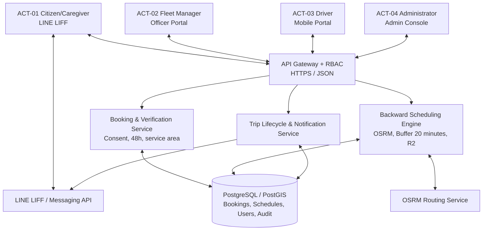
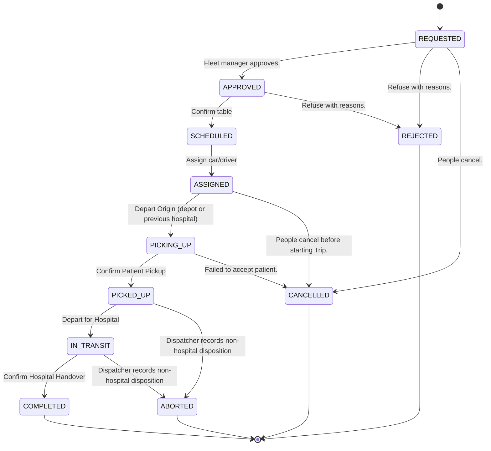
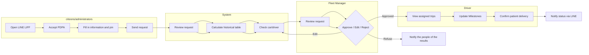
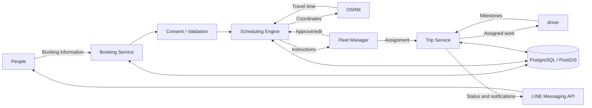
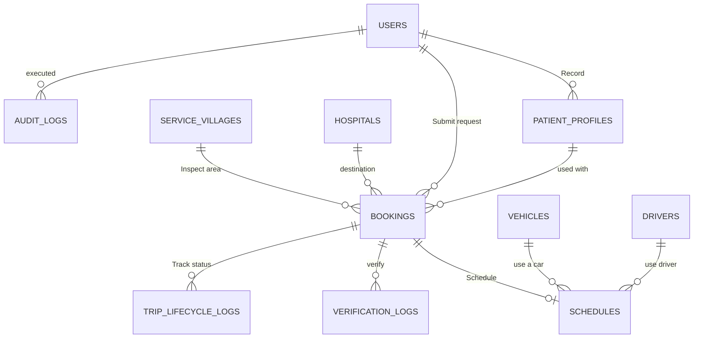

# Software Requirements Specification

## Non-emergency patient transportation booking platform of Ban Klang Municipality

**Project name:** Reservation management system: Municipal online queue reservation through LINE OA
**Project Team:** Takuk Takak (Group 14)
**Course:** 1305394 project in Software Engineering
**Standard:** ISO/IEC/IEEE 29148:2018
**Version:** 1.3
**Status:** Baseline for review
**Date:** 7 November 2026
**Prepared for:** Ban Klang Subdistrict Municipality Mueang Lamphun District, Lamphun Province
**Advisor:** Dr. Prasara Jakkaew

---

## Document control

| Version | Date | Author | Description | Status |
|---|---|---|---|---|
| 1.0 | 7 Nov 2026 | Takuk Takak | First official Baseline SRS | For review by stakeholders |
| 1.1 | 10 Nov 2026 | Project owner / development team | Confirmed logic and flow decisions; see Section 16.10 | Project-owner confirmed; municipal review pending |
| 1.2 | 10 Nov 2026 | Project owner / development team | Approved corrections, ABORTED outcome, and holiday management; see Section 16.11 | Project-owner confirmed; municipal review pending |
| 1.3 | 10 Nov 2026 | Development team | Corrected reference crosswalk and UC-28 ownership; explicit earlier-pickup waiting and dispatcher modification contract | Implementation plan authorized by project owner; municipal review pending |

## Approval

| Role | Name | Signature | Date |
|---|---|---|---|
| Project team representative | Takuk Takak (Group 14) | __________________ | __________ |
| Advisor | Dr. Prasara Jakkaew | __________________ | __________ |
| Municipal representative | [name] | __________________ | __________ |

# 1. Introduction

## 1.1 Objectives

This Software Requirements Specification (SRS) defines the requirements for the municipality's scheduled, non-emergency patient transportation booking platform. It serves as the baseline agreement among the project team, Ban Klang Subdistrict Municipality, the advisor, designers, developers, and evaluators.

This system replaces the current hybrid work environment using Google Forms, notebooks, phone coordination, and Google Calendar with a controlled process for booking, scheduling, dispatching, and tracking travel status.

## 1.2 Product scope

The system allows eligible citizens or caregivers to request one-way transportation from the patient pickup point in Ban Klang Subdistrict to a supported hospital. The system calculates the recommended schedule backwards from the hospital appointment time, checks vehicle and driver availability, and presents the recommendation to municipal fleet managers for human approval.

The system has the following capabilities:

- Public reservations through LINE LIFF
- Review of requests and resource allocation by the fleet manager
- Travel operations via the driver's mobile device
- Vehicle management and admin settings
- Notifications and status tracking through LINE
- Audit records and reports on municipal operations

This SRS defines the complete implementation and evaluation scope for project completion by December 2026. The project shall deliver a working, integrated, tested, and demonstrated system; it shall not provide emergency medical services.

## 1.3 Target reader group

- Citizens and caregivers who request transportation services
- Municipal fleet manager who coordinates daily travel
- Ambulance drivers working on assigned trips
- Administrator who takes care of vehicle information and access rights
- Project developers and testers
- Advisors and stakeholders of the municipality

## 1.4 Definitions and abbreviations

| Word | Definition |
|---|---|
| NEMT | Non-Emergency Medical Transport |
| LINE OA | LINE Official Account |
| LIFF | LINE Front-end Framework |
| RBAC | Role-Based Access Control |
| OSRM | Open Source Routing Machine |
| Pick-up time | The time allotted for the vehicle to arrive at the patient pick-up point |
| Buffer | A fixed time allowance of 20 minutes before the appointment time at the hospital |
| Turnaround | Fixed 30-minute preparation period at the destination hospital, excluding return-to-depot travel. Planned readiness is hospital target arrival plus 30 minutes; actual delays can defer readiness. |
| Fleet manager | Municipal officials who review and allocate requests |

## 1.5 Standards and compliance basis

1. ISO/IEC/IEEE 29148:2018, Requirements engineering
2. Thailand Personal Data Protection Act B.E. 2562 (PDPA)

This SRS is a standalone project document. Project requirements, decisions, use cases, design constraints, verification evidence, and change history shall be maintained within this document and its internal traceability tables.

# 2. Overall description

## 2.1 Product view

The platform is a four-tiered web system:

1. **Presentation Floor:** Citizen interface through LINE LIFF and responsive employee portal.
2. **Application layer:** REST API Service for checking reservations, scheduling, dispatching work, life cycle management and notifications.
3. **External services:** LINE platform and OSRM routing engine.
4. **Data layer:** Relational storage. PostgreSQL/PostGIS

Citizens access the interface through LINE LIFF, while fleet managers, drivers and administrators use a web portal that authenticates and controls role-based controls.

### System architecture diagram



## 2.2 User type

| ID | User type | Access channel | Primary responsibilities |
|---|---|---|---|
| ACT-01 | Citizens/administrators | Mobile web via LINE LIFF | give consent, submit, review and cancel their requests |
| ACT-02 | Municipal fleet manager | Employee web portal | Review, approve, edit, allocate, track and edit requests |
| ACT-03 | Ambulance Driver | Mobile Employee Portal | View assigned trips and update performance incidents |
| ACT-04 | Administrator | Admin Console | Manage users, vehicles, settings, permissions and audit logs |

## 2.3 Working environment

- Modern mobile browser within LINE LIFF for citizens.
- Modern desktop browser for fleet managers and administrators.
- Mobile browser for drivers
- Network Communication HTTPS
- Node.js/TypeScript REST API
- PostgreSQL with PostGIS
- LINE LIFF and Messaging API
- Routing service OSRM

## 2.4 Limitations and delivery baseline

- This service is for non-emergency scheduled transportation only.
- Requests must be submitted at least 48 hours before the appointment time.
- There is no maximum advance booking period.
- Trips operate daily from 06:00 to 16:00 Asia/Bangkok, except configured holidays. Departure and planned resource-ready time must both fall within those hours on an operating day.
- The project supports one vehicle and one patient per one-way trip.
- Buffer time to 20 minutes is fixed and cannot be configured.
- Drivers update events manually There is no need for continuous vehicle tracking data.
- Do not store clinical diagnoses. Medical history Laboratory test results and doctor's notes
- The December 2026 target is a production-ready, live municipal deployment. Synthetic data shall be used for development and acceptance testing; real-patient operation begins only after the deployment prerequisites in Section 15.1 are complete.

## 2.5 Assumptions and dependencies

- The municipality takes care of accurate information on cars, drivers, hospitals, and villages.
- Services LINE and OSRM are available when the respective operations are performed.
- Employee has an authorized account
- The request belongs to a supported hospital and the pickup point is in one of the 12 service villages.
- Stakeholders will confirm supported hospitals, the holiday calendar, retention periods, and operational acceptance of the project-owner decisions in Section 16.10.

## 2.6 Out of scope

- Emergency delivery or replacement Thailand EMS 1669
- Return travel and transfers between hospitals
- Combining multiple passengers or adjusting multiple routes
- Continuous vehicle GPS tracking and geofencing
- Connecting to EHR or hospital information systems
- Payment, billing or commercial fare collection
- Unapproved live production operation before municipal, privacy/legal, and operational acceptance.

# 3. Specific requirements

## 3.1 Functional requirements

The original reference baseline defines FR-01 through FR-12 in `reference_files/NR_and_NFR.md`. Detailed SRS identifiers FR-001 through FR-050 are a separate namespace; leading zeros must be preserved. Earlier versions incorrectly claimed an original FR-01–FR-26 catalog. The corrected crosswalk follows:

| Canonical baseline requirement | Detailed SRS requirements |
|---|---|
| FR-01 Interactive Location Pinning | FR-009–FR-010 |
| FR-02 Backward Travel-Time Scheduling | FR-015–FR-019 |
| FR-03 Conflict-Free Fleet Verification | FR-020–FR-022 |
| FR-04 Dispatcher Review and Decision Support | FR-023–FR-030 |
| FR-05 Milestone State Management | FR-032–FR-038 |
| FR-06 Digital Notification and Status Card | FR-012, FR-040 |
| FR-07 Citizen Booking Cancellation | FR-014 |
| FR-08 Resource Resolution and Manual Rejection | FR-022, FR-024, FR-026–FR-028 |
| FR-09 Failed Pickup and Exceptional Outcomes | FR-039 |
| FR-10 Emergency Reassignment | FR-025–FR-026, FR-031 |
| FR-11 Geospatial Change Revalidation | FR-042–FR-043 |
| FR-12 Administrative Safeguards | FR-013, FR-044–FR-046 |
| SRS additions (not invented original reference IDs) | FR-001–FR-008, FR-011, FR-041, FR-047–FR-050 |

Reference IDs retain their original meaning. Detailed SRS IDs drive implementation and verification. Overlaps are intentional; NFR-04 also supports consent and access requirements. Additional SRS requirements derive from this document and confirmed decisions, not an unsupported reference catalog.

### 3.1.1 Citizens' consent and reservations

| ID | Requirements | Priority |
|---|---|---|
| FR-001 | The system must display the consent notice according to PDPA before the public can access the reservation form | Must |
| FR-002 | The system must record the decision to give consent and the citizens' timestamp | Must |
| FR-003 | If you refuse consent The system must stop the digital booking process and display the municipal phone contact option. | Must |
| FR-004 | The system must support bookings for the requester and bookings for other patients | Must |
| FR-005 | The system must offer previously recorded patient information to auto-populate to eligible persons. | Must |
| FR-006 | Requests shall be submitted at least 48 hours before the appointment time. There is no maximum advance booking period. | Must |
| FR-007 | The system must display a permanent notice to contact 1669 in the event of an emergency | Must |
| FR-008 | The system must allow people to choose between regular assistance, a wheelchair, or a stretcher, as well as the need for additional assistance. | Must |
| FR-009 | The system must receive the pick-up point coordinates from GPS or from a draggable map pin | Must |
| FR-010 | The system must check that the pick-up point is within the 12 service villages of Ban Klang | Must |
| FR-011 | The system must display a page to review patient information, contacts, destinations, appointment times, assistance, and pick-up points before submitting a request. | Must |
| FR-012 | The system must issue a unique booking request identifier and display the request status | Must |
| FR-013 | Citizens shall be able to edit booking information before submission, and correctly entered information shall remain after validation errors occur. After submission, changes must be requested through the dispatcher; citizens cannot directly edit submitted requests. | Should |
| FR-014 | Citizens must cancel their reservations before the designated driver begins the trip. | Must |

### 3.1.2 Scheduling and resource management

| ID | Requirements | Priority |
|---|---|---|
| FR-015 | The system shall request travel times from the planned trip origin to pickup and from pickup to hospital. The origin is the depot, previous destination hospital for a chained trip, or a dispatcher-verified handoff location during pre-pickup reassignment. | Must |
| FR-016 | The system must calculate the target hospital time as appointment time minus 20 minutes | Must |
| FR-017 | Pickup time shall equal hospital target minus verified pickup-to-hospital travel and the explicit pickup waiting allowance (zero by default). Waiting shall not alter the route estimate or target; see Section 16.12. | Must |
| FR-018 | Planned origin departure shall equal pickup time minus origin-to-pickup travel time. For chained trips, departure must be no earlier than the previous trip's resource-ready time, with both vehicle and driver availability validated. | Must |
| FR-019 | Planned resource-ready time shall equal hospital target arrival plus 30 minutes of turnaround at that hospital. This excludes return-to-depot travel. Actual delays and unresolved incidents shall prevent premature resource reuse. | Must |
| FR-020 | The system must check the readiness of both the vehicle and the driver throughout the calculated period | Must |
| FR-021 | The system must prevent overlapping work assignments for the same vehicle or driver | Must |
| FR-022 | If there are no resources available The system must keep the request in pending status/REQUESTED and notify the fleet manager | Must |

### 3.1.3 Fleet manager operations

| ID | Requirements | Priority |
|---|---|---|
| FR-023 | Fleet managers must be able to view incoming requests and scheduling instructions | Must |
| FR-024 | Fleet managers must approve valid requests without specifying a mandatory reason | Must |
| FR-025 | Fleet managers must edit the vehicle, driver, or schedule assigned to the request after checking for new conflicts. | Must |
| FR-026 | The system must specify and store the reason when the fleet manager modifies a request. | Must |
| FR-027 | The fleet manager must decline the request only if the reason is recorded. | Must |
| FR-028 | Fleet managers must resolve resource conflicts and re-check availability before rejecting them due to insufficient capacity. | Must |
| FR-029 | The fleet manager must be able to view and follow the daily vehicle schedule | Must |
| FR-030 | Fleet managers must process and record the results of optional inspection calls. | Should |
| FR-031 | The fleet manager must be able to change travel assignments before accepting a patient. After investigating new conflicts | Must |

### 3.1.4 Driver performance and travel life cycle

| ID | Requirements | Priority |
|---|---|---|
| FR-032 | The driver shall be able to view the assigned daily trips, pickup locations, appointment details, and required mobility aids. | Must |
| FR-033 | The system must manage the normal life cycle of REQUESTED, APPROVED, SCHEDULED, ASSIGNED, PICKING_UP, PICKED_UP, IN_TRANSIT and COMPLETED | Must |
| FR-034 | Drivers must be able to begin assigned work without changing the life cycle from ASSIGNED | Must |
| FR-035 | The driver's Depart Origin operation shall change ASSIGNED to PICKING_UP. Display the verified depot, previous hospital, or reassignment handoff origin. | Must |
| FR-036 | The driver's Confirm Patient Pickup operation must change the trip to PICKED_UP | Must |
| FR-037 | The driver's Depart for Hospital operation must change the trip to IN_TRANSIT | Must |
| FR-038 | The driver's Confirm Hospital Handover operation must change the trip to COMPLETED | Must |
| FR-039 | Drivers must report unsuccessful patient pickups. which must cancel the reservation Notify relevant people and return the resource reservation | Must |

### 3.1.5 Notification and administration

| ID | Requirements | Priority |
|---|---|---|
| FR-040 | Reservation confirmation notifications, schedule changes, lifecycle changes, cancellations, and rejection notifications must be sent through LINE when applicable. | Must |
| FR-041 | The administrator shall be able to manage vehicle, driver, hospital, service-village, and system-configuration data. | Must |
| FR-042 | Changing geospatial settings must trigger a new calculation proposal for a trip that has not yet started. | Must |
| FR-043 | The original schedule must remain in use until the fleet manager reviews and confirms the newly calculated replacement table. | Must |
| FR-044 | The system must prevent disabling vehicles or drivers with unfinished work | Must |
| FR-045 | The system must revoke active licenses quickly when a user is suspended or reduced. | Must |
| FR-046 | The system must record the actions of the system administrator and fleet manager in the audit log. | Must |
| FR-047 | The system shall provide a daily dispatch manifest as Excel `.xlsx` and printable PDF, and a monthly municipal service report as an Excel `.xlsx` workbook with three sheets, subject to final municipal field confirmation. | Must |

Additional SRS requirements FR-048–FR-050 derive from the approved decisions in Section 16.11 and extend the original reference baseline without renumbering it.

| ID | Requirements | Priority |
|---|---|---|
| FR-048 | Only dispatchers may correct an accidentally recorded milestone to its immediately preceding milestone, with a reason, preserved original history, confirmation of the physical trip state, and revalidation of affected assignments. Corrections shall not reverse actual pickup, bypass incident handling, or reopen terminal trips. | Must |
| FR-049 | A dispatcher may close a trip from PICKED_UP or IN_TRANSIT as ABORTED when transport ends without hospital handover, recording reason, actual end time/location, and confirmation of the patient's handoff or next arrangement. Resources remain held until readiness is confirmed. | Must |
| FR-050 | Administrators shall maintain closure dates. Adding a closure shall flag affected existing assignments for dispatcher review without silently cancelling them. New or changed schedules shall enforce closure dates. | Must |

## 3.2 External interface requirements

### 3.2.1 Public interface

The citizen interface must include views of consent, reservations, map pins, reviews, status, cancellations, and notifications. Must use clear Thai language labels. The letters are easy to read. High contrast controls and touch areas suitable for the elderly and caregivers

### 3.2.2 Employee contact section

The dispatcher interface shall provide a request queue, scheduling recommendations, conflict warnings, assignment controls, daily schedules, audit records, and data exports. The driver interface shall provide assigned trips, pickup information for navigation, required assistance details, and lifecycle controls. The administrator interface shall provide master-data, settings, access-control, and protected audit functions.

### 3.2.3 Software interface and communication

| Interface | Requirements |
|---|---|
| LINE LIFF | The system must verify identity and present the citizen's booking interface through LINE LIFF |
| LINE Messaging API | The system must send supported booking and lifecycle notifications through LINE |
| OSRM | The system shall request travel times using the planned origin (depot or previous hospital), pickup, and destination hospital coordinates. |
| REST API | The client application must communicate with the application service through HTTPS requests that authenticate and use JSON |

## 3.3 Non-functional requirements

| ID | Requirements | Verification method |
|---|---|---|
| NFR-01 | At least 90% of test participants and at least 85% of seniors must complete a normal booking within 120 seconds. | Usability testing |
| NFR-02 | The scheduling engine must create zero vehicle or driver time-slot collisions in the defined simulation scenarios. | Simulation |
| NFR-03 | The citizen interface shall target WCAG 2.1 AA practices, use primary text of at least 16px and high contrast, and provide touch targets of at least 48px. | Accessibility inspection |
| NFR-04 | The system shall enforce Thai PDPA data minimization, explicit LINE LIFF consent, and role-based access control. | Privacy and access-control testing |

The system shall also display clear errors and preserve entered data when external routing or notification services are unavailable. This is a supplemental reliability requirement verified by failure testing.

## 3.4 Data requirements

At a minimum, the system must maintain the following entities:

- Users and roles
- Saved patient profiles
- Service Village
- Supported hospitals
- Cars and their capabilities
- Driver
- Reservations
- Schedules and resource periods
- Audit record
- Record the travel life cycle
- Notifications
- Audit notes
- System Settings

The system must store patient names. Requester's phone/contact person Address and pick-up point coordinates Movement type Details of appointment time and destination only as necessary for transportation operations. Do not store diagnostics. Medical history Laboratory test results or doctor's note

## 3.5 Business Rules and Scheduling Logic

| Rules | Definition |
|---|---|
| R1 | Appointment time minus submission time must be at least 48 hours; there is no maximum advance booking period. |
| R2 | Vehicles and drivers must not have overlapping booking times |
| R3 | The target time at the hospital must be 20 minutes earlier than the appointment |
| R4 | Planned resource readiness is hospital target arrival plus 30 minutes at that hospital, excluding depot return. Chained departure must be at or after readiness and include travel from the previous hospital to the next pickup. |
| R5 | Requests outside the service scope must not enter scheduling |
| R6 | Must be approved by the fleet manager. The scheduling engine must not manually approve requests |
| R7 | Corrections and rejections must have a recorded reason. But approval is not required |
| R8 | People can cancel until the start of the driver's trip |
| R9 | Failed pickup cancels the booking and releases its reservation, but resources remain operationally unavailable until the dispatcher confirms readiness. No payment or refund is involved. |
| R10 | Trips operate daily 06:00–16:00 Asia/Bangkok except configured holidays. No planned departure or resource-ready time may fall outside this window. |

For appointments at 09:00, Buffer 20 minutes, Pick-up point to hospital 35 minutes and Depot to pick-up point 15 minutes:

`Hospital target = 08:40`  
`Pickup = 08:05`  
`Depot departure = 07:50`  
`Vehicle available = 09:10`

The reserved time period is `[07:50, 09:10)`.

For a subsequent trip starting at this hospital, suppose its next pickup is 10:00 and hospital-to-next-pickup travel is 20 minutes. Origin departure is 09:40, which is after the preceding planned readiness at 09:10. Validate the next trip's full interval, capabilities, both resources, and service hours before assignment. If the preceding trip changes, revalidate affected later assignments without silently overwriting confirmed schedules.

### Validation and scheduling logic diagram

```mermaid
flowchart TD
START["Send reservation request"] --> CONSENT{"Accept PDPA?”}
CONSENT -- "Do not accept" --> PHONE["End of digital process<br/>Recommended telephone call"]
CONSENT -- "Accept" --> LEAD{"In advance >= 48 hours?"}
LEAD -- "No" --> HOTLINE["Automatically declined<br/>Recommended municipal hotline"]
LEAD -- "Yes" --> AREA{"Is the pick-up point in 12 villages?"}
AREA -- "No" --> OUT["Refuse outside service area"]
AREA -- "Yes" --> PIN{"Coordinates correct?"}
PIN -- "No" --> HOLD["Hold request<br/>Select a new pin"]
PIN -- "Yes" --> ROUTE["Call OSRM<br/>Calculate travel time"]
ROUTE --> CALC["Calculate back<br/>Buffer 20 minutes / Turnaround 30 minutes"]
CALC --> CONFLICT{"Car and driver available<br/>No overlapping periods?"}
CONFLICT -- "Not available" --> RESOLVE["Remain status REQUESTED<br/>Let fleet manager edit resource"]
    RESOLVE --> CONFLICT
CONFLICT -- "Available" --> REVIEW["Offer recommendations to the fleet manager"]
REVIEW --> DECISION{"Decision"}
DECISION -- "Approve" --> ASSIGN["Resource booking and notification"]
DECISION -- "Edit" --> RECHECK["Record reason<br/>Recheck conflict"]
    RECHECK --> CONFLICT
DECISION -- "Reject" --> REJECT["Record reasons and report results"]
```

## 3.6 Security privacy and access control

- All protected employee operations must verify their identity.
- Authorization with RBAC must be enforced on all protected operations.
- Citizens must only have access to their own active and historical booking data.
- Drivers must have access only to the trips assigned to them.
- Fleet managers must have access to operational data necessary for inspection and assignment.
- Administrators must access the setup and monitoring functions according to permissions.
- Consent must be recorded PDPA before receiving citizen information.
- The actions of administrators and fleet managers must be traceable.
- Privilege must be revoked when the account is suspended or reduced.
- Do not send personal information to third-party AI services.

## 3.7 Other quality requirements

| ID | Category | Requirements |
|---|---|---|
| QR-001 | Usage | The citizen process must reduce duplicate data entry and support auto-population from saved and authorized profiles |
| QR-002 | Accessibility | The citizen interface shall target the NFR-03 accessibility requirements. |
| QR-003 | Reliability | Scheduling decisions must be reliable when the inputs and routing time are the same |
| QR-004 | Maintenance | Business Rules | State Change and settings must be expressed in clear and testable application logic |
| QR-005 | Traceability | Each normative requirement must be associated with at least one use case and verification item before acceptance |

# 4. Verification and Validation

## 4.1 Requirements Verification Matrix

| Group of requirements | Verification methods | Evidence of acceptance |
|---|---|---|
| FR-001–FR-014 | Functional and usability testing | Consent results, reservations, inspections, reviews, status and cancellation |
| FR-015–FR-022 | Algorithm analysis and simulation | Example calculations and simulation results without overlap |
| FR-023–FR-031 | Fleet Manager Process Testing | Record approvals, corrections, conflict resolution, rejections, and reassignments |
| FR-032–FR-039 | Driver process testing | Correct status change and unsuccessful patient admission management |
| FR-040–FR-047 | Connection testing and administration | Notifications, exports, revocation of permissions, audit records, and safeguards |
| NFR-01–NFR-04 | Usability, simulation, accessibility, privacy, and access-control testing | Measurable results against targets |
| Security requirements | Role-based access auditing and testing | No unauthorized data access or operation |

## 4.2 Acceptance criteria

The SRS Baseline is accepted when:

1. All Must requirements have specified tests or inspections.
2. The booking process enforces consent, 48-hour rule, service scope, and mandatory fields.
3. The scheduling engine repeats document-based calculations and does not cause resource overlapping in approved situations.
4. The rights of fleet managers and drivers prevent unauthorized status changes.
5. Rules for cancellation, refusal, and unsuccessful patient admission. Reassignment and notifications can be demonstrated
6. PDPA data reduction and access control requirements are documented and testable.
7. Stakeholder review documents deviations from the approved baseline.

# 5. Appendix

## Appendix A: Traceability Use Cases

The requirements are linked to project use cases UC-01 to UC-29, covering citizen bookings and cancellations; dispatcher triage and conflict resolution; driver execution and failed pickup; and administrator configuration, auditing, RBAC, recalculation, and safeguards.

## Appendix B: Status Transition Summary

`REQUESTED -> APPROVED -> SCHEDULED -> ASSIGNED -> PICKING_UP -> PICKED_UP -> IN_TRANSIT -> COMPLETED`

End results:

- `CANCELLED`: People cancel before starting the trip or cancel automatically after unsuccessfully accepting patients.
- `REJECTED`: Fleet manager refused with recorded reasons.
- `ABORTED`: dispatcher closes a trip after pickup when transport ends without hospital handover, under Section 16.11.

### Journey life cycle state machine diagram



# 6. Project background and evidence

## 6.1 Current process

The municipality currently coordinates non-emergency patient transport using Google Forms, hand-written notes. Telephone coordination and Google Calendar create four operational problems:

1. Citizens re-enter the same information with every request and cannot reliably see availability.
2. Employees calculate the pick-up time by counting back from the appointment time themselves.
3. Vehicle and driver assignments may overlap when trips take a long time.
4. Drivers do not have a common mobile process for reporting trip progress.

The proposed system solves these problems with a single citizen channel. Scheduling that gives certain results Fleet manager approval Driver's self-operation event and records that can be traced back

## 6.2 Project objectives

- Reduce the effort required by citizens and moderators to submit requests.
- Prevent collisions between car schedules and drivers.
- Calculate pick-up and departure times regularly
- Support the fleet manager's decision-making while maintaining human decision-making authority.
- Provide drivers with clear operating procedures on their mobile devices.
- Prepare records and reports on municipal operations.
- Use privacy-by-design and reducing data before actual use

## 6.3 Stakeholder and user context

The municipality is the data controller and owner of the proposed operation. Waiting for confirmation G-SERVE SOLUTION CO., LTD. is a cooperative organization. The system is intended for elderly patients. Homebound or bedridden patients and their caregivers in 12 villages of Ban Klang Subdistrict.

The team must review the final version of the specification with municipal officials and end users unfamiliar with the technology before going live. production interface evaluation requires synthetic data.

# 7. Complete list of use cases

## 7.1 Use cases of citizens/administrators

| ID | Use case | Results |
|---|---|---|
| UC-01 | Send reservation request | Create reservation REQUESTED after verification |
| UC-02 | Specify mobility assistance needs | Record only approved transportation assistance |
| UC-03 | Pin pickup point | Record the correct pickup point within the service area |
| UC-04 | Review travel confirmation card | Show booking results and references |
| UC-05 | Review scheduled pick-up times | Show pick-up times confirmed by the fleet manager |
| UC-06 | Review lifecycle alerts | Show progress and end results |
| UC-25 | Cancel booking request | Cancel before Start Trip and return resources |

## 7.2 Fleet manager use case

| ID | Use case | Results |
|---|---|---|
| UC-07 | Sort booking requests | Review verified requests |
| UC-08 | Review of automated vehicle-driver assignments | Review of recommended resources |
| UC-09 | Evaluate scheduling warnings | Check for route, time, or capacity warnings |
| UC-10 | Approve booking request | Approve valid request |
| UC-11 | Edit booking request | Change schedule/resources after re-check |
| UC-12 | Reject booking request | Reject with reasons that must be provided |
| UC-13 | Record reasons | Record reasons for correction or rejection |
| UC-14 | Follow the daily bus schedule | View resource usage |
| UC-15 | Manage trip cancellations | Process cancellations and restore capacity |
| UC-16 | Manage urgent reassignments | Reassign before admitting patients after checking for conflicts |
| UC-26 | Resolve resource conflicts | Fix capacity before rejecting as a last resort |
| UC-28 | Review recalculated schedule | Dispatcher confirms or retains the current schedule; administrator initiates the settings change only |

## 7.3 Driver's use case

| ID | Use case | Results |
|---|---|---|
| UC-17 | View daily schedule | Show assigned trips |
| UC-18 | View patient pick-up point | Show pick-up point details |
| UC-19 | View required mobility devices | Show approved assistance information |
| UC-20 | Travel life cycle promotion | Promote only permitted operational events |
| UC-27 | Report unsuccessful patient admission | Cancel trip and return booking |

## 7.4 Administrator use cases

| ID | Use case | Results |
|---|---|---|
| UC-21 | Take care of main vehicle information | Take care of vehicles and drivers |
| UC-22 | Configure geospatial parameters | Maintain vehicle depot, area and operational settings |
| UC-23 | Check system transaction records | Review actions that can be traced back |
| UC-24 | Enforce RBAC and PDPA | Control access and visibility of data |
| UC-29 | Prevent vehicle and account changes | Block unsafe deactivation and revoke permissions |

# 8. Detailed work process from start to finish.

## 8.1 Public reservations

1. Citizens open the application LINE LIFF
2. The system displays a notice that it is not an emergency service and emergency link 1669.
3. Citizens read the privacy notice and accept the approved data use conditions.
4. People can choose to book for themselves or as a carer.
5. Citizens fill in information about the patient/requester, hospital, appointment time, assistance, and pick-up point details.
6. Phone format checking system, service scope, consent, supported destinations and 48 hours in advance
7. The system receives the travel time and calculates the proposed schedule.
8. Citizens review submitted information.
9. The system creates a REQUESTED booking and displays the referral.
10. People can view the status and cancel until Start Trip.

## 8.2 Fleet Manager Decisions

1. The fleet manager opens a queue waiting to be processed.
2. The fleet manager reviews the request information. route suggestions Resource availability and warnings
3. The fleet manager may call to inspect and record the results.
4. Fleet manager approves, edits or rejects.
5. Amendments must be re-examined and reasonable.
6. Rejection must be reasonable and a last resort after resources have been fixed.
7. Decision recording system Improve lifecycle, reserve resources and notify relevant users.

## 8.3 Driver's performance

1. The driver opens the assigned daily schedule.
2. Drivers see only assigned trip information and approved assistance.
3. Start Trip records a separate start event and blocks citizen cancellation while status remains ASSIGNED.
4. Depart Origin changes ASSIGNED to PICKING_UP; the displayed origin is the depot or previous hospital.
5. Confirm Patient Pickup, change PICKING_UP to PICKED_UP.
6. Depart for Hospital change PICKED_UP to IN_TRANSIT
7. Confirm Hospital Handover change IN_TRANSIT to COMPLETED.
8. Unsuccessful patient admission, change booking to CANCELLED, notify citizen and fleet manager, and return booking.

### Process diagram from start to finish.



# 9. User Interface Requirements

## 9.1 Citizen interface: LINE LIFF

| ID | Screen | Required content |
|---|---|---|
| C-01 | Reservation home page | Service introduction Reservation Status Emergency 1669 |
| C-02 | Consent PDPA | Privacy Notice Accept Reject Telephone Options |
| C-03 | Patients and appointments | Name, telephone, hospital, date, time |
| C-04 | Help and Location | Help Options GPS/Custom Map Address |
| C-05 | Review and submit | Review all, edit, submit |
| C-06 | Reservation sent | Reference and pending status |
| C-07 | Reservation status | Decisions, pick-up time, life cycle, notifications |

## 9.2 Fleet Manager Portal

| ID | Screen | Required content |
|---|---|---|
| D-01 | Dashboard | Today's travel, pending requests, warnings, vehicle summary |
| D-02 | Reservation request | Search Filter Request list |
| D-03 | Booking details | Patients for work, contacts, directions, appointments, support |
| D-04 | Scheduling Guidance | Proposed Time, Resources, and Warnings |
| D-05 | Assignment decision | Approve, edit, reject, reason |
| D-06 | Car calendar | Car times and drivers |
| D-07 | Travel Operations | Cancellation and Reassignment |

## 9.3 Driver Portal

| ID | Screen | Required content |
|---|---|---|
| DR-01 | Driver dashboard | Next trip and usage status |
| DR-02 | Daily schedule | Travel and assigned times |
| DR-03 | Travel details | Pick-up point, hospital, assistance, table |
| DR-04 | Pick up point map | Pick up point pin and location information |
| DR-05 | Trip progress | Current status and allowed next actions |

## 9.4 Admin Console

| ID | Screen | Required content |
|---|---|---|
| A-01 | Admin Dashboard | Administration Module |
| A-02 | Car management | Car records and capabilities |
| A-03 | Driver management | Employee list and account |
| A-04 | Geospatial settings | Vehicle depot, service area, business hours |
| A-05 | Audit Log | Operator Action Time Stamp Details |
| A-06 | Roles and permissions | Accounts and permissions RBAC |

The complete production interface has 25 main screens: 7 citizens, 7 fleet managers, 5 drivers and 6 admins. Common components include employee login. Access denied, badge, booking card, map, dialog box, loading status Verification error and notifications

# 10. System architecture

## 10.1 Logical elements

| Components | Responsibilities |
|---|---|
| Citizen Client | Experience booking and viewing status through LINE LIFF |
| Employee Client | Process for Fleet Managers, Drivers and System Administrators |
| API gateway | HTTPS session verification RBAC |
| Booking services | Consent Verification Duplicate data flag Booking records |
| Scheduling service | Duration OSRM Reverse calculation Conflict checking |
| Travel services | Life cycle changes, notifications, audit events |
| Connecting LINE | Identity LIFF and Messaging |
| Connection OSRM | Travel duration request |
| PostgreSQL/PostGIS | Relational, geospatial, and temporal data |

### Data flow diagram



## 10.2 Behavior when connection fails

If OSRM is unavailable, the system shall not create a successful schedule without notification. It shall display a clear scheduling error and retain the request or route it to the fleet manager according to the agreed operating policy. If notification delivery fails, the booking decision shall remain traceable and the system shall record the delivery failure.

# 11. Data models and data dictionaries

| Entity | Important information | Purpose |
|---|---|---|
| USERS | user ID, LINE ID/username, role, phone, active status, consent record | Identity and access |
| PATIENT_PROFILES | patient name, phone, assistance, village, address, coordinates | Autocomplete allowed |
| SERVICE_VILLAGES | village number/name, center, radius, active status | boundary check |
| HOSPITALS | name, coordinates, supported status | list of destinations |
| VEHICLES | plate, type, capacity/capabilities, active status | Vehicle resources |
| DRIVERS | linked user, license/roster status, active status | Driver resources |
| BOOKINGS | reference, requester, patient, route, appointment, status | request record |
| SCHEDULES | booking, vehicle, driver, interval, calculated times | resource booking |
| VERIFICATION_LOGS | booking, actor, outcome, timestamp, notes | Verifying options by telephone |
| TRIP_LIFECYCLE_LOGS | booking, old state, new state, actor, time | Status history |
| NOTIFICATIONS | recipient, event, channel, delivery status | Delivery verification |
| AUDIT_LOGS | actor, action, entity, timestamp, detail | responsibility |
| SYSTEM_CONFIGS | depot, operating hours, service settings | controlled settings |

### Master data relationship diagram



The data model shall use a time-slot representation that prevents vehicle and driver reservations from overlapping. The database and API shall reject symptom, diagnosis, medical-history, medical-record, and national-ID-copy fields.

# 12. Register of privacy decisions and PDPA

| Decision | Current status | Things to confirm |
|---|---|---|
| Data Controller | Proposed Ban Klang Municipality | Review by Municipality/Legal Department |
| Purpose | Organize and inspect non-emergency transportation | Confirm announcement |
| Data reduction | Keep only transportation operational data | Confirm help fields |
| Clinical data | Explicitly excluded | Maintain exemption |
| Carer's authority | Carer may make reservations for other patients | Confirm operating procedures |
| Storage | Not yet determined | Municipal approval |
| Rights of the data subject | Must be specified in the final privacy notice/process | Review by the municipality/legal department |
| Third Party | Must verify LINE Hosting and Routing Role | Contract/Privacy Review |
| Testing | Uses synthetic data only | Must be performed before testing |

This SRS is not a legal-compliance certification. Real patient data shall not be processed until the municipality confirms the privacy notice, lawful bases, retention, access, incident handling, and service-provider arrangements.

# 13. Assessment and testing requirements

## 13.1 Participant Plan

| Group | Goal | Assessment |
|---|---:|---|
| Elderly people aged 60 years and over | 5 | Self-booking |
| Caregivers/Family/VHV | 5 | Booking for other patients |
| Municipal officials | 1–2 | Work delivery, drivers, administration |

## 13.2 Test cases

| ID | Situation | Expected Results |
|---|---|---|
| TC-C01 | Initial booking and validation under/over 48 hours | An invalid date is blocked; a valid request becomes REQUESTED |
| TC-C02 | Automatic filling of the original profile | Filling in saved and authorized information |
| TC-C03 | Status review and cancellation before travel | Status is accurate; cancellation releases the reservation |
| TC-D01 | Dispatcher triage and optional telephone verification | Verification decisions and results are recorded |
| TC-D02 | Reverse scheduling and assignment | Time is accurate and no overlap |
| TC-R01 | Driver trip list and event updates | Only status changes in the correct order are successful |
| TC-A01 | Fleet, settings, and RBAC review | Authorized administration works and fixed rules remain protected |

## 13.3 Indicators and targets

- Booking completion: at least 90% overall and at least 85% for seniors.
- Normal booking time: no more than 120 seconds according to project goals
- SUS: Target average of at least 75 for overall project evaluation. Subgroup criteria may be reported separately.
- Grid correctness: No collisions in a given simulation.
- Driver/Fleet Manager Core Process: 100% success for all key scenarios tested.

# 14. Change control

Any change to privacy scope, scheduling rules, role permissions, lifecycle states, or system boundaries must:

1. Get change identifier
2. Identify reasons and affected stakeholders.
3. Identify affected requirements, screens, data, tests, and documents.
4. Be reviewed by the project team and advisor.
5. Obtain municipal approval when changing operational or privacy decisions.


# 15. Deployment and release

## 15.1 Deployment prerequisites (separate from product requirements)

The product requirements in this SRS define what the system shall do. The following prerequisites govern authorization to operate it with real municipal users and patient data; they are release-gate obligations, not substitutes for FR/NFR implementation:

1. **Municipal approval:** written acceptance by Ban Klang Municipality, named service owner, confirmed supported hospitals and 12 service villages, operating hours, escalation contacts, and approval of the daily/monthly reports.
2. **Privacy and legal review:** municipality-confirmed controller/processor roles, PDPA notice and consent wording, lawful basis, data-subject request process, breach-response process, cross-border/vendor review, and emergency-service disclaimer.
3. **Retention and deletion:** approved retention schedule for bookings, consent logs, audit logs, exports and notifications; tested deletion/anonymization workflow and legal-hold procedure.
4. **Hosting and continuity:** production hosting, domain/TLS, backups, restore test, monitoring, OSRM and LINE credentials, secret rotation, availability target, incident response, and disaster-recovery contacts.
5. **Training and support:** trained dispatchers, drivers and administrators; citizen-facing instructions; runbooks for failed pickup, reassignment, routing outage, notification outage and privacy incidents.
6. **Operational readiness:** verified vehicle/driver master data, accessibility review, test of exports, support coverage, go-live rehearsal, rollback plan, and sign-off that real-patient data may be processed.

No prerequisite changes a product requirement; a failed prerequisite blocks go-live until remediated and recorded in the release decision.

## 15.2 Delivery plan and evidence

The project completion evidence package must include:

- SRS approved and traceability requirements
- Use case diagram and use case list
- Sequence state and ER architecture diagram
- Production interface implementation and complete screen inventory
- Test records with synthetic data
- SUS usage results and questionnaires
- Table collision simulation results
- Approval records and release decision
- Data export example
- Demonstration and release evidence

The product is complete when the live-ready system passes the defined verification, usability, scheduling, security, and stakeholder-acceptance criteria by December 2026. Real-patient operation remains conditional on the deployment prerequisites in Section 15.1, and this service never replaces emergency medical services.


# 16. Production Traceability and Operational Appendices

This section contains the production details required to implement, verify, deploy, and operate the system. It intentionally excludes research notes, stakeholder communication history, and progress snapshots.

## 16.1 Canonical Requirements and Traceability

Section 3.1 contains the authoritative crosswalk from original reference FR-01–FR-12 to detailed SRS FR-001–FR-050. No original FR-13–FR-26 catalog is assumed. The following table groups implementation work, not canonical reference identifiers.

| Detailed IDs | Area | Primary verification |
|---|---|---|
| FR-001–FR-014 | Citizen consent and booking | Citizen functional tests |
| FR-015–FR-022 | Scheduling, routing, and validation | Algorithm tests and simulations |
| FR-023–FR-031, FR-048–FR-049 (shared) | Dispatcher decisions, corrections, and incidents | Dispatcher workflow tests |
| FR-032–FR-039, FR-048–FR-049 (shared) | Driver execution and exceptions | Driver workflow tests |
| FR-040–FR-047, FR-050 | Administration, notifications, exports, and closures | Integration and administration tests |

Every requirement shall have an owner, implementation status, acceptance test, and evidence link recorded in the team's project tracker. Requirement changes shall update affected screens, data fields, workflows, tests, and deployment documentation.

## 16.2 Dispatcher Validation Rules

| ID | Rule | Failure handling |
|---|---|---|
| VR-01 | Contact phone is a valid Thai mobile number with 10 digits. | Return the request to form validation. |
| VR-02 | Pickup pin is inside the 12 service villages and matches the provided address. | Hold or reject after dispatcher review. |
| VR-03 | Appointment is at least 48 hours after submission and destination is supported. | Reject and direct requester to the municipal hotline. |
| VR-04 | Duplicate or overlapping requests by LINE ID or phone are flagged. | Dispatcher reviews and decides. |
| VR-05 | Optional phone call confirms patient, hospital, appointment, pickup, and assistance details. | Record outcome, actor, and timestamp. |
| VR-06 | Verification result and modification/rejection reason are stored separately. | Required audit evidence. |
| VR-07 | Emergency or clinical information is not accepted through this service. | Direct the requester to the appropriate emergency or clinical channel. |

## 16.3 Municipal Data Exports

### Daily Dispatch Manifest

The system shall export an Excel `.xlsx` file and printable PDF containing one row per assigned trip with:

- Booking reference and trip date
- Patient and requester names
- Contact number for authorized operational use
- Pickup address, village, coordinates, and landmark
- Destination hospital and appointment time
- Calculated origin departure and pickup time, including origin name/location (depot or previous hospital)
- Assigned vehicle and driver
- Mobility assistance requirement
- Current lifecycle status
- Verification, cancellation, or exception notes permitted by role

### Monthly Municipal Service Report

The system shall export an Excel `.xlsx` workbook with three sheets:

1. **Service summary:** total requests, approved, completed, cancelled, rejected, aborted, failed pickup, and completion rate. ABORTED shall be reported separately and shall never count as completed or failed pickup.
2. **Village summary:** totals grouped by each of the 12 service villages.
3. **Hospital and fleet summary:** totals grouped by hospital, vehicle, driver, mobility category, and travel outcome.

Exports shall enforce role permissions, exclude prohibited clinical data, include an export timestamp and reporting period, and record the export action in the audit log.

## 16.4 PDPA and Data-Handling Requirements

### Data to collect

The system shall collect only data necessary to arrange and audit transport:

- Patient and requester identity
- Contact phone number
- Pickup address and coordinates
- Hospital and appointment details
- Approved functional mobility assistance
- Booking, assignment, lifecycle, notification, and security audit data

The system shall not collect or store symptoms, diagnoses, medical history, medical records, laboratory results, physician notes, national ID scans, payment data, or unrelated marketing data.

### Consent and privacy

- The citizen must review the privacy notice and provide explicit consent before the booking form is unlocked.
- Consent decision and timestamp must be recorded.
- Refusal ends the digital flow and displays the municipal phone alternative.
- The service must display a persistent non-emergency notice and one-tap 1669 emergency link.
- The municipality must confirm the controller, lawful basis, privacy contact, retention period, deletion process, caregiver authority, third-party roles, and incident process before production activation.

### Role-based access

| Role | Permitted access |
|---|---|
| Citizen/Caregiver | Own bookings, status, notifications, and authorized saved profiles |
| Dispatcher | Operational booking details, contact data, schedules, assignments, verification, and exports |
| Driver | Assigned active trips, pickup data, hospital, appointment, and approved assistance details |
| Administrator | Users, roles, fleet, configuration, audit records, and authorized reports |

No role may access data beyond its operational purpose. Driver access shall be limited to assigned trips and active-shift needs. Personal data shall not be sent to third-party AI services or unapproved APIs.

## 16.5 Production State and Exception Rules

Normal lifecycle:

`REQUESTED -> APPROVED -> SCHEDULED -> ASSIGNED -> PICKING_UP -> PICKED_UP -> IN_TRANSIT -> COMPLETED`

Terminal outcomes:

- `CANCELLED`: citizen cancellation before Start Trip or automatic cancellation after failed pickup.
- `REJECTED`: dispatcher rejection with a recorded reason.
- `ABORTED`: dispatcher-confirmed end of transport after pickup without hospital handover; required disposition records and resource holds are defined in Section 16.11.

The dispatcher alone approves, modifies, assigns, or rejects a request. Approval requires no reason; modification and rejection require reasons. A driver cannot skip milestones or update a trip not assigned to that driver. A vehicle or driver with unfinished assignments cannot be deactivated. Permission reductions and suspensions revoke active access immediately.

## 16.6 Required Production Screens

The production system shall implement these 25 core screens and shared states:

| Actor | Screens |
|---|---|
| Citizen / Caregiver | C-01 Booking Home, C-02 PDPA Consent, C-03 Patient and Appointment, C-04 Assistance and Location, C-05 Review and Submit, C-06 Booking Submitted, C-07 Booking Status |
| Dispatcher | D-01 Dashboard, D-02 Booking Requests, D-03 Booking Details, D-04 Schedule Recommendation, D-05 Assignment Decision, D-06 Fleet Calendar, D-07 Trip Operations |
| Driver | DR-01 Dashboard, DR-02 Daily Schedule, DR-03 Trip Details, DR-04 Pickup Map, DR-05 Trip Progress |
| Administrator | A-01 Dashboard, A-02 Vehicle Management, A-03 Driver Management, A-04 Geospatial Settings, A-05 Audit Logs, A-06 Roles and Permissions |

Shared states shall include login, access denied, loading, empty, validation error, service failure, confirmation, cancellation, rejection, and notification states.

## 16.7 Acceptance Test Set

| ID | Test | Acceptance condition |
|---|---|---|
| TC-C01 | First booking and 48-hour validation | Under-48-hour date is blocked; valid request becomes REQUESTED. |
| TC-C02 | Returning profile auto-fill | Authorized saved data populates and can be edited. |
| TC-C03 | Status and cancellation | Status is accurate; permitted cancellation releases the reservation. |
| TC-D01 | Dispatcher triage and verification | Request details and optional verification outcome are recorded. |
| TC-D02 | Scheduling and assignment | Calculated times are correct and no vehicle/driver overlap is possible. |
| TC-R01 | Driver execution | Only the next permitted lifecycle action succeeds. |
| TC-A01 | Administration and RBAC | Authorized administration works and restricted actions are denied. |
| TC-X01 | Export validation | Daily and monthly exports contain required fields, correct formats, and no prohibited data. |
| TC-P01 | Privacy and access | Consent, minimization, role access, audit, and revocation work as specified. |
| TC-F01 | External-service failure | OSRM/notification failure is explicit, auditable, and does not create false success. |

## 16.8 Production Readiness Gate

Before live municipal activation, the team and municipality shall sign off:

- All Must requirements implemented and tested.
- NFR-01 usability target and NFR-02 zero-collision target met.
- NFR-03 accessibility inspection completed.
- NFR-04 privacy, consent, RBAC, retention, and audit review completed.
- Hosting, backups, monitoring, logging, TLS, secrets, and recovery procedures configured.
- Supported hospitals, service villages, operating hours, depot, vehicle capabilities, and driver accounts confirmed.
- Daily and monthly export formats approved.
- Dispatcher, driver, and administrator training completed.
- Incident, support, rollback, and data-deletion procedures documented.
- Stakeholder acceptance recorded.

The December 2026 project completion milestone is the delivery of the implemented, tested, accepted, and deployable system. Live operation with real patient data begins only after this readiness gate is approved.

## 16.9 Internal Change Log

| Version | Date | Change | Approved by |
|---|---|---|---|
| 1.0 | 7 Nov 2026 | Initial production SRS baseline | Pending stakeholder approval |
| 1.1 | 10 Nov 2026 | LC-01: confirmed logic and flow decisions in Section 16.10 | Project owner confirmed in questionnaire/conversation; municipal approval pending |
| 1.2 | 10 Nov 2026 | LC-02: approved milestone corrections, ABORTED closure, and holiday management in Section 16.11 | Project owner confirmed in conversation; municipal approval pending |
| 1.3 | 10 Nov 2026 | LC-03: reference alignment, explicit waiting, and dispatcher modifications in Section 16.12 | Project owner authorized implementation plan; municipal approval pending |
| [next] | [date] | [change summary] | [approver] |

## 16.10 Confirmed Logic and Flow Decisions (LC-01)

Source: completed `PRODUCTION-INPUTS.md` and project-owner confirmations on 10 November 2026. These decisions guide implementation; municipal release approval remains governed by Section 15.1. Affected areas include FR-006, FR-013, FR-015–FR-022, FR-025–FR-028, FR-031, FR-034–FR-040, FR-043, citizen validation/status screens, dispatcher scheduling/operations, driver progress, schedules, lifecycle events, and audit records.

### Citizen flow

- No maximum advance booking period; the minimum 48-hour notice remains mandatory.
- Citizens cannot directly edit submitted requests; changes go through the dispatcher.
- Flag possible duplicate requests for dispatcher review rather than automatically rejecting them.
- Saved patient profiles are reusable only by the requester who saved them; no cross-account sharing.
- Service is daily 06:00–16:00 Asia/Bangkok, closed on configured holidays. Invalid appointment/trip windows show a validation error and municipal contact alternative. Validate the full planned trip interval, not merely appointment time.

### Dispatcher and scheduling flow

- Approval is separate from assignment. Schedule confirmation moves APPROVED to SCHEDULED. Confirming both vehicle and driver moves SCHEDULED to ASSIGNED and commits both reservations atomically after a fresh conflict check.
- Unconfirmed recommendations do not reserve resources. They can become unavailable before confirmation.
- The first trip starts at the depot. Subsequent trips may start at the previous hospital after its 30-minute turnaround. Calculate the connecting hospital-to-pickup leg; validate vehicle and driver availability and location continuity. Do not assume an unrelated driver is already at that hospital.
- Rank resources by required assistance capability, then stable resource order. Dispatchers may select another eligible pair.
- Routing failure retains the request as REQUESTED with a visible warning; assignment is blocked until a valid schedule exists.
- Schedule overrides require a reason and fresh validation, preserve the fixed arrival buffer, and cannot introduce resource conflicts.
- Changes to pickup, hospital, appointment, or an earlier trip trigger recalculation and downstream validation. Retain existing confirmed assignments if the proposed change fails; dispatcher confirmation is required before replacement.

### Driver and exception flow

- Start Trip is a separately persisted event. Only a dispatcher may undo it, with a reason, before Depart Origin.
- Dispatchers may cancel after Start Trip but before patient pickup, with a reason. Reassignment before pickup requires a confirmed handoff, availability checks, and notification of both drivers.
- Failed pickup releases the booking reservation while keeping resources unavailable until dispatcher readiness confirmation.
- A late active trip generates a dispatcher warning and prevents the same resource from starting another trip until the active trip ends and readiness requirements are met. The dispatcher resolves affected later assignments.
- Breakdown flags the trip for dispatcher intervention; it does not automatically complete or reassign the trip.
- Offline driver updates remain visibly unconfirmed. Reconnection retries must be idempotent and cannot skip milestones.
- Milestone corrections require dispatcher authority, a reason, and preserved audit history, subject to the approved limits in Section 16.11.
- After patient pickup, if the patient asks to stop/return, the vehicle breaks down, or the destination needs to change, the driver shall report the incident and contact the dispatcher. The trip remains active while the dispatcher arranges the next action. Record the incident, dispatcher action, and final outcome in the trip history and audit trail. Do not automatically cancel the trip, mark it COMPLETED, or release its vehicle/driver. Destination changes require dispatcher review and schedule/resource revalidation. A picked-up patient shall never be treated as a failed pickup. The final disposition must reflect what actually occurred; COMPLETED still requires hospital handover.

### Required verification additions

- TC-C01: no maximum booking horizon, exact 48-hour boundary, operating-hour boundaries, and configured holidays.
- TC-C02/TC-P01: saved profiles cannot be reused across requester accounts.
- TC-D01: duplicate flags, no citizen edits after submission, and audited dispatcher modifications.
- TC-D02: previous-hospital origins, connecting travel, turnaround, driver location continuity, concurrent assignment rejection, non-reserving recommendations, and downstream revalidation.
- TC-R01: separate Start Trip event, origin-aware departure, cancellation cutoff, authorized correction, late-trip blocking, and failed-pickup readiness hold.
- TC-F01: routing failure retains a pending request without assignment; offline retries do not duplicate or skip lifecycle events.
- TC-R01/TC-F01: an incident after pickup keeps the trip active and resources occupied, records dispatcher intervention, and does not falsely report cancellation or hospital handover.

Section 16.11 resolves allowed milestone corrections and terminal closure without hospital handover. The actual holiday calendar remains to be supplied.

## 16.11 Approved Corrections, Aborted Trips, and Holidays (LC-02)

The project owner approved these recommendations on 10 November 2026. Municipal release approval remains pending. This change extends FR-048–FR-050 and affects dispatcher operations, driver progress, admin closure settings, lifecycle events, incident records, resource holds, reports, and their tests.

### Milestone corrections

- Drivers report mistakes; only dispatchers may correct them, with a mandatory reason.
- Preserve the original event and append a correction containing actor, timestamp, previous state, corrected state, and reason.
- Only the immediately preceding milestone is eligible, and only when it reflects the physical trip state. Revalidate resource availability and affected later assignments before confirming.
- Never reverse an actual patient pickup, bypass incident handling, or reopen COMPLETED, CANCELLED, REJECTED, or ABORTED trips through this operation.
- Undoing Start Trip remains a separate operation allowed only before Depart Origin. Driver actions still cannot skip milestones.

### Trips ending without hospital handover

- During incident coordination, keep the current active lifecycle status and resource holds.
- If transport resumes and hospital handover occurs, use COMPLETED.
- If transport ends after pickup without hospital handover, only the dispatcher may set ABORTED from PICKED_UP or IN_TRANSIT. Require a reason, actual end time/location, and recorded confirmation of patient handoff or next arrangement.
- Incident/disposition records describe transport arrangements, not diagnoses or prohibited clinical information.
- ABORTED is a separate terminal outcome, not successful completion, citizen cancellation, or failed pickup. Display it distinctly in citizen status, dispatcher operations, driver history, daily manifests, and monthly outcome reports.
- Preserve historical reservations and events. Closing a trip does not automatically release operational holds; resources become eligible only after dispatcher readiness confirmation and fresh availability checks.
- Audit the closure, notify the citizen and assigned driver of the final outcome, and record notification failures under existing notification requirements.

### Holiday management

- Administrators maintain explicit closure dates for the service. The actual approved calendar/source remains an operational input; no national holiday calendar is assumed.
- Adding a closure flags affected existing assignments for dispatcher review. It does not silently cancel, reassign, or overwrite them.
- Dispatcher review resolves affected assignments through permitted changes or cancellation; no new conflicting/closed-day schedule may be confirmed.

### Acceptance evidence

- TC-R02: unauthorized correction fails; permitted correction preserves original history and records its reason; actual pickup and terminal trips cannot be reversed.
- TC-R03: only dispatchers can record ABORTED after pickup; required disposition fields are enforced; no false completion or automatic resource release occurs.
- TC-X01: ABORTED appears distinctly in exports and is excluded from completed and failed-pickup counts.
- TC-A02: administrator closure changes flag affected assignments without silent cancellation and prevent new closed-day schedules.
- TC-P01/TC-F01: correction/closure actions are audited, transport notes exclude prohibited clinical fields, and notification failures remain traceable.

## 16.12 Explicit Waiting and Assignment Changes (LC-03)

To implement the authorized plan without falsifying route estimates, an earlier pickup uses a separate nonnegative waiting allowance at the pickup point. Hospital target remains appointment minus 20 minutes; readiness remains target plus 30 minutes. Planned pickup equals hospital target minus verified pickup-to-hospital travel minus waiting. Planned origin departure equals pickup minus verified origin-to-pickup travel. Waiting is zero by default and participates in the full reserved interval, shift, and operating-hour checks.

Only the dispatcher may modify an assigned trip, with a reason and latest-revision check. Changes are allowed before patient pickup, require complete downstream revalidation, preserve old schedule/event snapshots, and create notification outbox entries for the citizen and old/new drivers. Drivers do not need to acknowledge the update.

After Start Trip, reassignment requires a recorded operational arrangement. Resources already in use cannot be assumed to be at a replacement origin: any retained resource requires verified physical positioning/readiness, and released resources remain held until dispatcher readiness confirmation. A replacement execution assignment starts at ASSIGNED with a new Start Trip requirement and preserves the previous execution history. Post-pickup changes use incident handling rather than pre-pickup reassignment.

Reassignment does not restore citizen cancellation rights once the trip has begun. Only the already defined dispatcher undo of an accidental Start Trip before any departure can restore that cutoff. Driver commands must identify the current execution version after reassignment so stale controls cannot advance a replacement assignment.
