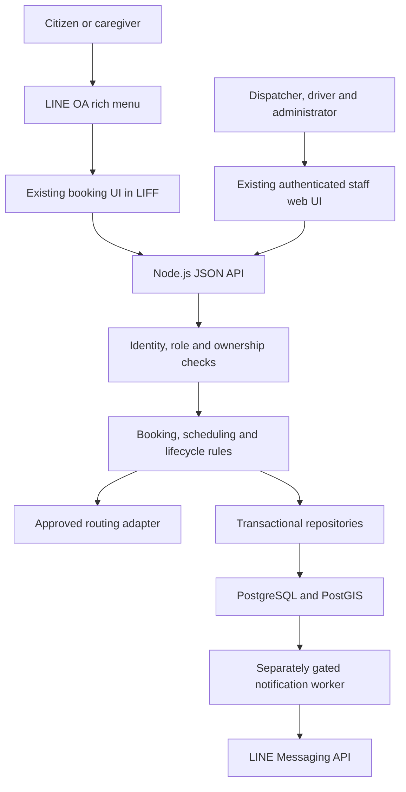
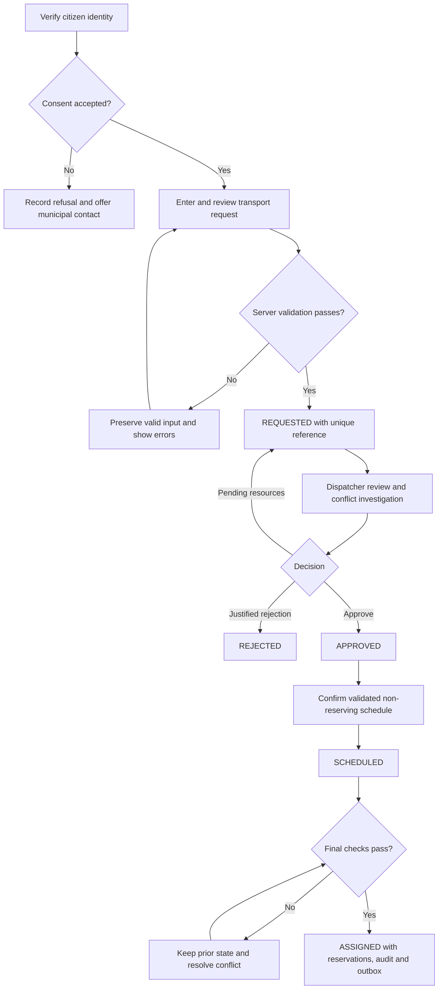
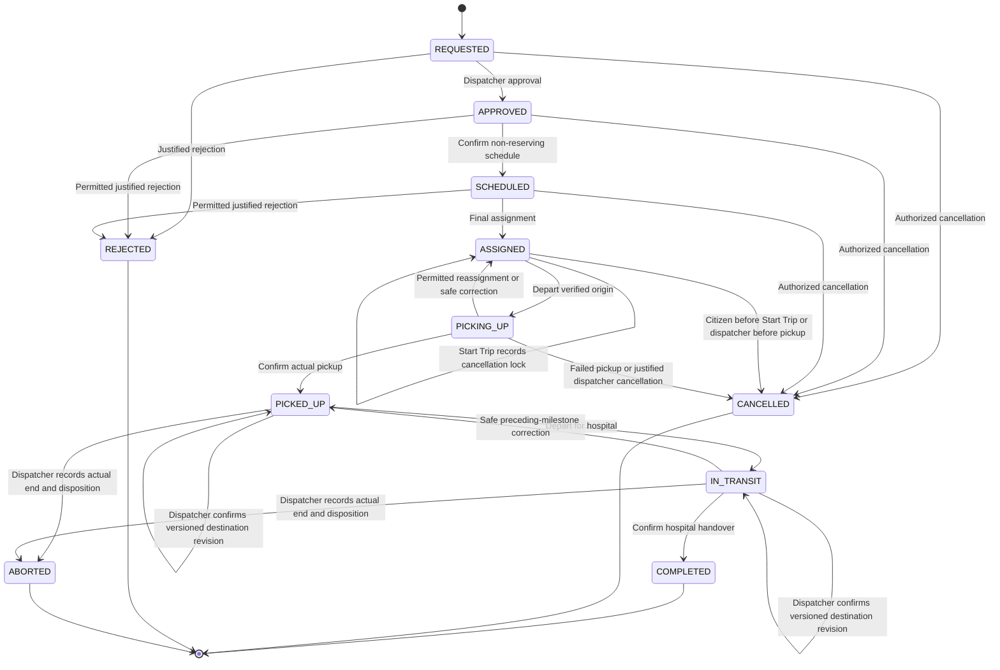
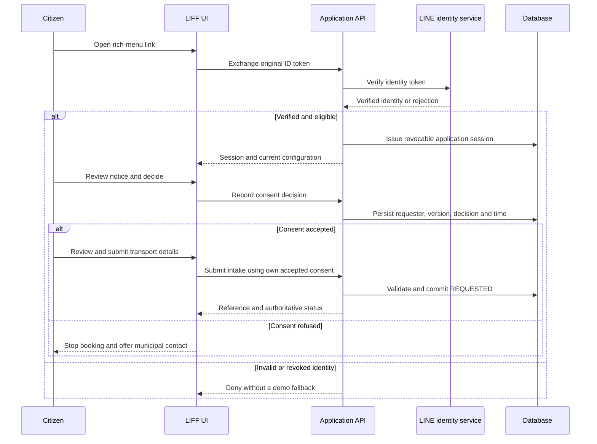
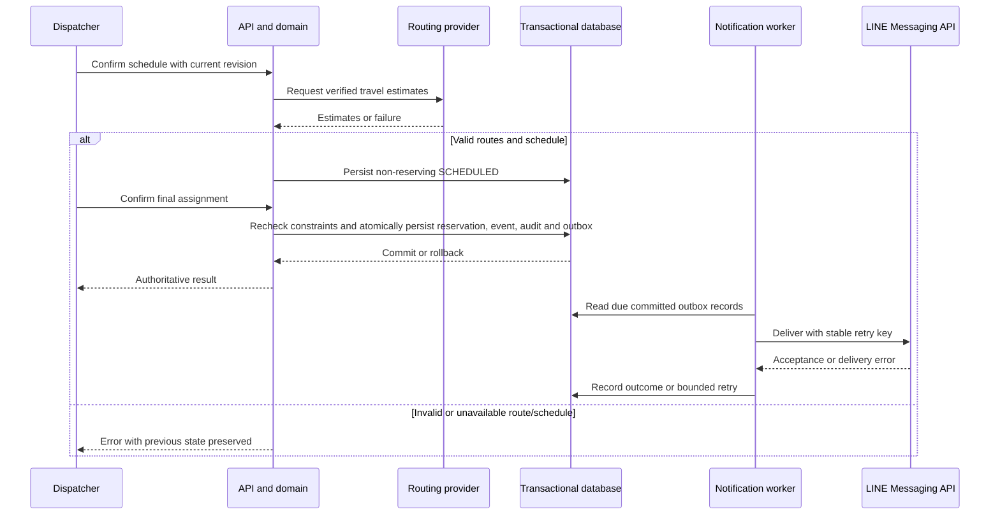
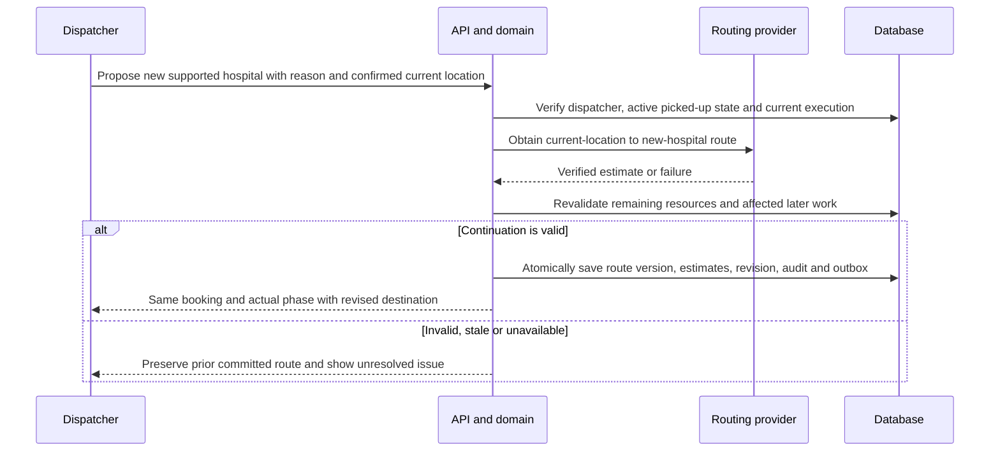

# ข้อกำหนดความต้องการซอฟต์แวร์

**ระบบ:** ระบบรับส่งผู้ป่วยที่ไม่ใช่กรณีฉุกเฉินของเทศบาลตำบลบ้านกลาง  
**รหัสเอกสาร:** SRS-BK-2026  
**เวอร์ชัน:** 2.1 — ฐานข้อกำหนดสำหรับทีมที่ปรับปรุงรายละเอียดแล้ว  
**วันที่:** 11 พฤศจิกายน 2026  
**สถานะ:** ฐานสำหรับการพัฒนาโครงการ; อยู่ระหว่างรอการตรวจรับจากเทศบาล  
**เป้าหมายการเสร็จสิ้น:** ก่อนสิ้นเดือนพฤศจิกายน 2026 โดยกำหนดส่งมอบขั้นสุดท้ายวันที่ 30 พฤศจิกายน 2026  
**ภาษา:** ส่วนติดต่อผู้ใช้และคู่มือผู้ใช้เป็นภาษาไทย; ข้อกำหนดทางเทคนิคต้นฉบับเป็นภาษาอังกฤษ

เอกสารนี้กำหนดระบบขั้นสุดท้ายที่ต้องการ ไม่ใช่การยืนยันว่าทุกคุณลักษณะได้รับการพัฒนาแล้ว เอกสารนี้ใช้แทนชุดข้อกำหนด/การออกแบบที่เคยสร้างไว้ โดยเป็นข้อกำหนดหลัก เอกสารความต้องการและเอกสารอ้างอิงต้นฉบับยังคงเก็บรักษาไว้เป็นหลักฐานแหล่งที่มา

| เวอร์ชัน | วันที่ | การเปลี่ยนแปลง | อำนาจอนุมัติ/สถานะ |
|---|---|---|---|
| 1.3 | 10 พฤศจิกายน 2026 | SRS รายละเอียดฉบับก่อนหน้าและข้อตกลงด้านการปฏิบัติงานที่ยืนยันแล้ว | เก็บรักษาไว้เป็นฐานต้นทาง |
| 2.0 | 11 พฤศจิกายน 2026 | รวมเนื้อหาเป็นเก้าหัวข้อที่ร้องขอ; ฝังแผนภาพการออกแบบ การตรวจสอบย้อนกลับในการทดสอบ ข้อกำหนดเอกสารผู้ใช้ และแผนส่งมอบเดือนพฤศจิกายน | เจ้าของโครงการเป็นผู้ร้องขอ; รอเทศบาลทบทวน/ลงนามตรวจรับ |
| 2.1 | 11 พฤศจิกายน 2026 | เจ้าของโครงการรับรองกฎเปลี่ยนจุดหมายหลังรับผู้ป่วย ตารางสิทธิ์ การตรวจสอบข้อมูล การคำนวณรายงาน กฎแจ้งเตือน/ตรวจสอบข้อมูล เป้าหมายการปฏิบัติงานที่วัดผลได้ และแผนตรวจรับ; เพิ่ม FR-051 | อนุมัติใช้เป็นฐานโครงการตามคำสั่งเจ้าของโครงการ; รอหลักฐานความเป็นไปได้และการตรวจรับจากเทศบาล |

## 1. วัตถุประสงค์และขอบเขต

### 1.1 วัตถุประสงค์

ระบบต้องรองรับการจอง การจัดตาราง การจัดรถโดยเจ้าหน้าที่ การปฏิบัติงาน และการตรวจสอบย้อนหลังของบริการรับส่งผู้ป่วยแบบนัดหมายที่ไม่ใช่กรณีฉุกเฉิน ซึ่งดำเนินการโดยเทศบาลตำบลบ้านกลาง อำเภอเมืองลำพูน จังหวัดลำพูน ระบบต้องทดแทนการประสานงานที่กระจัดกระจายผ่านแบบฟอร์ม สมุดบันทึก โทรศัพท์ และปฏิทิน ด้วยบันทึกการปฏิบัติงานร่วมกันที่มีการควบคุม

ทีมโครงการต้องใช้ SRS นี้พัฒนาแอปพลิเคชันจริง ทีมเอกสารต้องใช้จัดทำแผนภาพ ข้อกำหนด และรายงาน ผู้ทดสอบต้องใช้กำหนดสถานการณ์ตรวจรับ และผู้มีส่วนได้ส่วนเสียของเทศบาลต้องใช้ทบทวนบริการและอนุมัติการเปิดใช้งาน

### 1.2 ขอบเขต

ระบบต้องรองรับการรับส่งเที่ยวเดียวจากจุดรับที่มีสิทธิ์ภายใน 12 หมู่บ้านบริการของเทศบาล ไปยังโรงพยาบาลที่รองรับ แต่ละเที่ยวต้องมีผู้ป่วยหนึ่งคนต่อรถหนึ่งคัน ประชาชนหรือผู้ดูแลต้องเข้าผ่านลิงก์ Rich Menu ของ LINE Official Account ซึ่งเปิดหน้าจองผ่าน LINE LIFF เจ้าหน้าที่จัดรถ คนขับ และผู้ดูแลระบบต้องใช้งานผ่านเว็บที่มีการยืนยันตัวตน

ความสามารถในขอบเขตประกอบด้วยความยินยอม ข้อมูลผู้ป่วยที่บันทึกไว้และเป็นของผู้ยื่นคำขอ การรับคำขอจอง การเลือกจุดรับด้วยแผนที่/GPS การคำนวณตารางย้อนหลัง การตรวจสอบรถ/คนขับที่มีงานทับซ้อน การอนุมัติและมอบหมายโดยเจ้าหน้าที่ ขั้นตอนการเดินทางของคนขับ การยกเลิกและเหตุผิดปกติ การแจ้งเตือน LINE การจัดการทรัพยากร/ข้อมูลหลัก การทบทวนวันปิดบริการและการเปลี่ยนข้อมูลภูมิสารสนเทศ การควบคุมสิทธิ์ บันทึกตรวจสอบ รายงาน และเอกสารปฏิบัติงาน

ความสามารถนอกขอบเขต ได้แก่ การสั่งการฉุกเฉิน การประเมินทางการแพทย์ การเชื่อมต่อเวชระเบียน การรับผู้ป่วยหลายคนร่วมเที่ยว การจัดเที่ยวกลับจากโรงพยาบาลถึงบ้านตามตาราง การจองส่งต่อระหว่างโรงพยาบาล การติดตามรถแบบต่อเนื่องทันที การรับข้อมูลจากอุปกรณ์ติดตาม ค่าโดยสาร การชำระเงิน/คืนเงิน และการเรียกเก็บเงินเชิงพาณิชย์ การรับมือเหตุการณ์อาจบันทึกการจัดการผู้ป่วยทางเลือกที่เกิดขึ้นจริงได้ โดยไม่ทำให้แพลตฟอร์มนี้กลายเป็นบริการเที่ยวกลับหรือการสั่งการฉุกเฉิน

UI ปัจจุบันเป็นฐานภาพลักษณ์ขั้นสุดท้าย ทีมต้องคงโครงร่าง ตัวอักษร ระยะห่าง การนำทาง พฤติกรรมตามขนาดหน้าจอ การ์ด และกล่องโต้ตอบ การเพิ่มหรือปรับเล็กน้อยทำได้เพื่อให้มีส่วนควบคุมที่ข้อกำหนดนี้ต้องการ ทีมต้องไม่แทนที่ด้วยการออกแบบพื้นที่ทำงานที่ไม่สอดคล้องกับของเดิม

### 1.3 ผู้มีส่วนได้ส่วนเสียและความรับผิดชอบ

| ผู้ใช้งาน/ผู้มีส่วนได้ส่วนเสีย | ความรับผิดชอบ | ขอบเขตการเข้าถึง |
|---|---|---|
| ประชาชน/ผู้ดูแล | ให้ความยินยอมและข้อมูลรับส่งที่ถูกต้อง; ตรวจสอบ ส่ง ติดตาม และยกเลิกคำขอของตนตามสิทธิ์ | เฉพาะการจองของตนและโปรไฟล์ที่บันทึกไว้ซึ่งได้รับอนุญาต |
| เจ้าหน้าที่จัดรถของเทศบาล | ทบทวนคำขอ แก้ความขัดแย้ง ยืนยันตารางและการมอบหมาย จัดการการเปลี่ยนแปลง/เหตุการณ์/ความพร้อม และรายงานปฏิบัติงาน | งานรับส่งที่ได้รับอนุญาต; การตัดสินใจที่ควบคุมต้องมีเหตุผล/ประวัติ |
| คนขับ | ทบทวนงานที่ได้รับมอบหมาย นำทางไปจุดรับ บันทึกขั้นตอนจริง และรายงานปัญหา | งานที่มอบหมายภายในกะหรืองานที่ยังดำเนินต่อเกินเวลา; ประวัติงานที่จบแล้วต้องลดข้อมูลให้เหลือเท่าที่จำเป็น |
| ผู้ดูแลระบบ | ดูแลบัญชี บทบาท รถ/ข้อมูลหลัก ภูมิศาสตร์/การตั้งค่า วันปิดบริการ บันทึกตรวจสอบ และรายงานที่มีสิทธิ์ | ไม่มีอำนาจตัดสินใจของเจ้าหน้าที่จัดรถหรือเข้าถึงข้อมูลผู้ป่วยอย่างไม่จำกัดเพียงเพราะมีสถานะผู้ดูแลระบบ |
| ผู้รับผิดชอบบริการของเทศบาล | ยืนยันข้อมูลบริการ นโยบายปฏิบัติงาน การฝึกอบรม และการตรวจรับก่อนเปิดใช้งาน | เป็นผู้มีส่วนได้ส่วนเสียที่รับผิดชอบ ไม่ใช่บทบาทแอปพลิเคชันเพิ่มเติมโดยอัตโนมัติ |
| ทีมโครงการ | พัฒนา ทดสอบ จัดทำเอกสาร และสาธิตระบบ | การพัฒนา/ทดสอบต้องใช้ข้อมูลจำลอง เว้นแต่ได้รับอนุญาตแยกต่างหาก |

### 1.4 คำจำกัดความและหลักการใช้ข้อกำหนด

| คำศัพท์ | ความหมาย |
|---|---|
| Requester (ผู้ยื่นคำขอ) | ประชาชน/ผู้ดูแลที่ยืนยันตัวตนและเป็นเจ้าของคำขอ อาจเป็นคนละคนกับผู้ป่วย |
| Appointment (เวลานัดหมาย) | วัน/เวลานัดโรงพยาบาลที่ใช้คำนวณตารางย้อนหลัง |
| Hospital target (เวลาเป้าหมายถึงโรงพยาบาล) | เวลานัดลบด้วยระยะเผื่อการมาถึงคงที่ 20 นาที |
| Pickup waiting (เวลารอที่จุดรับ) | เวลารอเพิ่มเติมที่ระบุชัดเจน ณ จุดรับ แยกจากเวลาเดินทางที่ตรวจสอบแล้ว; ค่าเริ่มต้นเป็นศูนย์ |
| Origin (ต้นทาง) | ศูนย์รถ โรงพยาบาลปลายทางของเที่ยวก่อนหน้าสำหรับงานต่อเนื่อง หรือจุดรับช่วงก่อนรับผู้ป่วยที่เจ้าหน้าที่จัดรถตรวจยืนยันแล้ว |
| Turnaround (เวลาเตรียมพร้อม) | เวลาเตรียมพร้อมคงที่ 30 นาที ณ โรงพยาบาลปลายทาง ไม่รวมการกลับศูนย์รถ |
| Reservation (การจองทรัพยากร) | ช่วงเวลาตามแผนที่จัดสรรให้รถและคนขับด้วยการมอบหมายขั้นสุดท้าย |
| Operational hold (การระงับความพร้อมปฏิบัติงาน) | ความไม่พร้อมจริงที่อาจยาวนานกว่าหรือคงอยู่หลังปล่อยการจองทรัพยากร |
| Start Trip (เริ่มงาน) | เหตุการณ์ที่บันทึกแยกต่างหาก โดยยังเป็น ASSIGNED แต่ล็อกไม่ให้ประชาชนยกเลิก |
| Execution version (เวอร์ชันการปฏิบัติงาน) | ตัวระบุ/เวอร์ชันการมอบหมายที่ใช้ปฏิเสธการกระทำจากการปฏิบัติงานของคนขับเวอร์ชันที่ถูกแทนที่แล้ว |
| ABORTED | งานที่สิ้นสุดหลังรับผู้ป่วยจริง โดยไม่มีการส่งมอบที่โรงพยาบาล และมีเจ้าหน้าที่จัดรถบันทึกการจัดการผู้ป่วย |
| Outbox | งานแจ้งเตือนที่จัดเก็บถาวรและยืนยันร่วมกับธุรกรรมปฏิบัติงาน ก่อนนำส่งแยกต่างหาก |
| RPO / RTO | เป้าหมายจุดกู้คืน (ข้อมูลสูญหายสูงสุดที่ยอมรับได้: หนึ่งชั่วโมง) / เป้าหมายเวลากู้คืน (ฟื้นฟูบริการที่ตรวจสอบแล้วภายในสี่ชั่วโมง) |
| SUS | System Usability Scale; รายงานผลหากเก็บข้อมูล โดยไม่สร้างเกณฑ์ผ่านขึ้นเอง |

“Shall” หมายถึงข้อกำหนดที่ต้องทำ ข้อกำหนดระดับ Must เป็นข้อบังคับในการตรวจรับ ส่วน Should ต้องพัฒนาให้ครบหรือมีมติผู้มีส่วนได้ส่วนเสียให้เลื่อนอย่างชัดเจนและบันทึกไว้ รหัสรายละเอียด FR-001–FR-050 ยังคงเดิม โดย FR-051 ขยายฐานข้อกำหนดสำหรับการเปลี่ยนจุดหมายหลังรับผู้ป่วยแล้ว ส่วน FR-01–FR-12 ของเอกสารอ้างอิงต้นฉบับเป็นคนละชุดรหัส ไม่ให้สมมติว่ามีรายการ FR-13–FR-26 ต้นฉบับ

### 1.5 สมมติฐาน สิ่งที่ต้องพึ่งพา และรายการที่ต้องยืนยัน

ข้อตกลงทางธุรกิจที่ยืนยันแล้วใน SRS นี้ต้องไม่ถูกเปิดทบทวนใหม่เพียงเพราะต้นแบบก่อนหน้าทำงานต่างออกไป ค่าจริง/การอนุมัติต่อไปนี้ยังต้องได้รับหรือทวนสอบ และห้ามสร้างขึ้นเอง:

| รหัส | รายการ | ผู้มีอำนาจตัดสินใจ | ต้องพร้อมก่อน |
|---|---|---|---|
| O-01 | รูปทรงพื้นที่บริการ 12 หมู่บ้าน โรงพยาบาลที่รองรับ ศูนย์รถ และความสามารถทรัพยากรที่อนุมัติแล้ว | เทศบาล | การตรวจรับข้อมูลบริการและเปิดใช้งานจริง |
| O-02 | ปฏิทิน/แหล่งข้อมูลและวันที่ปิดบริการจริง | เทศบาล | การตรวจรับปฏิทินและเปิดใช้งานจริง |
| O-03 | เบอร์ติดต่อทางการของเทศบาล ข้อความความเป็นส่วนตัวปัจจุบัน อำนาจของผู้ดูแล และความรับผิดชอบด้านความเป็นส่วนตัว | เทศบาล/ผู้ทบทวนความเป็นส่วนตัว | การตรวจรับส่วนประชาชนขั้นสุดท้ายและเปิดใช้งานจริง |
| O-04 | ระยะเก็บรักษา กฎลบ/ทำให้ไม่ระบุตัวบุคคล และขั้นตอนระงับการลบเพื่อการดำเนินการทางกฎหมาย | เทศบาล/ผู้ทบทวนความเป็นส่วนตัว | การตรวจรับการเก็บรักษาและเปิดใช้งานจริง |
| O-05 | ผู้ให้บริการ/ช่องทาง/การตั้งค่า LIFF ของ LINE ระบบเส้นทาง/แผนที่ที่อนุมัติ โฮสติ้ง/โดเมน/TLS และผู้รับผิดชอบข้อมูลลับ | ผู้รับผิดชอบบริการและทีมเทคนิค | การเชื่อมต่อจริงและตรวจรับการติดตั้งใช้งาน |
| O-06 | การยืนยันฟิลด์รายงานรายวัน/รายเดือนในหัวข้อ 2.7 โดยเทศบาล | เทศบาล | การลงนามตรวจรับรายงาน |
| O-07 | ความเป็นไปได้ของโฮสติ้งและหลักฐานวัดผลตามเป้าหมายที่รับรองในหัวข้อ 3.3; ภาระงานทดสอบโหลดและขั้นตอนสำรอง/กู้คืนที่อนุมัติ | ผู้รับผิดชอบบริการและทีมเทคนิค | การตรวจรับสมรรถนะ/การกู้คืนในการปฏิบัติงาน |
| O-08 | ชื่อผู้ทบทวน/ผู้รับผิดชอบ การรับสมัครกลุ่มทดสอบสิบคนที่มีผู้สูงอายุเจ็ดคนตามที่รับรอง กำลังคนของทีม และเวอร์ชันอุปกรณ์/เบราว์เซอร์ที่ทดสอบจริง | เจ้าของโครงการและเทศบาล | การนัดทดสอบและยืนยันผู้รับผิดชอบหมุดหมาย |

รายการบริการที่ยังเปิดอยู่เหล่านี้ไม่ใช่การอนุญาตให้ตัดคุณลักษณะที่ต้องมี หากขาดข้อมูล ให้พัฒนาโดยใช้การตั้งค่าจำลองที่ระบุชัดเจน และระบุว่าการตรวจรับจริงส่วนที่เกี่ยวข้องยังรอดำเนินการ การส่งมอบเดือนพฤศจิกายนต้องไม่ถูกอ้างว่าเป็นการอนุญาตให้รับส่งผู้ป่วยจริงโดยยังไม่ผ่านเกณฑ์ตรวจรับ

ก่อนหน้านี้ยังไม่ได้ระบุเป้าหมายปฏิบัติงาน ปัจจุบันเจ้าของโครงการรับข้อเสนอแนะเป็นฐานโครงการในหัวข้อ 3.3 แล้ว แต่การวัดผลที่ผ่าน ความเป็นไปได้ของโฮสติ้ง และการตรวจรับจากเทศบาลยังต้องดำเนินการตาม O-07 การรับรองเป้าหมายไม่ได้เป็นหลักฐานว่าบริการที่ติดตั้งทำได้ตามนั้น

### 1.6 แหล่งที่มาและลำดับความสำคัญ

SRS นี้รวบรวมจาก [SRS ฉบับก่อนหน้าที่เก็บรักษาไว้](SRS-Complete-Official-EN.md), [ข้อมูลตัดสินใจที่กรอกแล้ว](PRODUCTION-INPUTS.md), [ผู้ใช้งาน](../../reference_files/user-roles-and-actors.md), [กรณีใช้งาน](../../reference_files/use-case-list.md), [ข้อกำหนดเชิงหน้าที่/ไม่ใช่เชิงหน้าที่อ้างอิง](../../reference_files/NR_and_NFR.md) และ [ตรรกะระบบ](../../reference_files/designs/system-logic.md)

ข้อตกลงที่ยืนยันโดยเจ้าของโครงการ รวมถึงเป้าหมายเสร็จสิ้นที่ปรับเป็นเดือนพฤศจิกายน มีลำดับเหนือขอบเขตสัมมนาที่ถูกแทนที่และแบบที่เคยเสนอ เอกสารนี้กำหนดพฤติกรรมเป้าหมายที่ต้องการ ส่วนแผนเชื่อมต่อระบบใช้บันทึกความคืบหน้าจริงแยกต่างหาก ช่องอนุมัติของเทศบาลต้องคงสถานะรอไว้จนกว่าผู้มีอำนาจที่ระบุชื่อจะอนุมัติจริง

## 2. ข้อกำหนดเชิงหน้าที่

### 2.1 ความยินยอมและการจองของประชาชน

| รหัส | ระดับความสำคัญ | ข้อกำหนด | การทดสอบตรวจรับ |
|---|---|---|---|
| FR-001 | Must | ระบบต้องแสดงประกาศความเป็นส่วนตัว/ความยินยอมฉบับปัจจุบัน ก่อนประชาชนเข้าถึงแบบฟอร์มจอง | TC-C01, TC-P01 |
| FR-002 | Must | ระบบต้องบันทึกการยอมรับ/ปฏิเสธความยินยอม ผู้ยื่นคำขอที่ยืนยันตัวตน เวอร์ชันประกาศ และเวลาจากเซิร์ฟเวอร์ | TC-C01, TC-P01 |
| FR-003 | Must | การปฏิเสธต้องหยุดการจองดิจิทัลและแสดงทางเลือกติดต่อเทศบาลทางโทรศัพท์ที่อนุมัติแล้ว | TC-C01 |
| FR-004 | Must | ระบบต้องรองรับการจองสำหรับผู้ยื่นคำขอเองหรือผู้ป่วยคนอื่น โดยคงความแตกต่างระหว่างผู้ป่วยกับผู้ยื่นคำขอ | TC-C02 |
| FR-005 | Must | ระบบต้องเสนอข้อมูลผู้ป่วยที่เคยบันทึกและมีสิทธิ์ใช้งาน เพื่อกรอกอัตโนมัติและทบทวนภายใต้สิทธิ์ของผู้ยื่นคำขอ | TC-C02, TC-C06, TC-P01 |
| FR-006 | Must | การส่งคำขอต้องล่วงหน้าก่อนนัดอย่างน้อย 48 ชั่วโมง และต้องไม่มีระยะจองล่วงหน้าสูงสุด | TC-C03 |
| FR-007 | Must | หน้าจองของประชาชนต้องแสดงข้อความบริการไม่ใช่กรณีฉุกเฉินและลิงก์ติดต่อฉุกเฉิน 1669 อย่างต่อเนื่อง | TC-C01, TC-U01 |
| FR-008 | Must | ระบบต้องรับความต้องการนั่งปกติ รถเข็น หรือเปลนอน และความช่วยเหลือเพิ่มเติมด้านการใช้งานที่อนุญาต | TC-C02, TC-C06, TC-D02 |
| FR-009 | Must | ระบบต้องรับพิกัดจุดรับจาก GPS หรือหมุดแผนที่ที่ลาก/กำหนดเองได้ และมีทางเลือกกำหนดเองเมื่อ GPS ล้มเหลว | TC-C04 |
| FR-010 | Must | เซิร์ฟเวอร์ต้องตรวจสิทธิ์จุดรับกับพื้นที่ 12 หมู่บ้านบริการที่อนุมัติแล้ว | TC-C04, TC-P01 |
| FR-011 | Must | ประชาชนต้องทบทวนข้อมูลผู้ป่วย/ผู้ติดต่อ จุดหมาย นัดหมาย ความช่วยเหลือ และจุดรับก่อนส่ง | TC-C02 |
| FR-012 | Must | ระบบต้องออกรหัสอ้างอิงการจองที่ไม่ซ้ำและแสดงสถานะคำขอที่เป็นข้อมูลอ้างอิงจริง | TC-C05 |
| FR-013 | Should | ข้อมูลร่างที่ถูกต้องต้องไม่สูญหายเมื่อการตรวจสอบ/บริการผิดพลาด และยังแก้ไขได้ก่อนส่ง หลังส่ง การเปลี่ยนแปลงต้องดำเนินการโดยเจ้าหน้าที่จัดรถ ไม่ให้ประชาชนแก้โดยตรง | TC-C02, TC-C06, TC-F01 |
| FR-014 | Must | ประชาชนยกเลิกได้เฉพาะการจองของตนก่อนคนขับที่ได้รับมอบหมายทำ Start Trip การมอบหมายใหม่ต้องไม่รีเซ็ตจุดตัดสิทธิ์นี้ | TC-C05, TC-R01 |

ขั้นตอนประชาชน: ยืนยันตัวตน LINE → แสดงประกาศ → บันทึกการตัดสินใจ → กรอก/ใช้ข้อมูลผู้ป่วยและนัดหมายเดิม → ความช่วยเหลือและจุดรับ → ทบทวน/แก้ไข → ส่งเป็น REQUESTED → แสดงรหัสอ้างอิง/สถานะ ต้องไม่ข้ามการปฏิเสธประกาศหรือการไม่ผ่านยืนยันตัวตนด้วยการเปิดเส้นทางตรงหรือใช้ข้อมูลในเบราว์เซอร์

ส่วนติดต่อผู้ใช้ต้องคงจุดรับที่ผู้ใช้เลือกเอง หากผล GPS ที่ล่าช้ามาถึงภายหลัง การเลือกโปรไฟล์ที่บันทึกไว้ต้องกรอกเฉพาะข้อมูลที่ผู้ยื่นคำขอซึ่งยืนยันตัวตนมีสิทธิ์ และผู้ใช้ต้องทบทวนก่อนส่ง ห้ามอัปโหลดข้อมูลสาธิตเดิมในเบราว์เซอร์เป็นข้อมูลจริงที่ยืนยันตัวตนแล้วโดยไม่แจ้งผู้ใช้

#### 2.1.1 พจนานุกรมกฎตรวจสอบฟิลด์ร่วม

การตรวจสอบฝั่งไคลเอนต์ต้องให้คำแนะนำทันที ส่วนเซิร์ฟเวอร์ต้องบังคับกฎเดียวกันและส่งข้อผิดพลาดรายฟิลด์โดยไม่ล้างข้อมูลที่ถูกต้อง ความยาวข้อความด้านล่างนับเป็น Unicode code points หลังตัดช่องว่างหัวท้าย โดยใช้เหมือนกันกับภาษาไทยและภาษาอื่น การปรับรูปแบบโทรศัพท์เป็นไปตามกฎชัดเจนด้านล่าง API และฐานข้อมูลต้องปฏิเสธหรือจัดการข้อมูลยาวเกินอย่างปลอดภัยและสอดคล้องกัน การตรวจรูปแบบโทรศัพท์ไม่ใช่หลักฐานความเป็นเจ้าของหรือการติดต่อได้จริง; บันทึกตรวจสอบเพิ่มเติมเป็นอีกส่วนหนึ่ง

| ฟิลด์ | ค่าที่ต้องมี/อนุญาต | กฎตรวจสอบและประวัติ |
|---|---|---|
| ชื่อผู้ป่วย | จำเป็น; 1–120 อักขระ | ตัดช่องว่างหัวท้าย; รับชื่อบุคคลภาษาไทยและภาษาอื่นโดยไม่จำกัดว่าต้องเป็นตัวอักษรล้วน; คงการสะกดที่แสดง |
| ชื่อผู้ยื่นคำขอ | จำเป็น; 1–120 อักขระ | เก็บผู้ยื่นคำขอแยกจากผู้ป่วย; การจองให้ตนเองอาจเริ่มต้นด้วยชื่อผู้ป่วยหลังทบทวน |
| เบอร์ติดต่อ | ต้องเป็นหมายเลขโทรศัพท์มือถือไทย | ลบช่องว่าง/ขีดกลาง; รับรูปแบบในประเทศ `0` ตามด้วยเก้าหลัก หรือ `+66` ตามด้วยเก้าหลักของหมายเลขภายในประเทศที่สอดคล้องกัน; เก็บในรูปแบบมาตรฐานในประเทศสิบหลัก ปฏิเสธรูปแบบอื่นพร้อมข้อความชัดเจน |
| ที่อยู่จุดรับ | จำเป็น; 1–1,000 อักขระ | ต้องมีพิกัด/หมู่บ้านบริการที่ตรวจสอบแล้วประกอบ; ที่อยู่อย่างเดียวไม่ยืนยันสิทธิ์ทางภูมิศาสตร์ |
| จุดสังเกต | ไม่บังคับ; สูงสุด 1,000 อักขระ | ใช้บอกทางรับส่งเท่านั้น; ห้ามมีข้อมูลทางคลินิก |
| พิกัด | ต้องเป็นตัวเลขละติจูด/ลองจิจูดที่มีค่าจำกัด | ละติจูด −90 ถึง 90; ลองจิจูด −180 ถึง 180; เซิร์ฟเวอร์ตรวจรูปทรงพื้นที่หมู่บ้านที่อนุมัติและขอบเขตที่เปิดใช้งาน |
| หมู่บ้านและโรงพยาบาล | ต้องอ้างอิงรายการที่เปิดใช้งาน | รหัสต้องมีอยู่และยังมีสิทธิ์เมื่อเซิร์ฟเวอร์ยืนยันธุรกรรม; ป้ายข้อความใน UI ไม่ใช่ข้อมูลอ้างอิงที่มีอำนาจ |
| นัดหมาย | ต้องมีวัน/เวลาที่ระบุเขตเวลา | ตีความ/แสดงด้วยเวลากรุงเทพฯ; บังคับกฎ 48 ชั่วโมงขณะส่งและกฎจัดตารางหลังจากนั้น |
| การเคลื่อนย้าย | เลือกหนึ่งค่าเท่านั้น: `standard`, `wheelchair`, `stretcher` | ต้องตรงกับความสามารถทรัพยากรที่ต้องใช้ |
| ความช่วยเหลือเพิ่มเติม | ชุดรหัสที่ควบคุม; ว่างหมายถึงไม่มี | `boarding_support` = ช่วยขึ้น/ลงรถ; `caregiver_accompanies` = ผู้ดูแลเดินทางกับผู้ป่วย คงตัวเลือก UI ปัจจุบัน; ไม่มีหมวดคลินิกแบบข้อความอิสระ เจ้าหน้าที่จัดรถยืนยันความเป็นไปได้ในการปฏิบัติงานก่อนมอบหมาย |
| ความสัมพันธ์ในการจอง | ตนเองหรือผู้ดูแล/ผู้ป่วยคนอื่น | กรณีตนเองไม่ต้องมีคำอธิบายความสัมพันธ์แยก; ตัวตน/อำนาจผู้ดูแลเป็นไปตามประกาศที่อนุมัติและ O-03 |
| เหตุผล/หมายเหตุปฏิบัติงาน | จำเป็นในคำสั่งที่กำหนด; 1–1,000 อักขระ | ต้องไม่ว่างหลังตัดช่องว่าง; เฉพาะการกระทำ/การจัดการรับส่ง หมายเหตุที่ไม่บังคับอาจว่างได้ แต่ต้องอยู่ในขอบเขตความยาว/เนื้อหาเดียวกัน |
| สถานที่สิ้นสุดจริงและการจัดการผู้ป่วย | จำเป็นสำหรับ ABORTED; อย่างละ 1–1,000 อักขระ | อธิบายสถานที่จริงและการส่งมอบ/แผนรับช่วงที่ยืนยันแล้ว; ห้ามแทนด้วยการส่งถึงโรงพยาบาลที่สร้างขึ้น |
| ตัวอ้างอิงโปรไฟล์ ความยินยอม revision และ execution | ต้องเป็นค่าถูกต้องที่เซิร์ฟเวอร์ออกให้ | ตรวจเจ้าของที่ยืนยันตัวตน/ประกาศปัจจุบัน/revision หรือ execution ปัจจุบัน; ปฏิเสธฟิลด์รับคำขอที่ไม่รู้จัก |

การเปลี่ยนโปรไฟล์ที่บันทึกไว้ต้องกระทบเฉพาะการกรอกอัตโนมัติของแบบฟอร์มในอนาคต การจองที่ส่งแล้วต้องคงข้อมูลและภาพบันทึกความยินยอมขณะส่ง ไม่เปลี่ยนเองเมื่อโปรไฟล์หรือชื่อแสดงบัญชีเปลี่ยน ประกาศเวอร์ชันใหม่ต้องมีการตัดสินใจให้ความยินยอมปัจจุบันที่ใช้ได้ก่อนจองใหม่ โดยต้องไม่เขียนทับประวัติเดิมหรือทำให้งานรับส่งที่รับไว้แล้วใช้ไม่ได้โดยอัตโนมัติ การดำเนินนโยบายย้อนหลังต้องมีขั้นตอนของเทศบาลที่อนุมัติอย่างชัดเจน

### 2.2 การจัดตารางและจัดการทรัพยากร

| รหัส | ระดับความสำคัญ | ข้อกำหนด | การทดสอบตรวจรับ |
|---|---|---|---|
| FR-015 | Must | เซิร์ฟเวอร์ต้องรับค่าประมาณเวลาเดินทางบนถนนที่ตรวจสอบแล้ว จากต้นทางจริงถึงจุดรับ และจากจุดรับถึงโรงพยาบาล | TC-D02, TC-F01 |
| FR-016 | Must | เวลาเป้าหมายถึงโรงพยาบาลต้องเท่ากับเวลานัดลบ 20 นาที | TC-D02 |
| FR-017 | Must | เวลารับต้องเท่ากับเวลาเป้าหมายถึงปลายทาง ลบเวลาเดินทางจากจุดรับถึงโรงพยาบาลและเวลารอที่จุดรับที่ระบุชัด เวลารอต้องไม่ทำให้ค่าประมาณเส้นทางหรือเวลาเป้าหมายเป็นเท็จ | TC-D02, TC-D03 |
| FR-018 | Must | เวลาออกต้องเท่ากับเวลารับลบเวลาเดินทางจากต้นทางถึงจุดรับ งานต่อเนื่องต้องเคารพความพร้อมของงานก่อนและความต่อเนื่องของตำแหน่งทรัพยากรทั้งสอง | TC-D02, TC-D03 |
| FR-019 | Must | เวลาพร้อมตามแผนต้องเท่ากับเวลาเป้าหมายถึงโรงพยาบาลบวก 30 นาที ณ โรงพยาบาลนั้น ความล่าช้าจริง งานที่ยังดำเนินอยู่ และการระงับที่ยังไม่คลี่คลายต้องป้องกันการใช้งานซ้ำก่อนพร้อม | TC-R01, TC-R04 |
| FR-020 | Must | ช่วงเวลาทั้งหมดต้องสอดคล้องกับข้อจำกัดด้านช่วงว่าง ความสามารถ บริการ และความพร้อมของรถและคนขับทั้งสอง | TC-D02, TC-D04 |
| FR-021 | Must | ระบบต้องป้องกันช่วงจองที่ยืนยันแล้วทับซ้อนสำหรับรถหรือคนขับ รวมถึงคำขอมอบหมายที่เกิดพร้อมกัน | TC-D04 |
| FR-022 | Must | เมื่อทรัพยากรไม่พร้อม ต้องคง REQUESTED เพื่อให้เจ้าหน้าที่จัดรถทบทวนและแจ้งเจ้าหน้าที่ แทนการปฏิเสธหรือจองทรัพยากรโดยอัตโนมัติ | TC-D01, TC-F01 |

กำหนดให้เวลานัดเป็น `A` เวลาเดินทางจากต้นทางที่ตรวจสอบแล้วเป็น `R1` เวลาเดินทางถึงโรงพยาบาลที่ตรวจสอบแล้วเป็น `R2` และเวลารอเป็น `W >= 0`:

```text
Hospital target = A - 20 minutes
Pickup          = Hospital target - R2 - W
Origin departure= Pickup - R1
Planned ready   = Hospital target + 30 minutes
Reservation     = [Origin departure, Planned ready)
```

การคำนวณเวลาต้องใช้จุดเวลาที่ระบุเขตเวลาและวันบริการตามเวลากรุงเทพฯ เวลาให้บริการคงที่คือ 06:00–16:00; ช่วงตามแผนทั้งหมดต้องอยู่ในเวลาดังกล่าว เคารพวันปิดบริการและช่วงว่างทรัพยากร ช่วงเวลาที่ติดกันอาจใช้ขอบเวลาเดียวกันได้ ต้องเก็บแหล่งที่มาของเส้นทาง และห้ามแทนด้วยระยะเวลาที่สร้างขึ้นเมื่อระบบเส้นทางล้มเหลว

ตัวอย่าง: นัด 09:00 เวลาเดินทางจากจุดรับถึงโรงพยาบาล 35 นาที จากต้นทางถึงจุดรับ 30 นาที และไม่มีเวลารอเพิ่ม จะได้เวลาเป้าหมาย 08:40 เวลารับ 08:05 เวลาออก 07:35 และเวลาพร้อมตามแผน 09:10 เที่ยวถัดไปที่เริ่มจากโรงพยาบาลต้องตรวจความพร้อมจริงและเวลาเดินทางไปจุดรับถัดไปเพิ่มเติม

### 2.3 การปฏิบัติงานของเจ้าหน้าที่จัดรถ

| รหัส | ระดับความสำคัญ | ข้อกำหนด | การทดสอบตรวจรับ |
|---|---|---|---|
| FR-023 | Must | เจ้าหน้าที่จัดรถต้องดูคำขอเข้า ข้อมูลรับส่งครบถ้วน และคำแนะนำจัดตารางได้ | TC-D01 |
| FR-024 | Must | เจ้าหน้าที่จัดรถต้องอนุมัติคำขอที่ถูกต้องได้โดยไม่บังคับเหตุผลการอนุมัติ | TC-D01 |
| FR-025 | Must | เจ้าหน้าที่จัดรถเปลี่ยนข้อมูลรถ/คนขับ/ตารางที่อนุญาตได้ หลังตรวจเส้นทาง ความพร้อม และผลต่องานถัดไปใหม่เท่านั้น | TC-D03 |
| FR-026 | Must | ทุกการเปลี่ยนแปลงโดยเจ้าหน้าที่จัดรถต้องเก็บเหตุผลที่ไม่ว่าง ผู้กระทำ เวลา และประวัติเดิม | TC-D03, TC-P01 |
| FR-027 | Must | การปฏิเสธต้องมีเหตุผลไม่ว่างที่บันทึกถาวรและแสดงแก่ผู้ยื่นคำขอตามความเหมาะสม | TC-D01 |
| FR-028 | Must | เจ้าหน้าที่จัดรถต้องพิจารณาและตรวจความขัดแย้งทรัพยากรใหม่ก่อนปฏิเสธเพราะขีดความสามารถไม่เพียงพอ | TC-D01, TC-D04, TC-D05 |
| FR-029 | Must | เจ้าหน้าที่จัดรถต้องดูและติดตามงานมอบหมายรายวัน ความคืบหน้าจริง และผลลัพธ์ผิดปกติได้ | TC-D01, TC-R04 |
| FR-030 | Should | เจ้าหน้าที่จัดรถต้องบันทึกผลการโทรตรวจสอบ/ยืนยันเพิ่มเติมและหมายเหตุปฏิบัติงานที่อนุญาตได้ | TC-D01, TC-D05 |
| FR-031 | Must | การมอบหมายใหม่ก่อนรับผู้ป่วยต้องตรวจทรัพยากร/เส้นทางใหม่ บันทึกข้อตกลงรับช่วงที่จำเป็น แจ้งทีมเดิม/ใหม่ และปฏิเสธการกระทำจากเวอร์ชันปฏิบัติงานเก่า | TC-D03, TC-R01 |

การอนุมัติ การยืนยันตาราง และการมอบหมายขั้นสุดท้ายต้องเป็นคนละคำสั่ง โดยได้สถานะ APPROVED, SCHEDULED และ ASSIGNED ตามลำดับ ข้อเสนอตารางที่ยืนยันแล้วต้องยังไม่จองทรัพยากร การมอบหมายขั้นสุดท้ายต้องตรวจสถานะปัจจุบันใหม่ ยืนยันการจองทรัพยากรทั้งสอง และเก็บเหตุการณ์ บันทึกตรวจสอบ และงานแจ้งเตือนที่เกี่ยวข้องเป็นธุรกรรมเดียวกันทั้งหมด

การเปลี่ยนเวลานัด/โรงพยาบาล/จุดรับของคำขอที่ส่งแล้วต้องผ่านเจ้าหน้าที่จัดรถ และยืนยันเมื่อคำนวณใหม่กับตรวจสอบสำเร็จเท่านั้น หากล้มเหลว ต้องคงข้อมูลเดิมและการจองทรัพยากรที่ยืนยันไว้ การเปลี่ยนแปลงที่กระทบงานภายหลังต้องนำเข้าสู่การทบทวน/จัดการความขัดแย้ง ไม่ใช่เปลี่ยนตารางโดยไม่แจ้ง

หลัง Start Trip แต่ก่อนรับผู้ป่วย การมอบหมายใหม่ต้องมีตำแหน่งที่เจ้าหน้าที่จัดรถยืนยัน ข้อตกลงปฏิบัติงาน และการยืนยันที่เก่าไม่เกินห้านาทีและไม่ก่อนเวลาเริ่มงาน การมอบหมายทดแทนต้องสร้าง execution version ใหม่ ทีมเดิมที่ปล่อยออกอาจยังถูกระงับความพร้อม แต่การระงับนั้นต้องไม่ทำให้ทีมทดแทนที่ตรวจสอบแล้วถูกบล็อกอย่างผิดพลาด เพียงเพราะเกี่ยวข้องกับการจองเดียวกัน

#### 2.3.1 คำขอที่อาจซ้ำและการตรวจสอบยืนยัน

คำเตือนรายการซ้ำต้องเทียบตัวตนโปรไฟล์ผู้ป่วยเดิมเมื่อมี ร่วมกับชื่อผู้ป่วยที่ปรับรูปแบบ เบอร์ติดต่อ โรงพยาบาล และเวลานัดที่เป็นจุดเวลาเดียวกัน ชื่อตรงกันอย่างเดียวต้องไม่ใช้ยืนยันตัวบุคคล กฎแจ้งเตือนพื้นฐานคือชื่อ/เบอร์/โรงพยาบาล/เวลานัดหลังปรับรูปแบบตรงกันทุกส่วน กฎความคล้ายอื่นต้องมีบันทึกการเปลี่ยนแปลงแยก ต้องพิจารณาโปรไฟล์เดียวกัน/เวลานัดเดียวกันด้วย แม้ข้อมูลติดต่อจะต่างกัน

คำเตือนมีเพื่อสนับสนุนการทบทวน ต้องไม่ปฏิเสธ รวม หรือยกเลิกคำขอโดยอัตโนมัติ ประชาชนต้องไม่เห็นตัวตน/รายละเอียดของผู้ยื่นรายอื่นผ่านการตรวจซ้ำ การเปรียบเทียบข้ามเจ้าของและรายละเอียดทบทวนเป็นสิทธิ์ของเจ้าหน้าที่จัดรถที่มีอำนาจ การกันซ้ำจากการลองใหม่/กดสองครั้งใน UI ต้องใช้ตัวระบุคำขอ/เหตุการณ์แยกจากกฎสงสัยซ้ำนี้

ผลการโทรยืนยันเพิ่มเติมต้องเป็น `confirmed`, `correction_needed`, `unreachable` หรือ `requester_declined` พร้อมผู้กระทำที่มีสิทธิ์ เวลาจากเซิร์ฟเวอร์ และหมายเหตุที่อนุญาต การบันทึกผลต้องไม่เปลี่ยนสถานะจองเอง หรือข้ามกฎอนุมัติ/ปฏิเสธ/ยกเลิกที่แยกกัน การแก้บันทึกตรวจสอบต้องคงประวัติก่อนหน้า

ก่อนปฏิเสธด้วยเหตุขีดความสามารถ เจ้าหน้าที่จัดรถต้องบันทึกผลตรวจความพร้อม/ความขัดแย้งล่าสุดจากเซิร์ฟเวอร์ ทางเลือกรถ/คนขับที่พิจารณา และเหตุที่ไม่มีทางเลือกใดจัดบริการได้อย่างถูกต้อง ต้องเชื่อมผลตรวจปัจจุบันอย่างน้อยหนึ่งครั้งกับการตัดสินใจ หาก revision ของสถานะ/ทรัพยากรเปลี่ยนก่อนปฏิเสธ ต้องตรวจใหม่ การปฏิเสธยังต้องมีเหตุผลชัดเจน; การติดต่อไม่ได้หรือคำเตือนซ้ำต้องไม่ทำให้ถูกปฏิเสธอัตโนมัติ

### 2.4 การปฏิบัติงานของคนขับ

| รหัส | ระดับความสำคัญ | ข้อกำหนด | การทดสอบตรวจรับ |
|---|---|---|---|
| FR-032 | Must | คนขับต้องดูงานรายวันที่ได้รับมอบหมาย ข้อมูลจุดรับ/นำทางที่อนุญาต โรงพยาบาล/นัดหมาย และความช่วยเหลือที่ต้องใช้ ภายในขอบเขตปฏิบัติงานที่ตนมีสิทธิ์ | TC-R01, TC-P01 |
| FR-033 | Must | วงจรปกติต้องเป็น REQUESTED → APPROVED → SCHEDULED → ASSIGNED → PICKING_UP → PICKED_UP → IN_TRANSIT → COMPLETED | TC-R01 |
| FR-034 | Must | ต้องบันทึก Start Trip แยกต่างหาก โดยยังคง ASSIGNED และล็อกการยกเลิกของประชาชน | TC-R01, TC-C05 |
| FR-035 | Must | Depart Origin ต้องเปลี่ยน ASSIGNED เป็น PICKING_UP และระบุต้นทางศูนย์รถ โรงพยาบาลก่อนหน้า หรือจุดรับช่วงที่ตรวจสอบแล้ว | TC-R01 |
| FR-036 | Must | Confirm Patient Pickup ต้องเปลี่ยน PICKING_UP เป็น PICKED_UP โดยการปฏิบัติงานเวอร์ชันปัจจุบันของคนขับที่ได้รับมอบหมายเท่านั้น | TC-R01 |
| FR-037 | Must | Depart for Hospital ต้องเปลี่ยน PICKED_UP เป็น IN_TRANSIT หลังผ่านเวลารอ/เงื่อนไขก่อนหน้าที่กำหนด | TC-R01 |
| FR-038 | Must | Confirm Hospital Handover ต้องเปลี่ยน IN_TRANSIT เป็น COMPLETED และคงข้อจำกัดเวลาเตรียมพร้อม/ความพร้อมที่จำเป็น | TC-R01, TC-R04 |
| FR-039 | Must | คนขับต้องรายงานรับผู้ป่วยไม่ได้เฉพาะก่อนรับจริง พร้อมเหตุผล; ยกเลิก/ปล่อยการจองทรัพยากรแต่ยังคงการระงับความพร้อมปฏิบัติงาน | TC-R04 |

ตัวตนคนขับต้องมาจากทะเบียนคนขับที่เชื่อมกับบัญชีเจ้าหน้าที่ที่ยืนยันแล้ว ไม่ใช่การเลือกในเบราว์เซอร์หรือคนขับรายแรกที่ว่าง คำสั่งต้องส่งข้อมูล revision/execution ปัจจุบัน เซิร์ฟเวอร์ต้องป้องกันรถหรือคนขับเริ่มงานอื่นระหว่างมีงานที่ขัดกันหรือถูกระงับความพร้อม ส่วนติดต่อผู้ใช้ต้องแสดงว่ายังไม่ยืนยันการอัปเดตจนกว่าเซิร์ฟเวอร์ยืนยันธุรกรรม เก็บข้อมูลที่กรอกไว้เมื่อผิดพลาด และให้ตรวจเทียบสถานะอย่างปลอดภัยหลังผลลัพธ์ไม่แน่นอน

รายละเอียดปฏิบัติงานต้องเข้าถึงได้เฉพาะงานที่มอบหมายในวันปัจจุบันระหว่างกะที่ตรวจสอบแล้ว หรืองานที่เริ่มแล้วและดำเนินเกินเวลา ประวัติงานที่จบต้องแสดงเพียงรหัสอ้างอิง ผลลัพธ์/สถานะ และวันที่; ต้องไม่เก็บรายละเอียดผู้ป่วย/ติดต่อ/จุดรับเป็นข้อมูลประวัติ การติดตามแบบต่อเนื่องทันทีอยู่นอกขอบเขต

### 2.5 การแจ้งเตือน การดูแลระบบ บันทึกตรวจสอบ และรายงาน

| รหัส | ระดับความสำคัญ | ข้อกำหนด | การทดสอบตรวจรับ |
|---|---|---|---|
| FR-040 | Must | การยืนยันจอง การเปลี่ยนตาราง/มอบหมาย วงจรงาน การยกเลิก และการปฏิเสธที่เกี่ยวข้อง ต้องแจ้งผ่าน LINE โดยประมวลผล outbox ที่ตรวจสอบย้อนหลังและลองส่งซ้ำได้อย่างปลอดภัย | TC-N01, TC-N02, TC-F01 |
| FR-041 | Must | ผู้ดูแลระบบต้องจัดการข้อมูลรถ คนขับ โรงพยาบาล หมู่บ้านบริการ และการตั้งค่าระบบ ภายใต้สิทธิ์จำกัดตามวัตถุประสงค์ | TC-A01 |
| FR-042 | Must | การเปลี่ยนการตั้งค่าภูมิสารสนเทศที่เกี่ยวข้องต้องสร้างข้อเสนอคำนวณใหม่สำหรับเที่ยวที่ได้รับผลและยังไม่เริ่ม | TC-A02 |
| FR-043 | Must | ตารางที่ยืนยันเดิมต้องยังเป็นข้อมูลอ้างอิงหลัก จนกว่าเจ้าหน้าที่จัดรถจะทบทวนและยอมรับตารางทดแทนที่ถูกต้อง | TC-A02 |
| FR-044 | Must | ต้องบล็อกการปิดใช้งานรถ/คนขับที่ยังมีงานปฏิบัติงานไม่จบ | TC-A01 |
| FR-045 | Must | การระงับบัญชีหรือลดบทบาทต้องเพิกถอนเซสชันเดิมที่ได้รับผลโดยเร็ว; ห้ามใช้สิทธิ์เก่าต่อ | TC-P01 |
| FR-046 | Must | การกระทำของผู้ดูแลระบบและเจ้าหน้าที่จัดรถต้องระบุตัวผู้กระทำและตรวจสอบย้อนหลังได้ พร้อมเวลา เอนทิตี และเหตุผล/ประวัติที่จำเป็น | TC-P01 |
| FR-047 | Must | ระบบต้องจัดทำบัญชีงานจัดรถรายวันเป็น `.xlsx` และ PDF ที่พิมพ์ได้ และรายงานรายเดือนเป็น `.xlsx` สามแผ่นงานตามที่กำหนด โดยรอเทศบาลตรวจรับฟิลด์ | TC-X01, TC-X02 |

การตอบรับจากผู้ให้บริการแจ้งเตือนต้องไม่แสดงเป็นการยืนยันว่าอ่านข้อความแล้ว ความล้มเหลวชั่วคราวต้องลองส่งซ้ำโดยใช้กุญแจกันซ้ำคงที่และตารางเวลาที่มีขอบเขต ความล้มเหลวถาวรต้องแสดงแก่เจ้าหน้าที่ที่มีสิทธิ์ เมื่อขาดข้อมูลรับรอง ห้ามสร้างผลส่งสำเร็จปลอม ข้อความต้องไม่มีเนื้อหาคลินิกที่เป็นความลับ

การเปลี่ยนข้อมูลภูมิสารสนเทศและวันปิดบริการโดยผู้ดูแลระบบต้องไม่อนุมัติงานทดแทนหรือยกเลิกงานที่มอบหมายโดยไม่แจ้ง ผู้ดูแลระบบเริ่มการเปลี่ยนการตั้งค่า แต่เจ้าหน้าที่จัดรถเป็นเจ้าของการยืนยันตารางทดแทน รวมถึง UC-28 การสงสัยรายการซ้ำและการตรวจสอบเพิ่มเติมต้องสนับสนุนการทบทวนโดยคน ไม่ใช่ปฏิเสธว่าใช้งานผิดโดยอัตโนมัติตามเกณฑ์คาดเดาที่ยังไม่อนุมัติ

#### 2.5.1 ตารางเหตุการณ์แจ้งเตือนและผู้รับ

| เหตุการณ์ | ผู้รับที่จำเป็น | เนื้อหาขั้นต่ำที่อนุญาต |
|---|---|---|
| รับคำขอแล้ว | ผู้ยื่นคำขอที่ยืนยันตัวตน; คิวงานของเจ้าหน้าที่จัดรถที่มีสิทธิ์ | รหัสจอง สถานะ REQUESTED และลิงก์ทบทวน/สถานะที่ต้องยืนยันตัวตน |
| มอบหมายขั้นสุดท้าย | ผู้ยื่นคำขอและคนขับที่มอบหมาย | รหัสอ้างอิง เวลารับที่ยืนยัน การมอบหมาย/สถานะ และลิงก์ปฏิบัติงานที่ต้องยืนยันตัวตน |
| เปลี่ยนตาราง/จุดหมาย | ผู้ยื่นคำขอและคนขับปัจจุบันที่ได้รับผล; บันทึกการเปลี่ยนโดยเจ้าหน้าที่จัดรถ | รหัสอ้างอิง เวลา/สถานะที่จำเป็นซึ่งปรับแล้ว และลิงก์รายละเอียดที่ต้องยืนยันตัวตน |
| มอบหมายใหม่ | ผู้ยื่นคำขอ คนขับเดิม และคนขับใหม่ | รหัสอ้างอิงและความหมายชัดเจนว่าเปลี่ยน/ถอด/มอบหมายงาน; คนขับเดิมที่ถูกแทนที่ต้องเสียสิทธิ์เข้าถึงรายละเอียดปฏิบัติงาน |
| รับผู้ป่วยไม่ได้ | ผู้ยื่นคำขอและเจ้าหน้าที่จัดรถที่มีสิทธิ์; คนขับผู้รายงานได้รับการยืนยัน | รหัสอ้างอิง ผลรับไม่ได้/ยกเลิก และคำแนะนำว่าความพร้อมยังถูกควบคุม |
| เหตุการณ์หรือการคลี่คลาย | เจ้าหน้าที่จัดรถที่มีสิทธิ์และผู้ยื่นคำขอ/คนขับปัจจุบันที่เกี่ยวข้อง | รหัสอ้างอิง สถานะปฏิบัติงาน และคำแนะนำขั้นตอนถัดไป/การติดต่อ โดยไม่มีรายละเอียดคลินิก |
| ปฏิเสธหรือยกเลิก | ผู้ยื่นคำขอและคนขับที่มอบหมายซึ่งได้รับผล; บันทึกของเจ้าหน้าที่จัดรถ | รหัสอ้างอิง ผลลัพธ์ และเหตุผลที่อนุญาตหรือลิงก์อ่านเหตุผลที่ต้องยืนยันตัวตน |
| ส่งมอบโรงพยาบาล/COMPLETED | ผู้ยื่นคำขอและคนขับที่เกี่ยวข้อง; บันทึกของเจ้าหน้าที่จัดรถ | รหัสอ้างอิงและผลสำเร็จจริง; ห้ามสื่อว่าได้รับยกเว้นเวลาเตรียมพร้อมแล้ว |
| ABORTED | ผู้ยื่นคำขอและคนขับที่เกี่ยวข้อง; บันทึกของเจ้าหน้าที่จัดรถที่มีสิทธิ์ | รหัสอ้างอิงและผล ABORTED ที่แยกชัด พร้อมลิงก์ติดต่อ/รายละเอียดที่เหมาะสม ไม่ใช่ผลสำเร็จปลอม |

ผู้รับฝั่งเจ้าหน้าที่จัดรถอาจได้รับผ่านคิวงาน/แจ้งเตือนที่ยืนยันตัวตนแล้ว การส่ง LINE ให้เจ้าหน้าที่ต้องผูกบัญชี LINE ที่ตรวจสอบแล้วและต้องไม่แทนการตรวจสิทธิ์เว็บเจ้าหน้าที่ ผู้รายงานได้รับการยืนยันทันทีผ่าน API/UI; ไม่จำเป็นต้องส่ง LINE ซ้ำการยืนยันนั้น เว้นแต่เป็นผู้รับที่กำหนด ผู้ใช้คนเดียวที่มีหลายบทบาทต้องไม่ทำให้เกิดข้อความซ้ำสำหรับเหตุการณ์/ผู้รับเดียวกัน

โดยค่าเริ่มต้น ข้อความต้องไม่ใส่ชื่อผู้ป่วย เบอร์โทร พิกัด/ที่อยู่จุดรับ หรือรายละเอียดการจัดการผู้ป่วย ให้ส่งเวลาที่จำเป็นและลิงก์ที่ต้องยืนยันตัวตนเพื่ออ่านรายละเอียดตามสิทธิ์ เมื่อผู้รับเสียสิทธิ์ ต้องบล็อกการเข้าถึงข้อมูลอ่อนไหวผ่านลิงก์ แม้เคยได้รับข้อความแล้ว

การนำส่งต้องอนุญาตรวมสูงสุดห้าครั้ง คือครั้งแรกและลองซ้ำได้อีกไม่เกินสี่ครั้ง โดยเว้น 1, 5, 30 และ 120 นาทีจากครั้งก่อนที่ล้มเหลว หากผู้ให้บริการกำหนดเวลาลองใหม่ที่ช้ากว่าอย่างชัดเจน ให้เคารพเวลานั้นโดยยังไม่เกินห้าครั้ง ลองซ้ำได้เฉพาะข้อผิดพลาดชั่วคราว ส่วนข้อผิดพลาดถาวร เช่น ผู้รับไม่ถูกต้อง/ไม่ผ่านยืนยัน ต้องเข้าคิวความล้มเหลวที่แสดงได้ทันที เมื่อหมดจำนวนลองก็ต้องเข้าคิวนั้น พร้อมจำนวนครั้ง ข้อผิดพลาดที่ตัดข้อมูลอ่อนไหว ตัวอ้างอิงเหตุการณ์/ผู้รับ และขั้นตอนถัดไปของเจ้าหน้าที่ ต้องระบุชื่อเจ้าหน้าที่จัดรถเพื่อตรวจการส่งล้มเหลวที่เกี่ยวกับการจองในเวลาบริการ และแจ้งผู้รับผิดชอบเทคนิคด้วยหากเป็นปัญหาการตั้งค่า การลองซ้ำต้องคงตัวระบุกันซ้ำเหตุการณ์/ผู้รับ และต้องไม่สร้างธุรกรรมปฏิบัติงานรอบที่สองหรือหลักฐานอ่านปลอม

### 2.6 การแก้สถานะ การยกเลิก เหตุผิดปกติ และความพร้อม

| รหัส | ระดับความสำคัญ | ข้อกำหนด | การทดสอบตรวจรับ |
|---|---|---|---|
| FR-048 | Must | เฉพาะเจ้าหน้าที่จัดรถเท่านั้นที่แก้ขั้นตอนซึ่งบันทึกผิดกลับไปขั้นก่อนหน้าทันทีที่อนุญาตได้ โดยมีเหตุผล เก็บประวัติ ยืนยันสภาพจริง และตรวจงานที่ได้รับผล ห้ามย้อนการรับผู้ป่วยจริงหรืองานสิ้นสุด | TC-R02 |
| FR-049 | Must | เฉพาะเจ้าหน้าที่จัดรถเท่านั้นที่บันทึก ABORTED จาก PICKED_UP หรือ IN_TRANSIT ได้ เมื่อการรับส่งจบโดยไม่ส่งมอบโรงพยาบาล พร้อมเหตุผล เวลาจบจริง/สถานที่ และการส่งมอบผู้ป่วย/แผนรับช่วง; ต้องคงการระงับความพร้อม | TC-R03, TC-R04 |
| FR-050 | Must | ผู้ดูแลระบบต้องดูแลวันปิดบริการ; วันปิดใหม่ต้องทำเครื่องหมายงานเดิมให้เจ้าหน้าที่จัดรถทบทวนโดยไม่ยกเลิกเงียบ และตารางใหม่/ที่เปลี่ยนต้องบังคับวันปิด | TC-A02 |
| FR-051 | Must | หลังรับผู้ป่วยจริง เจ้าหน้าที่จัดรถเปลี่ยนไปโรงพยาบาลที่รองรับและเปิดใช้งานได้ เฉพาะผ่านการแก้ช่วงเส้นทางแบบมีเวอร์ชันและเหตุผลในการจองเดิม โดยเก็บการรับจริง/ประวัติ ยืนยันตำแหน่งปัจจุบัน และตรวจทรัพยากร/งานถัดไปใหม่; ใช้ ABORTED เฉพาะเมื่อการรับส่งจบจริงโดยไม่ส่งมอบ | TC-R05 |

| สถานการณ์ | ขั้นตอนที่ต้องทำ |
|---|---|
| ประชาชนยกเลิกก่อน Start Trip | ตรวจเจ้าของ/จุดตัดสิทธิ์ บันทึกการยกเลิก และปล่อยการจองทรัพยากรที่เกี่ยวข้องโดยไม่ลบประวัติ |
| เจ้าหน้าที่จัดรถยกเลิกหลัง Start Trip แต่ก่อนรับจริง | ต้องมีเหตุผล; ยกเลิกภายใต้อำนาจเจ้าหน้าที่จัดรถและคงการระงับความพร้อมปฏิบัติงาน |
| บันทึก Start Trip โดยผิดพลาด | เฉพาะเจ้าหน้าที่จัดรถย้อนกลับได้ก่อน Depart Origin พร้อมเหตุผลและประวัติ; ห้ามปลดจุดตัดสิทธิ์ประชาชนที่เกิดจากการเริ่มจริง/มอบหมายใหม่แล้ว |
| รับผู้ป่วยไม่ได้ | คนขับบันทึกเหตุผลก่อนรับ; เป็น CANCELLED ปล่อยการจองทรัพยากร แต่ความพร้อมทางกายภาพยังถูกควบคุม |
| เหตุการณ์/รถเสีย | คนขับรายงานและติดต่อเจ้าหน้าที่จัดรถ; คงขั้นตอนจริงและบล็อกการดำเนินต่อที่ไม่ปลอดภัยระหว่างประสานงาน |
| ดำเนินต่อได้อย่างปลอดภัย | เจ้าหน้าที่จัดรถบันทึกเหตุผลและยืนยันการคลี่คลาย; ดำเนินต่อเฉพาะเมื่อกฎโดเมน/ทรัพยากรอนุญาต |
| ผู้ป่วยอยู่บนรถแล้ว แต่ไปถึงโรงพยาบาลไม่ได้ | บันทึก ABORTED พร้อมจุดสิ้นสุดจริง/การจัดการผู้ป่วย; ห้ามเปลี่ยนชื่อเป็นรับไม่ได้ การยกเลิกปกติของประชาชน หรือส่งมอบสำเร็จ |
| ความพร้อมหลังงานจบ | ยืนยันตำแหน่งจริง/ความพร้อมของแต่ละทรัพยากร; บังคับตรวจงานที่ยังดำเนินและเวลาเตรียมพร้อม การปล่อยบางส่วนไม่ได้หมายความว่าทั้งหมดพร้อม; ปิดเหตุการณ์ที่ยังเปิดของงานสิ้นสุดเมื่อปล่อย hold สุดท้ายแล้วเท่านั้น |

COMPLETED, CANCELLED, REJECTED และ ABORTED เป็นผลลัพธ์สิ้นสุดของการจอง ผลสิ้นสุดอย่างเดียวต้องไม่ยกเว้น hold หรือข้อจำกัดความเป็นส่วนตัวที่ยังเหลือ เมื่อเพิ่มบันทึกคลี่คลายหรือแก้ไข ต้องคงเหตุการณ์/เหตุผิดปกติต้นฉบับไว้ในประวัติ

#### 2.6.1 การเปลี่ยนจุดหมายหลังรับผู้ป่วยจริง

การดำเนินการนี้ต่างจากการแก้ไข/มอบหมายใหม่ก่อนรับผู้ป่วย เจ้าหน้าที่จัดรถต้องคงการจอง/รหัสอ้างอิงและเหตุการณ์รับจริงเดิม คนขับต้องไม่เปลี่ยนจุดหมายที่บันทึกเอง เริ่มเที่ยวใหม่ บันทึกรับผู้ป่วยซ้ำ หรือเปิดสิทธิ์ยกเลิกให้ประชาชนอีก

การดำเนินต่อกรณีนี้ใช้กับปลายทางโรงพยาบาลที่รองรับภายในเที่ยวรับผู้ป่วยเดิมที่ยังดำเนินอยู่ ไม่เพิ่มการจองส่งต่อระหว่างโรงพยาบาลหรือเที่ยวจากโรงพยาบาลถึงบ้านแบบแยก ซึ่งยังอยู่นอกขอบเขต

เจ้าหน้าที่จัดรถต้องบันทึกเหตุผล โรงพยาบาลปลายทางที่เปิดใช้งานและรองรับ ตำแหน่งปัจจุบันที่ตรวจยืนยันทางกายภาพ และแผนดำเนินต่อ การยืนยันสภาพจริงต้องเก่าไม่เกินห้านาที ไม่อยู่หลังเวลาเซิร์ฟเวอร์ และไม่ก่อน Start Trip จริง ต้องรับเส้นทางที่ตรวจสอบแล้วจากจุดนั้นถึงโรงพยาบาลใหม่ คำนวณเวลาเดินทาง/ความพร้อมที่เหลือ และพิจารณารถ/คนขับปัจจุบันกับงานภายหลังที่ได้รับผล เก็บโรงพยาบาลเดิม ข้อผูกพันเวลานัด ค่าประมาณเส้นทาง และขั้นตอนเดิมในประวัติ; ห้ามเปลี่ยนเพียงเพื่อสร้างภาพว่าถึงทันเวลา เวลาถึงที่ประเมินใหม่และความล่าช้าต้องแยกบันทึกจากเป้าหมายเดิม

คง PICKED_UP หรือ IN_TRANSIT ตามสภาพจริงที่ยืนยัน การแก้ปลายทางไม่ใช่สิทธิ์มอบหมายผู้ป่วยบนรถใหม่ด้วยคำสั่งก่อนรับ หากต้องจัดการรับส่งรูปแบบอื่นจริง ให้บันทึกการแทรกแซงของเจ้าหน้าที่จัดรถกับการส่งมอบ/การจัดการจริง; ABORTED เหมาะสมเฉพาะเมื่อการรับส่งของการจองนี้จบโดยไม่ส่งมอบที่โรงพยาบาล

ต้องยืนยันเวอร์ชันช่วงเส้นทางใหม่ การเปลี่ยนจุดหมาย/ค่าประมาณ การทำให้ revision หรือ execution เดิมใช้ไม่ได้ การตรวจทรัพยากร/งานถัดไป บันทึกตรวจสอบ และ outbox ที่เกี่ยวข้อง ในธุรกรรมเดียว หากล้มเหลว ต้องคงเส้นทาง/การมอบหมายที่ยืนยันก่อนหน้าและแสดงข้อจำกัด incident/hold คำสั่งคนขับที่เก่าต้องล้มเหลวและให้โหลดข้อมูลปฏิบัติงานใหม่ เที่ยวที่ยังทำงานและล่าช้าอาจเกินช่วงตามแผน; ห้ามปลอมเวลาเพื่อให้เข้ากับสูตรจองปกติ หรืออนุญาตงานภายหลังที่ขัดกัน เจ้าหน้าที่จัดรถต้องแก้ความขัดแย้งงานถัดไปก่อนยืนยันการดำเนินต่อที่อ้างว่าทรัพยากรเหล่านั้นพร้อม

### 2.7 เนื้อหารายงานที่ต้องมี

บัญชีงานรายวันต้องมีรหัสจอง/วันที่ ชื่อผู้ป่วย/ผู้ยื่นคำขอ เบอร์ติดต่อที่มีสิทธิ์ ที่อยู่จุดรับ/หมู่บ้าน/พิกัด/จุดสังเกต จุดหมายและนัดหมาย เวลาออก/รับที่คำนวณและต้นทางจริง รถ/คนขับ รูปแบบการเคลื่อนย้าย สถานะวงจรงาน และหมายเหตุตรวจสอบ/เหตุผิดปกติที่อนุญาต โดยไม่ใส่ข้อมูลคลินิกที่ห้าม

สมุดงานรายเดือนต้องมี: (1) สรุปบริการ ได้แก่ จำนวนคำขอ อนุมัติ/สำเร็จ/ยกเลิก/ปฏิเสธ/ยุติ/รับไม่ได้ และอัตราสำเร็จ; (2) ยอดแยกตาม 12 หมู่บ้าน; (3) สรุปโรงพยาบาล/รถ แยกโรงพยาบาล รถ คนขับ การเคลื่อนย้าย และผลลัพธ์ ห้ามนับ ABORTED เป็นสำเร็จหรือรับผู้ป่วยไม่ได้ รายงานต้องบังคับขอบเขตสิทธิ์/ลดฟิลด์ ระบุรอบรายงาน/เวลาส่งออก และบันทึกการส่งออก การตรวจรับฟิลด์ขั้นสุดท้ายของเทศบาลคือ O-06

#### 2.7.1 นิยามรอบเวลา การนับ และอัตรา

รายงานรายวันและรายเดือนต้องเลือกกลุ่มการจองตามวันที่นัดหมายในเวลากรุงเทพฯ ตั้งแต่ต้นวัน/เดือนที่เลือกแบบรวมขอบเริ่ม ถึงต้นวัน/เดือนถัดไปแบบไม่รวมขอบสิ้นสุด ใช้ชุดข้อมูลที่สอดคล้องภายใต้ธุรกรรม และระบุเวลา `as of` ตัวกรอง กับรอบรายงานเวลากรุงเทพฯ จำนวนเป็นภาพกลุ่มที่เลือกตามข้อมูลที่ทราบขณะสร้าง ไม่ใช่จำนวนเหตุการณ์ที่เพิ่งรับเข้าระหว่างเดือนปฏิทิน

กลุ่มรายเดือนรวมรหัสจองที่ส่งถูกต้องทั้งหมดในรอบนัดหมาย บัญชีจัดรถรายวันเลือกเพิ่มเฉพาะการจองที่เคยมีการมอบหมายที่ยืนยันแล้ว; เก็บงานที่มอบหมายซึ่งยกเลิก/ยุติ/สำเร็จที่เกี่ยวข้อง พร้อมอ้างอิงทีมเดิมในประวัติ แทนการสร้างการมอบหมายให้คำขอรอ ตัวกรองส่งออกต้องชี้ความแตกต่างนี้ หากมีสรุปปฏิบัติงานรายวัน ต้องระบุว่าเป็นแถวในบัญชีงานที่มอบหมายหรือกลุ่มคำขอทั้งหมด และห้ามปะปนยอด

การจองแต่ละรายการต้องอยู่ในกลุ่มผลลัพธ์/สถานะปัจจุบันหนึ่งกลุ่มเท่านั้น:

- `completed`: สถานะปัจจุบันเป็น COMPLETED
- `aborted`: สถานะปัจจุบันเป็น ABORTED
- `failed_pickup`: สถานะปัจจุบันเป็น CANCELLED และมีเหตุการณ์ FAILED_PICKUP ที่บันทึกไว้
- `other_cancelled`: สถานะปัจจุบันเป็น CANCELLED โดยไม่มีเหตุการณ์ FAILED_PICKUP
- `rejected`: สถานะปัจจุบันเป็น REJECTED
- งานที่ยังเปิด: นับแยก REQUESTED, APPROVED, SCHEDULED, ASSIGNED, PICKING_UP, PICKED_UP และ IN_TRANSIT

ผลรวมกลุ่มที่ไม่ทับซ้อนเหล่านี้ต้องเท่ากับจำนวนรหัสจองไม่ซ้ำทั้งหมดในกลุ่มรายงาน หากแสดงยอดยกเลิกรวม ต้องระบุชัดว่าเป็น `failed_pickup + other_cancelled` และห้ามนำมาบวกซ้ำกับหมวดย่อย ยอดอนุมัติเป็นมาตรวัดกิจกรรมแยก: นับการจองไม่ซ้ำในกลุ่มที่มีเหตุการณ์ APPROVE ภายในเวลา `as of` ของรายงาน; อาจทับซ้อนผลภายหลังและห้ามรวมในยอดผลลัพธ์

```text
Service completion rate (%) =
  completed / (completed + aborted + failed_pickup) * 100
```

อัตรานี้วัดงานสำเร็จเทียบกับความพยายามบริการที่จบตามหมวดที่กำหนด โดยไม่นับ rejected, other_cancelled และงานที่ยังเปิดในตัวหาร หากตัวหารเป็นศูนย์ ให้แสดง `N/A` ไม่ใช่ศูนย์เปอร์เซ็นต์ คำนวณจากจำนวนที่ยังไม่ปัดเศษและแสดงทศนิยมหนึ่งตำแหน่ง การจัดกลุ่มหมู่บ้าน โรงพยาบาล และรถต้องใช้กลุ่มข้อมูลและหมวดเดียวกัน พร้อมช่องยังไม่มอบหมาย/ไม่เกี่ยวข้องที่ระบุชัดเมื่อไม่มีทรัพยากรมอบหมาย API และแผ่นงานส่งออกต้องใช้นิยามเดียวกัน

## 3. ข้อกำหนดที่ไม่ใช่เชิงหน้าที่

| รหัส | ข้อกำหนด | หลักฐานการทวนสอบ/ตรวจรับ |
|---|---|---|
| NFR-01 | ผู้เข้าร่วมอย่างน้อย 90% และผู้สูงอายุอย่างน้อย 85% ต้องจองตามปกติสำเร็จภายใน 120 วินาที | กลุ่มฐานสิบคนรวมผู้สูงอายุเจ็ดคน: ต้องผ่านรวมอย่างน้อยเก้าคนและผู้สูงอายุหกคน; ใช้กฎงาน/เวลาตามหัวข้อ 7.3 |
| NFR-02 | การจำลองจัดตารางที่กำหนดต้องไม่มีการจองรถหรือคนขับชนกันเลย | สถานการณ์ที่ให้ผลแน่นอน กรณีขอบเขต และการทดสอบธุรกรรมพร้อมกัน |
| NFR-03 | UI ประชาชนต้องมุ่งตามแนวทาง WCAG 2.1 AA ใช้ข้อความหลักอย่างน้อย 16px สีตัดกันสูง และพื้นที่แตะอย่างน้อย 48px | ตรวจอัตโนมัติร่วมกับตรวจแป้นพิมพ์/โฟกัส โปรแกรมอ่านหน้าจอ ความต่างสี ขนาดอักษร และการแตะด้วยตนเอง |
| NFR-04 | ระบบต้องบังคับการลดข้อมูลรับส่งเท่าที่จำเป็น ความยินยอมชัดเจน และการตรวจวัตถุประสงค์/บทบาท/เจ้าของ | ทบทวนความเป็นส่วนตัว ทดสอบกรณีไม่มีสิทธิ์ ตรวจฟิลด์ และหลักฐานความยินยอม/ตรวจสอบย้อนหลัง |

### 3.1 คุณลักษณะความมั่นคงปลอดภัยและความเป็นส่วนตัว

การใช้งานจริงต้องใช้ HTTPS ห้ามเก็บรหัสผ่านและโทเค็นเซสชันเป็นข้อความอ่านตรง ข้อมูลลับต้องอยู่ฝั่งเซิร์ฟเวอร์และนอกระบบควบคุมเวอร์ชัน/ชุดไฟล์ส่วนหน้า ทุกคำสั่งที่ป้องกันต้องตรวจการยืนยันตัวตน เจ้าของ สถานะบัญชี และอำนาจบทบาท ต้องตรวจข้อมูลที่ขอบเขต API; การเข้าถึง SQL ต้องใช้พารามิเตอร์และข้อจำกัดฐานข้อมูล บทบาท สถานะ ค่าประมาณเส้นทาง หรือเวลาบันทึกขั้นตอนจากไคลเอนต์ที่ไม่เชื่อถือ ต้องไม่กลายเป็นข้อมูลอำนาจอ้างอิง

เมื่อเซสชันหมดอายุ/ถูกเพิกถอน/ออกจากระบบ ต้องปฏิเสธการเข้าถึงที่ป้องกันในครั้งถัดไปโดยไม่ย้อนใช้บัญชีต้นแบบ การควบคุมการยืนยันตัวตนที่ไม่เหมาะสมและข้อความผิดพลาดที่ปลอดภัยต้องไม่เปิดเผยข้อมูลรับรองหรือรายละเอียดภายในเกินจำเป็น ห้ามส่งข้อมูลส่วนบุคคลไปบริการภายนอกหรือระบบ AI ภายนอกที่ยังไม่อนุมัติ เทศบาลต้องยืนยันบทบาทด้านความเป็นส่วนตัว ประกาศ ฐานกฎหมาย อำนาจผู้ดูแล และขั้นตอนเก็บรักษาที่เกี่ยวข้อง; ข้อกำหนดนี้ไม่ใช่การอนุมัติทางกฎหมาย

ตารางสิทธิ์ต่อไปนี้เป็นข้อกำหนดบังคับ `Own` คือความเป็นเจ้าของของผู้ยื่นคำขอที่ยืนยันตัวตน `Assigned` คือ execution ปัจจุบันของคนขับในกะ/งานเกินเวลาที่อนุญาต `Operational` คือสิทธิ์บริการที่จำเป็นของเจ้าหน้าที่จัดรถ `Aggregate` ไม่รวมรายละเอียดผู้ป่วย/ติดต่อ/จุดรับ ขีดหมายถึงปฏิเสธ การเลือกบทบาทในต้นแบบไม่ได้ให้สิทธิ์ใด ๆ

| การกระทำ/ข้อมูล | ประชาชน | เจ้าหน้าที่จัดรถ | คนขับ | ผู้ดูแลระบบ |
|---|---|---|---|---|
| ความยินยอมและโปรไฟล์ที่บันทึกไว้ | Own | — | — | — |
| สร้าง/ทบทวนร่างของตนและส่ง | Own | — | — | — |
| อ่านรายละเอียดปฏิบัติงานการจอง | Own | Operational | งานที่มอบหมายและยังดำเนินอยู่ | — |
| อ่านประวัติงานที่จบ | สถานะจองของตน | Operational | รหัส/สถานะ/วันที่เท่านั้น | รายงานรวมเท่านั้น |
| การยกเลิกของประชาชน | ของตน ก่อน Start Trip | ขั้นตอนยกเลิกโดยเจ้าหน้าที่จัดรถแยกต่างหาก มีเหตุผลและก่อนรับผู้ป่วย | — | — |
| อนุมัติ/ปฏิเสธ จัดตาราง/มอบหมาย แก้ไขก่อนรับ | — | ได้ ภายใต้เงื่อนไข/เหตุผลที่เกี่ยวข้อง | — | — |
| คนขับ Start Trip/ออก/รับผู้ป่วย/เดินทาง/ส่งมอบ | — | — | งานที่มอบหมาย ตามลำดับและตรวจเวอร์ชัน | — |
| รายงานรับผู้ป่วยไม่ได้ | — | ขั้นตอนยกเลิก/แทรกแซงแยกต่างหาก | งานที่มอบหมาย ก่อนรับเท่านั้น | — |
| รายงานเหตุขัดข้องรับส่ง | — | Operational | งานที่มอบหมายและยังดำเนินอยู่ | — |
| คลี่คลายเหตุ เปลี่ยนจุดหมายหลังรับ แก้ขั้นตอน ABORT หรือยืนยันความพร้อม | — | ได้ ภายใต้ข้อจำกัดสภาพจริง/สถานะ/เหตุผล | — | — |
| จัดการบัญชี/บทบาท/ทรัพยากร/ช่วงว่าง/ข้อมูลหลัก/การตั้งค่า/วันปิด | — | อ่านรายการปฏิบัติงานที่จำเป็นเท่านั้น | อ่านบริบทงานที่มอบหมายที่จำเป็นเท่านั้น | ได้ โดยมีมาตรการปิดใช้งาน/เพิกถอนสิทธิ์ |
| ยืนยันตารางทดแทนจากภูมิสารสนเทศ | — | ได้ UC-28 | — | เริ่มการตั้งค่า/ข้อเสนอเท่านั้น |
| อ่านบันทึกตรวจสอบ/ประวัติ | สถานะ/ประวัติของตนเท่านั้น | ประวัติปฏิบัติงานที่จำเป็น | ประวัติตนที่ลดข้อมูลแล้ว | บันทึกด้านบริหารที่ป้องกัน/ลดข้อมูลแล้ว |
| ส่งออกบัญชีงานรายวันที่มีข้อมูลผู้ป่วย | — | ได้ เพื่อบริการตามสิทธิ์ | — | — |
| ส่งออกรายงานรวมรายเดือน | — | ได้ | — | ได้ |
| ทบทวนการนำส่งแจ้งเตือนจองที่ล้มเหลว | — | คิวปฏิบัติงาน | รับทราบคำสั่งของตนเท่านั้น | การวินิจฉัยการตั้งค่า/บริการที่ตัดข้อมูลอ่อนไหวเท่านั้น |

ผู้ดูแลระบบต้องไม่ได้รับไฟล์ส่งออกที่มีข้อมูลผู้ป่วยหรือรายละเอียดปฏิบัติงานเพียงเพราะมีสถานะผู้ดูแลระบบ หากคนเดียวทำหลายหน้าที่ ต้องใช้บริบทบทบาทที่อนุญาตชัดเจน ห้ามสมมติว่าผู้ดูแลระบบสืบทอดอำนาจเจ้าหน้าที่จัดรถ การลดสิทธิ์ต้องปฏิเสธคำขอที่ป้องกันครั้งถัดไปหลังธุรกรรมเพิกถอน/เปลี่ยนบัญชียืนยัน ขั้นตอนความเป็นส่วนตัว/ช่วยเหลือที่อนุมัตินอกตารางนี้ต้องมีการอนุญาตที่บันทึกชัดเจน ไม่ใช่ข้อยกเว้นสิทธิ์กว้างโดยนัย ทดสอบทั้งการกระทำที่อนุญาตและช่องปฏิเสธตาม TC-P02

### 3.2 ความเชื่อถือได้ ความสอดคล้อง และการกู้คืน

สถานะจอง การจองทรัพยากร เหตุการณ์วงจรงาน hold บันทึกตรวจสอบ และ outbox ที่เกี่ยวข้องต้องยืนยันเป็นธุรกรรมเดียว คำสั่งไม่ถูกต้อง/เก่า/พร้อมกันต้องไม่อัปเดตบางส่วน คำขอต้องใช้ตัวระบุเหตุการณ์คงที่เพื่อการลองใหม่อย่างปลอดภัย; ผลไม่แน่นอนต้องตรวจเทียบกับเซิร์ฟเวอร์ สถานะกำลังดำเนินการ/ผิดพลาดของไคลเอนต์ต้องคงข้อมูลที่ถูกต้องและป้องกันการส่งซ้ำที่ไม่ควบคุม

เมื่อเส้นทางล้มเหลว ต้องคงการจอง/ตารางเดิมและบล็อกการมอบหมายที่ยังไม่ตรวจสอบ ความล้มเหลวของแจ้งเตือนต้องไม่ย้อนธุรกรรมที่ถูกต้องและยืนยันแล้ว การเชื่อมต่อใหม่ต้องไม่ข้ามขั้นตอนหรือสร้างการอัปเดตสำเร็จเท็จ การสำรองและกู้คืนต้องรักษาสถานะปฏิบัติงานกับประวัติที่จำเป็น และต้องทดสอบกู้คืนก่อนใช้งานจริง

### 3.3 สมรรถนะ ความพร้อมให้บริการ และการบำรุงรักษา

ค่าต่อไปนี้เป็นเป้าหมายโครงการที่รับรองแล้ว ผู้รับผิดชอบเทคนิค/บริการต้องตรวจความเป็นไปได้ของโฮสติ้งและพิสูจน์ผล; การตรวจรับปฏิบัติงานจากเทศบาลยังเป็น O-07 หากทำไม่ได้ ต้องมีมติผู้รับผิดชอบบันทึกและปรับฐานภายใต้การควบคุม ไม่ใช่ลดเกณฑ์เงียบหรือสร้างผลผ่านเท็จ

| รหัส | เป้าหมายวัดผลที่รับรอง | การวัด/ตรวจรับ |
|---|---|---|
| NFR-P01 | รองรับผู้ใช้พร้อมกัน 50 คน | บันทึกสัดส่วนภาระงาน ชุดข้อมูล อัตราคำสั่ง และระยะทดสอบที่ทบทวนแล้ว; ทดสอบงานประชาชนและเจ้าหน้าที่จริงตามลักษณะใช้งาน ไม่ใช่เซสชันว่างอย่างเดียว |
| NFR-P02 | อย่างน้อย 95% ของคำขอ API โต้ตอบปกติเสร็จใน 2 วินาที ภายใต้ภาระงาน 50 คนที่ตกลง | วัดตั้งแต่ส่งคำขอจนได้รับคำตอบครบในสภาพแวดล้อมที่บันทึก; แยกสร้างไฟล์ส่งออกและคำสั่งพึ่งเส้นทางภายนอก; ข้อผิดพลาดไม่นับเป็นผลธุรกิจสำเร็จ |
| NFR-P03 | อย่างน้อย 95% ของคำสั่งโต้ตอบที่พึ่งการหาเส้นทางเสร็จใน 10 วินาที ภายใต้ภาระงานที่ตกลง | รวมการติดต่อผู้ให้บริการ; หมดเวลาต้องแสดงข้อผิดพลาดชัดและคงสถานะยืนยัน ไม่ใช่จัดตารางสำเร็จปลอม รายงานความล้มเหลวด้านความพร้อม/หน้าที่แยกจากความหน่วง |
| NFR-P04 | พร้อมให้บริการอย่างน้อย 99.5% ในเวลาบริการที่ประกาศ | วัดรายเดือนตามวันเปิดที่ประกาศ เวลา 06:00–16:00 กรุงเทพฯ นับช่วงที่บริการจอง/จัดรถ/คนขับที่จำเป็นใช้ไม่ได้ทั้งหมดในช่วงดังกล่าว; ห้ามตัดเวลาบำรุงรักษาหรือผู้ให้บริการทำให้ล่มออกโดยไม่แจ้ง |
| NFR-P05 | RPO ไม่เกิน 1 ชั่วโมง; สำรองฐานข้อมูล/สร้างจุดกู้คืนอัตโนมัติที่ป้องกันไว้อย่างน้อยทุกชั่วโมง | เฝ้าระวังสำรองล้มเหลว/เก่า; เก็บสำรองพ้นขอบเขตความเสียหายเดียวกับฐานหลัก จำกัดสิทธิ์และเข้ารหัสตามที่อนุมัติ พิสูจน์การคืนสู่จุดกู้คืนก่อนเหตุเสียหายจำลองไม่เกินหนึ่งชั่วโมง |
| NFR-P06 | RTO ไม่เกิน 4 ชั่วโมง | วัดตั้งแต่ประกาศบริการล้มเหลวจนตรวจยืนยันแอป/ฐานข้อมูลที่ฟื้นคืน สิทธิ์ ประวัติ และ outbox ค้างแล้ว; ซ้อมกู้คืนก่อนปล่อยและหลังการเปลี่ยนแปลงสำคัญที่กระทบการกู้คืน |

ความพร้อมของบริการสำคัญหมายถึงเส้นทางจอง/สถานะที่ยืนยันตัวตน ทบทวน/มอบหมายของเจ้าหน้าที่จัดรถ และบันทึกงานคนขับใช้งานได้ การแสดงหน้าแรกขณะงานเหล่านี้เสียไม่ถือว่าพร้อม ต้องบันทึกเวลาหยุดจริงและคำนวณ `100 * (published service minutes - unavailable minutes) / published service minutes` หากไม่มีนาทีบริการในรอบ ให้แสดง `N/A` ระยะเก็บสำรองยังเป็นไปตาม O-04; เป้าหมายกู้คืนรายชั่วโมงไม่ใช่การสร้างนโยบายระยะเก็บ

ก่อนเปิดใช้ ต้องทดสอบตัวตรวจบริการ การนับเวลาหยุด และการแจ้งเตือนด้วยการจำลองล่มที่ควบคุม พร้อมรายงานความพร้อมตามช่วงสังเกตนำร่องจริง หากสังเกตไม่ครบเดือนต้องระบุว่าเป็นบางส่วน ห้ามอ้างว่าซ้อมสั้นพิสูจน์ทั้งเดือนใช้งานจริง เป้าหมายความพร้อมในเวลาบริการรายเดือน 99.5% ยังเป็นภาระหน้าที่หลังเปิดใช้ และผู้รับผิดชอบบริการต้องทบทวนผลเดือนเต็มแรก

โค้ดต้องแยกส่วนแสดงผล อินเทอร์เฟซที่ยืนยันตัวตน กฎโดเมน และการจัดเก็บ การเปลี่ยนสคีมาต้องใช้ migration มีเวอร์ชัน ห้ามแก้ประวัติ migration ที่ใช้แล้ว การทดสอบและรหัสข้อกำหนดต้องตรวจย้อนกลับได้ ผู้ปฏิบัติงานที่มีสิทธิ์ต้องสังเกตข้อผิดพลาด ผลตรวจสอบ และผลแจ้งเตือนได้ โดยไม่รั่วข้อมูลลับหรือคลินิก บันทึกระบบต้องรองรับสอบสวนเหตุภายใต้นโยบายเก็บรักษา/สิทธิ์ที่อนุมัติ

ต้องทดสอบหน้าประชาชนภายใน LINE บนอุปกรณ์ Android อย่างน้อยหนึ่งเครื่องและ iPhone หนึ่งเครื่อง การตรวจรับเว็บเจ้าหน้าที่ต้องมี Chrome และ Edge บนเดสก์ท็อป Chrome บน Android และ Safari บน iPhone โดยบันทึกเวอร์ชัน OS/เบราว์เซอร์/LINE จริงของรุ่นที่ทดสอบ การจำลองเดสก์ท็อปอัตโนมัติเป็นส่วนเสริม ไม่ใช่แทนการตรวจ LIFF บนอุปกรณ์จริง งานสำคัญต้องยังเข้าใจได้บนจอเล็กและเมื่อบริการภายนอกใช้ไม่ได้

## 4. สถาปัตยกรรมระบบ

### 4.1 สถาปัตยกรรมเชิงตรรกะและขอบเขตภายนอก

ระบบต้องใช้ส่วนหน้า React/TypeScript เดิม JSON API บน Node.js และ PostgreSQL/PostGIS โดย LINE ให้ตัวตนประชาชนและการส่งข้อความที่เกี่ยวข้อง บริการเส้นทางที่อนุมัติให้ค่าประมาณเวลาเดินทาง และบริการแผนที่/นำทางที่อนุมัติรองรับการโต้ตอบตำแหน่ง ไคลเอนต์เบราว์เซอร์ต้องไม่เข้าฐานข้อมูลโดยตรง



### 4.2 ความรับผิดชอบขององค์ประกอบและอินเทอร์เฟซ

| องค์ประกอบ | ความรับผิดชอบ | ข้อกำหนดที่เกี่ยวข้อง |
|---|---|---|
| ส่วนแสดงผลประชาชน | ความยินยอม โปรไฟล์ รับคำขอ แผนที่ ทบทวน สถานะ/ยกเลิกของตน | FR-001–FR-014 |
| ส่วนแสดงผลเจ้าหน้าที่จัดรถ | ทบทวน จัดตาราง มอบหมาย แก้ไข ปฏิบัติงาน ตรวจสอบ และส่งออก | FR-023–FR-031, FR-043, FR-047–FR-049 |
| ส่วนแสดงผลคนขับ | งานตามสิทธิ์ ต้นทาง/นำทาง ขั้นตอนตามลำดับ รายงานปัญหา และประวัติที่ลดข้อมูล | FR-032–FR-039 |
| ส่วนแสดงผลบริหาร | ข้อมูลหลัก บัญชี ภูมิศาสตร์ วันปิด บันทึกตรวจสอบ และสิทธิ์รายงาน | FR-041–FR-047, FR-050 |
| ชั้น API/ยืนยันตัวตน | ตัวตนที่ตรวจสอบ การอ่าน/เขียนตามวัตถุประสงค์ การตรวจข้อมูล revision และข้อผิดพลาดปลอดภัย | ทุกข้อกำหนดที่ป้องกัน, NFR-04 |
| บริการโดเมน | คณิตศาสตร์/ข้อจำกัดตาราง วงจรงาน มอบหมายใหม่ แก้ขั้นตอน ช่วงเส้นทางที่ปรับ และความพร้อม | FR-015–FR-022, FR-025–FR-028, FR-031, FR-033–FR-039, FR-048–FR-051 |
| ฐานข้อมูล/ส่วนเข้าถึงข้อมูล | เขียนเป็นธุรกรรมเดียว ข้อจำกัด ประวัติสคีมา/เวอร์ชัน และจัดเก็บ audit/outbox | FR-002, FR-012, FR-020–FR-021, FR-044–FR-046 |
| การนำส่งแจ้งเตือน | แม่แบบลดข้อมูล กันซ้ำ ลองส่งใหม่ และหลักฐานสถานะนำส่ง | FR-040 |

API ต้องมีขอบเขต JSON สำหรับการตั้งค่าสาธารณะ; เข้าระบบเจ้าหน้าที่/LINE ดูตัวตนปัจจุบันและออกจากระบบ; รายการข้อมูล; ความยินยอม; โปรไฟล์ตามเจ้าของ; สร้าง/อ่านการจอง; คำสั่งวงจรงาน; จัดตาราง/มอบหมาย/แก้ไข; ความพร้อม; ประวัติคนขับที่ลดข้อมูล; จัดการข้อมูลหลัก/บัญชี/ช่วงว่างตามสิทธิ์; ตรวจสอบและทบทวนคำนวณใหม่; วันปิด/บันทึกตรวจสอบ; และรายงาน การมีขอบเขตอยู่ในรายการนี้ไม่ได้แปลว่าพัฒนาแล้ว

[เอกสาร API รายละเอียด](../guides/API.md) และสคีมากายภาพปัจจุบันให้สัญญา endpoint/ฟิลด์ที่มีอยู่ สัญญา endpoint ที่เหลือต้องจัดทำให้สอดคล้อง SRS นี้ก่อนเชื่อมไคลเอนต์ ข้อมูลคำสั่งต้องมีตัวระบุเหตุการณ์ที่เหมาะสมและเงื่อนไข revision/execution ปัจจุบัน เซิร์ฟเวอร์ต้องเป็นผู้กำหนดตัวตนผู้กระทำ การเปลี่ยนสถานะ เส้นทางที่ตรวจสอบ และเวลาบันทึก ข้อมูลยืนยันเวลาจบจริง/รับช่วงต้องตรวจเทียบเวลาเซิร์ฟเวอร์และประวัติ

### 4.3 เจ้าของ UI และการตรวจย้อนถึงการพัฒนา

| เส้นทาง/ส่วนใช้งาน | ผู้รับผิดชอบการพัฒนาที่มีอยู่ | ขอบเขตข้อกำหนด |
|---|---|---|
| `/booking/*` | [BookingPage](../../src/pages/BookingPage.tsx) | FR-001–FR-014, ส่วนประชาชนของ FR-040; NFR-01, NFR-03, NFR-04 |
| `/staff/login` | [StaffLoginPage](../../src/pages/StaffLoginPage.tsx), [RequireStaff](../../src/components/RequireStaff.tsx) | อำนาจเจ้าหน้าที่ที่ยืนยัน, FR-045, NFR-04 |
| `/dispatcher/*` | [DispatcherPage](../../src/pages/DispatcherPage.tsx), [ส่วนควบคุมปฏิบัติงาน](../../src/components/DispatcherOperations.tsx) | FR-015–FR-031, FR-040, FR-043, FR-046–FR-049 |
| เปลี่ยนจุดหมายหลังรับในส่วนปฏิบัติงานเจ้าหน้าที่จัดรถ | ส่วนปฏิบัติงานเจ้าหน้าที่จัดรถที่มีตัวควบคุมดูข้อเสนอและยืนยันปลายทางแยกต่างหาก | FR-051; การจองเดิมและขั้นตอนจริง พร้อมประวัติช่วงเส้นทางมีเวอร์ชัน |
| `/driver/*` | [DriverPage](../../src/pages/DriverPage.tsx), [ตัวเชื่อม API คนขับ](../../src/services/driverApi.ts) | FR-019–FR-021, FR-032–FR-040; เหตุผิดปกติที่เป็นหน้าที่เจ้าหน้าที่จัดรถยังต้องให้เจ้าหน้าที่ตัดสินใจ |
| `/admin/*` | [AdminPage](../../src/pages/AdminPage.tsx) | FR-041–FR-047, FR-050 |
| โดเมน/API/การจัดเก็บ | [วงจรงาน](../../src/domain/lifecycle.ts), [จัดตาราง](../../src/domain/scheduling.ts), [มอบหมาย](../../src/domain/assignment.ts), [API](../../server/app.mjs), [ส่วนเข้าถึงข้อมูล](../../server/repository.mjs) | กฎคงสภาพฝั่งเซิร์ฟเวอร์ การตรวจสิทธิ์ และความสอดคล้องของข้อมูล |

ข้อมูลนี้เป็นตัวชี้ผู้รับผิดชอบ ไม่ใช่การอ้างว่าพัฒนาเสร็จ [รายการผู้ใช้งาน/กรณีใช้งาน](../../reference_files/use-case-list.md) และ [แหล่งแผนภาพที่ดูแลต่อเนื่อง](../../reference_files/use-case-diagram.md) คง UC-01–UC-29 รหัส FR ต้นฉบับและรหัสรายละเอียดต้องใช้ตารางเทียบใน SRS ที่เก็บรักษาไว้; ห้ามเปลี่ยนความหมายรหัสโดยไม่แจ้ง

### 4.4 กิจกรรมการจองและจัดรถ



### 4.5 แบบจำลองสถานะวงจรงาน

แผนภาพสถานะต่อไปนี้แสดงเส้นทางหลัก บันทึก incident และ hold เป็นข้อมูลเสริมสถานะ; Start Trip ไม่ใช่สถานะจองเพิ่ม ทุกการเปลี่ยนยังต้องเป็นไปตามกฎผู้กระทำ เจ้าของ revision เวลา และสภาพจริง



### 4.6 ลำดับการยืนยันตัวตนและจอง



### 4.7 ลำดับการมอบหมายและแจ้งเตือน



### 4.8 ลำดับการปรับเส้นทางหลังรับผู้ป่วย

คำสั่งเปลี่ยนจุดหมายหลังรับต้องมีขอบเขตเจ้าหน้าที่จัดรถที่ยืนยันตัวตนแยกเอง ห้ามนำคำสั่งแก้ก่อนรับมาใช้โดยลดเงื่อนไข คำขอต้องมีตัวระบุเหตุการณ์ revision การจอง/execution ที่คาดหมาย โรงพยาบาลปลายทาง เหตุผล ตำแหน่งปัจจุบันที่ยืนยัน และเวลายืนยันสภาพจริง เซิร์ฟเวอร์ต้องรับเส้นทางและเวลาบันทึกเอง แล้วยืนยันเวอร์ชันช่วงเส้นทางใหม่โดยไม่รีเซ็ตการรับจริงหรือขั้นตอนที่กำลังดำเนิน สคีมาขนส่ง/คำตอบที่แน่นอนต้องดูแลในข้อกำหนด API; สัญญาดูข้อเสนอ/ยืนยันที่พัฒนาแล้วระบุใน[คู่มือ API](../guides/API.md) ส่วนหลักฐานและข้อจำกัดการตรวจรับอยู่ในแผนบูรณาการ



ห้ามตีความแผนภาพใดว่าอนุญาตให้ข้ามเงื่อนไขตรวจสอบ/สิทธิ์ในหัวข้อ 2 UI และแหล่งขั้นตอนปัจจุบันให้รายละเอียดการแสดงผล ส่วน SRS นี้กำหนดความหมายด้านปฏิบัติงานที่ต้องการ

## 5. การจัดการข้อมูล

### 5.1 พจนานุกรมข้อมูลและความเป็นเจ้าของ

| กลุ่มเอนทิตี | ข้อมูลสำคัญ | เจ้าของ/กฎคงสภาพ |
|---|---|---|
| ผู้ใช้และเซสชัน | รหัสผู้ใช้ บทบาท สถานะบัญชี/สิทธิ์ ค่าแฮชข้อมูลรับรองเจ้าหน้าที่หรือลิงก์ตัวตน LINE ที่ยืนยัน ค่าแฮช/วันหมดอายุ/การเพิกถอนเซสชัน | ฟิลด์สิทธิ์สูงจัดการโดยเซิร์ฟเวอร์; ลดสิทธิ์แล้วต้องเพิกถอนเซสชัน |
| ความยินยอม | ผู้ยื่นคำขอ เวอร์ชันประกาศ การตัดสินใจ และเวลาบันทึก | การจองต้องใช้ความยินยอมยอมรับที่ใช้ได้ของผู้ยื่นคนนั้น |
| โปรไฟล์ผู้ป่วยที่บันทึก | ผู้ป่วย/ติดต่อ การเคลื่อนย้าย หมู่บ้านบริการ และตัวอ้างอิงจุดรับที่บันทึก | เป็นของผู้ยื่นคำขอ; ห้ามเลือกข้ามเจ้าของ |
| ตำแหน่ง/หมู่บ้าน/โรงพยาบาล | จุดต้นทาง/ปลายทาง รูปทรงพื้นที่บริการที่มีสิทธิ์ และสถานะเปิดใช้ | ข้อมูลหลักปฏิบัติงานที่อนุมัติ; ตรวจภูมิศาสตร์บนเซิร์ฟเวอร์ |
| การตั้งค่าบริการ/วันปิด | ศูนย์รถ เขตเวลากรุงเทพฯ เวลาคงที่ revision การตั้งค่า และวันปิด/เหตุผลที่ระบุ | เปลี่ยนการตั้งค่าแล้วต้องคงประวัติข้อเสนอ/ตรวจสอบที่เหมาะสม |
| รถ/คนขับ/ช่วงว่าง | ความสามารถ สถานะใช้งาน บัญชีคนขับที่เชื่อม ตำแหน่งจริง และช่วงว่าง | ห้ามปิดใช้งานอย่างไม่ปลอดภัย; ทรัพยากรทั้งสองต้องผ่านข้อจำกัด |
| การจอง | รหัสอ้างอิงไม่ซ้ำ ผู้ยื่น/ผู้ป่วย/ติดต่อ อ้างอิงความยินยอม/โปรไฟล์ จุดรับ/โรงพยาบาล นัดหมาย การเคลื่อนย้าย/ความช่วยเหลือ สถานะ เริ่มงาน/ล็อกยกเลิก revision และ execution version | ล่วงหน้า 48 ชั่วโมง; ฟิลด์จำกัดวัตถุประสงค์; วงจรและขอบเขตเจ้าของถูกต้อง |
| ตาราง/การจองทรัพยากร | การจอง/เวอร์ชัน รถ/คนขับ ต้นทาง ค่าประมาณเส้นทาง/แหล่งที่มา เวลารอ ออก/รับ/ถึง/พร้อม และสถานะยืนยัน/ปล่อย | แยกข้อเสนอที่ไม่จองทรัพยากรจากการจองที่ยืนยัน; ห้ามทรัพยากรทับซ้อน |
| Hold/อัปเดตตำแหน่ง | ทรัพยากร เที่ยวที่เกี่ยวข้องเมื่อมี ตำแหน่งจริง เวลาเริ่ม/จบ เหตุผล และผู้ยืนยัน/เวลา | ห้ามอนุมานความพร้อมจริงจากการยกเลิกการจองทรัพยากร |
| เหตุการณ์/เหตุผิดปกติ/การจัดการผู้ป่วย | คำสั่ง/ประวัติตามลำดับ ผู้กระทำ/เวลา เหตุผล การคลี่คลาย เวลาจบจริง/สถานที่ และการจัดการผู้ป่วย | เก็บต้นฉบับ; ระบุผู้รับผิดชอบการแก้/คลี่คลายได้ |
| ช่วงเส้นทางที่ปรับ | การจอง ช่วง/เวอร์ชันตามลำดับ ช่วงก่อนหน้า ต้นทางจริงที่ยืนยัน โรงพยาบาลใหม่ที่รองรับ แหล่งเส้นทาง/ประมาณการ เวลาถึง/พร้อมใหม่ เหตุผล และผู้อนุญาต/เวลา | เก็บการรับจริง/ข้อผูกพันเดิมและขั้นตอนที่ยังดำเนิน; ทำให้คำสั่งเส้นทาง/execution เก่าใช้ไม่ได้ในธุรกรรมเดียว; เพิ่มการจัดเก็บมีเวอร์ชันสำหรับ FR-051 |
| การตรวจสอบยืนยัน | การจอง ผู้กระทำที่มีสิทธิ์/เวลา ผลและหมายเหตุปฏิบัติงาน | บันทึกการตรวจสอบเพิ่มเติมโดยไม่มีข้อมูลคลินิก |
| การแจ้งเตือน | ผู้รับ การจอง/เหตุการณ์ แม่แบบ กุญแจกันซ้ำ สถานะครั้งที่ลอง/ผล/ลองใหม่ | ลดเนื้อหาและลองใหม่อย่างปลอดภัย; ไม่มีหลักฐานอ่านเท็จ |
| บันทึกตรวจสอบ | ผู้กระทำ การกระทำ เอนทิตี เวลา และเหตุผล/ตัวอ้างอิงประวัติ | ป้องกัน ระบุตัวผู้กระทำ และจำกัดตามวัตถุประสงค์ |

ตาราง คอลัมน์ ชนิดข้อมูล คีย์นอก ข้อจำกัด และดัชนีกายภาพกำหนดโดย migration ตามลำดับ [001](../../database/migrations/001_foundation.up.sql), [002](../../database/migrations/002_dispatch_changes.up.sql), [003](../../database/migrations/003_api_support.up.sql), [004](../../database/migrations/004_citizen_fields.up.sql), [005](../../database/migrations/005_consent_decisions.up.sql), [006](../../database/migrations/006_admin_accounts.up.sql) และ [007](../../database/migrations/007_admin_resources.up.sql), [008](../../database/migrations/008_service_administration.up.sql), [009](../../database/migrations/009_destination_continuation.up.sql), [010](../../database/migrations/010_notification_review.up.sql), [011](../../database/migrations/011_notification_messages.up.sql), [012](../../database/migrations/012_assignment_labels.up.sql), [013](../../database/migrations/013_dispatch_review.up.sql), [014](../../database/migrations/014_capacity_evidence.up.sql) ซึ่งเป็นอ้างอิงสคีมากายภาพปัจจุบัน ไม่ใช่การประกาศว่าผ่านการตรวจรับข้อกำหนดทั้งหมด การเปลี่ยนที่ต้องมีต้องใช้ migration เวอร์ชันใหม่ เอนทิตี `trip_route_legs` ด้านล่างจัดเก็บด้วย migration 009 แล้ว หลักฐานการตรวจสอบการพัฒนาและข้อจำกัดการตรวจรับที่เหลือบันทึกในแผนบูรณาการ

### 5.2 ความสัมพันธ์ของเอนทิตีหลัก

```mermaid
erDiagram
  users ||--o{ auth_sessions : authenticates
  users ||--o{ consent_records : decides
  users ||--o{ patient_profiles : owns
  users ||--o{ bookings : requests
  consent_records ||--o{ bookings : authorizes
  patient_profiles o|--o{ bookings : populates
  service_villages ||--o{ bookings : contains_pickup
  hospitals ||--o{ bookings : receives
  locations ||--o{ hospitals : locates
  locations ||--o{ schedules : defines_origin
  users ||--o| drivers : links_roster
  vehicles o|--o{ availability_windows : has_windows
  drivers o|--o{ availability_windows : has_windows
  bookings ||--o{ schedules : preserves_versions
  vehicles ||--o{ schedules : assigned
  drivers ||--o{ schedules : assigned
  bookings ||--o{ trip_events : records
  bookings ||--o{ trip_route_legs : preserves_route_versions
  locations ||--o{ trip_route_legs : defines_confirmed_origin
  hospitals ||--o{ trip_route_legs : receives_revised_leg
  users ||--o{ trip_route_legs : authorizes
  bookings ||--o{ trip_incidents : encounters
  bookings ||--o| trip_dispositions : ends_with
  bookings o|--o{ resource_holds : relates_to
  vehicles o|--o{ resource_holds : held
  drivers o|--o{ resource_holds : held
  vehicles o|--o{ resource_position_updates : positioned
  drivers o|--o{ resource_position_updates : positioned
  locations ||--o{ resource_position_updates : confirms_position
  bookings ||--o{ verification_logs : verified
  bookings ||--o{ notifications : queues
  users ||--o{ notifications : receives
  users ||--o{ audit_logs : acts
  locations ||--o| service_settings : depot
  users ||--o{ service_closures : maintains
```



นี่เป็นมุมมองความสัมพันธ์เชิงตรรกะ ข้อจำกัด SQL กำหนดความเป็นตัวเลือก การจับคู่ชนิดทรัพยากร ความไม่ซ้ำ และข้อจำกัดเวลา/ภูมิศาสตร์ที่แน่นอน ตัวอ้างอิงเอนทิตีใน audit เป็นแบบหลายชนิด ไม่ให้แสดงเท็จว่าเป็นคีย์นอกของการจองเท่านั้น

### 5.3 วงจรชีวิตข้อมูล การเก็บรักษา และการป้องกัน

ระบบต้องเก็บเฉพาะตัวตน/ติดต่อเพื่อรับส่ง จุดรับ ความช่วยเหลือ นัดหมาย/จุดหมาย และบันทึกปฏิบัติงาน/ความปลอดภัยที่จำเป็น ห้ามเก็บการวินิจฉัย อาการ ประวัติแพทย์ เวชระเบียน ผลแล็บ หมายเหตุแพทย์ ภาพสแกนบัตรประชาชน ข้อมูลชำระเงิน หรือข้อมูลการตลาดที่ไม่เกี่ยวข้อง

ต้องตรวจข้อมูลเมื่อรับเข้า จำกัดขอบเขตทุกการอ่าน/เขียน และลดข้อมูลในรายงาน แจ้งเตือน และประวัติคนขับที่จบแล้ว ห้ามคัดลอกข้อมูลส่วนบุคคลลงบันทึกระบบที่ไม่จำกัดสิทธิ์ การสาธิต หรือภาพหน้าจอสาธารณะ ฐานพัฒนา/ทดสอบต้องใช้ข้อมูลสมมติ; ห้ามแสดงรูปทรงพื้นที่จำลองว่าเป็นขอบเขตเทศบาลที่อนุมัติ

ความยินยอม การเปลี่ยนจอง/มอบหมาย การคลี่คลายเหตุ และหลักฐานตรวจสอบต้องยังสร้างภาพย้อนหลังได้ การเปลี่ยนบัญชี/โปรไฟล์/ข้อมูลหลักต้องไม่ทำให้ประวัติเสีย การลบ/ทำให้ไม่ระบุตัวบุคคลต้องตามนโยบายเก็บรักษาและระงับการลบทางกฎหมาย O-04 ที่อนุมัติ; ทีมต้องไม่เลือกระยะเองหรือลบพิกัดทันทีหลังเสร็จงานโดยไม่แจ้ง

ข้อมูลสำรองต้องป้องกันด้วยสิทธิ์จำกัดและจัดการตามนโยบายที่อนุมัติ การทดสอบคืนข้อมูลต้องตรวจการจอง ตาราง ประวัติ สิทธิ์ และงานแจ้งเตือนค้าง รวมถึงการลองส่งหลังคืนข้อมูลอย่างปลอดภัย ความถี่สำรอง จุดกู้คืน และเวลากู้คืนเป็น O-07 และต้องปิดรายการก่อนลงนามตรวจรับปฏิบัติงาน

## 6. เอกสารสำหรับผู้ใช้

### 6.1 เอกสารผู้ใช้ที่ต้องมี

| สิ่งส่งมอบ | ผู้อ่าน | เนื้อหาบังคับ |
|---|---|---|
| คู่มือเริ่มต้นสำหรับประชาชน | ประชาชน/ผู้ดูแล รวมผู้สูงอายุ | เปิด Rich Menu ความยินยอม/ปฏิเสธ แบบฟอร์มตนเอง/ผู้ดูแล ความช่วยเหลือ จุดรับ GPS/กำหนดเอง กฎ 48 ชั่วโมง ทบทวน รหัส/สถานะ จุดตัดสิทธิ์ยกเลิก ทางเลือกโทรศัพท์ และ 1669 |
| คู่มือปฏิบัติงานเจ้าหน้าที่จัดรถ | ผู้ประสานงานรถ | คัดกรอง/ตรวจสอบ ทรัพยากรรอ อนุมัติ/ตาราง/มอบหมายแยกกัน แก้ความขัดแย้ง ปฏิเสธ/เปลี่ยนโดยมีเหตุผล ต้นทางงานต่อเนื่อง มอบหมายใหม่/รับช่วง เหตุการณ์ ABORTED แก้ขั้นตอน ความพร้อม วันปิด/ทบทวนคำนวณใหม่ และส่งออก |
| คู่มือย่อคนขับ | คนขับ | เข้าระบบ/ขอบเขตกะที่ตรวจแล้ว ต้นทางจริง นำทาง/ใช้ข้อมูลติดต่อ Start Trip/ออกแยกกัน รับ/เดินทาง/ส่งมอบ รับไม่ได้ เหตุการณ์ ขาดการเชื่อมต่อ/ลองใหม่ และประวัติลดข้อมูล |
| คู่มือผู้ดูแลระบบ | ผู้ดูแลระบบที่มีสิทธิ์ | บัญชี/บทบาท/เพิกถอน ทรัพยากร/ความสามารถ/ช่วงว่าง ภูมิศาสตร์หลัก วันปิด ปิดใช้งานปลอดภัย ขอบเขตข้อเสนอ/ตรวจสอบ และรายงานตามสิทธิ์ |
| คำแนะนำบริการ/ความเป็นส่วนตัว | ประชาชนและเจ้าหน้าที่ที่มีสิทธิ์ | ประกาศ/ช่องทางติดต่อที่อนุมัติ ผลของความยินยอม ช่องทางคำร้อง/ร้องเรียน ข้อยกเว้นบริการฉุกเฉิน และขั้นตอนเจ้าของข้อมูลที่อนุมัติ |

คู่มือผู้ใช้ต้องใช้ภาษาไทยชัดเจน พร้อมภาพจาก UI จริงที่ตรวจรับแล้วและตัวอย่างสมมติ ต้องตรงกับชื่อปุ่ม ลำดับงาน และพฤติกรรมบนมือถือ ห้ามเสนอหน้าจอที่สร้างขึ้นหรือคุณลักษณะที่ยังไม่พัฒนาว่าใช้งานได้แล้ว คู่มือย่อต้องเหมาะกับการพิมพ์หรือแชร์ผ่านช่องทางที่เทศบาลอนุมัติ

### 6.2 เอกสารเทคนิคและปฏิบัติงานที่ต้องมี

ทีมต้องดูแลคำแนะนำติดตั้ง/ตั้งค่า ขั้นตอนผู้รับผิดชอบ/หมุนเวียนข้อมูลลับโดยไม่เผยค่า ข้อจำกัด migration/ย้อนกลับ เอกสาร API/ข้อมูล คำแนะนำสำรอง/กู้คืน การเฝ้าระวังและผู้ติดต่อช่วยเหลือ ขั้นตอนเส้นทาง/LINE ขัดข้อง คู่มือรับไม่ได้ มอบหมายใหม่ และเหตุการณ์หลังรับ ขั้นตอนเก็บรักษา/ลบและตอบสนองข้อมูลรั่วไหล ตลอดจนคำแนะนำปล่อยรุ่น/ย้อนกลับ

เอกสารต้องมีเวอร์ชัน/วันที่ ผู้รับผิดชอบ และรุ่นที่ใช้ การเปลี่ยนข้อกำหนด ป้าย UI API แผนภาพ และสื่อฝึกอบรมต้องทบทวนร่วมกัน ต้องฝึกอบรมและซ้อมด้วยข้อมูลจำลองสำหรับเจ้าหน้าที่จัดรถ คนขับ และผู้ดูแลระบบก่อนตรวจรับปฏิบัติงาน ต้องบันทึกการรับทราบของเจ้าหน้าที่และคำถามที่ยังไม่คลี่คลาย

## 7. ข้อกำหนดการทดสอบ

### 7.1 กลยุทธ์การทดสอบและหลักฐาน

ทีมต้องดูแลการตรวจย้อนข้อกำหนดถึงการทดสอบ และทดสอบทั้งเส้นทางสำเร็จกับล้มเหลว/ไม่มีสิทธิ์ ต้องแยกกฎโดเมนล้วน ข้อจำกัดฐานข้อมูลกายภาพ พฤติกรรม HTTP API การเชื่อมต่อเบราว์เซอร์ บริการภายนอกจำลอง และการเชื่อมต่อจริงที่ตั้งค่าแล้ว การผ่านชั้นหนึ่งห้ามอธิบายว่าเป็นหลักฐานของอีกชั้น

หลักฐานทดสอบต้องระบุรหัสข้อกำหนด/ทดสอบ build/เวอร์ชัน วันที่ สภาพแวดล้อม ชุดข้อมูล เงื่อนไขก่อน ขั้นตอน/ข้อมูลเข้า ผลคาดหวัง ผลจริง ผ่าน/ไม่ผ่าน ผู้ทดสอบ และตัวอ้างอิงข้อบกพร่อง/หลักฐาน ภาพหน้าจอ/บันทึกต้องใช้ข้อมูลจำลองหรือลดข้อมูลอย่างเหมาะสมและไม่เผยข้อมูลลับ การทดสอบที่ล้มเหลวหรือทำไม่ได้ต้องยังระบุไม่ผ่าน/รอ ห้ามละทิ้งโดยไม่แจ้ง

### 7.2 สถานการณ์ตรวจรับที่ต้องมี

| รหัสทดสอบ | ขอบเขตข้อกำหนด | สถานการณ์/ผลที่ต้องได้ |
|---|---|---|
| TC-C01 | FR-001–FR-003, FR-007 | ประกาศปัจจุบันกั้นการรับคำขอ; บันทึกยอมรับ/ปฏิเสธ; ปฏิเสธแล้วมีช่องทางทางการ; ลิงก์ฉุกเฉินยังมองเห็น |
| TC-C02 | FR-004–FR-005, FR-008, FR-011, FR-013 | ขั้นตอนตนเอง/ผู้ดูแลและโปรไฟล์ตามสิทธิ์; ความช่วยเหลือ/ทบทวนถูกต้อง; แก้ร่างและคงข้อมูลถูกต้อง |
| TC-C03 | FR-006 | ยอมรับครบ 48 ชั่วโมงพอดี ปฏิเสธน้อยกว่า ไม่มีเพดานล่วงหน้าสูงสุด; ตีความเขตเวลาชัดเจน |
| TC-C04 | FR-009–FR-010 | ปฏิเสธสิทธิ์/หมดเวลา GPS หมุดกำหนดเอง ปัญหาผล GPS เก่ามาทีหลัง และตรวจพื้นที่/หมู่บ้านที่ปิดใช้ |
| TC-C05 | FR-012, FR-014 | รหัสไม่ซ้ำ/สถานะจริง; เข้าถึง/ยกเลิกของตนเท่านั้น; ยังคงจุดตัด Start Trip และการมอบหมายใหม่ |
| TC-C06 | FR-001–FR-005, FR-008, FR-011, FR-013 | ตรวจความจำเป็น/ความยาว/Unicode/โทรศัพท์/ค่าที่อนุญาตทั้งไคลเอนต์และเซิร์ฟเวอร์; ปฏิเสธรหัสช่วยเหลือที่ไม่รู้จัก; เปลี่ยนโปรไฟล์ไม่แก้จอง; รับใหม่ต้องใช้ประกาศปัจจุบันและคงความยินยอมเก่า |
| TC-D01 | FR-022–FR-024, FR-027–FR-030 | คิว จัดการทรัพยากรรอ อนุมัติไร้เหตุผลบังคับ ปฏิเสธมีเหตุผล สอบสวนความขัดแย้ง มุมมองรายวัน และหลักฐานโทรเพิ่มเติม |
| TC-D02 | FR-008, FR-015–FR-018, FR-020 | เส้นทางตรวจแล้วทั้งสอง ระยะเผื่อคงที่ เวลารอแยก ต้นทางถูกต้อง ชั่วโมงบริการ ความสามารถ และช่วงว่างครบ |
| TC-D03 | FR-017–FR-018, FR-025–FR-026, FR-031 | รับเร็วขึ้น ความต่อเนื่องงานต่อกัน เปลี่ยนรายละเอียด/ทรัพยากรพร้อมกันในธุรกรรมเดียว คงเดิมเมื่อล้มเหลว รับช่วงยืนยันใหม่หลังเริ่ม และจัดการ execution เดิม/ใหม่ |
| TC-D04 | FR-020–FR-021, FR-028 | ความขัดแย้งรถ/คนขับแยกกัน ช่วงติดกัน ข้อเสนอไม่จอง และการยืนยันพร้อมกันไม่มีชน |
| TC-D05 | FR-028, FR-030 | แจ้งอาจซ้ำตามค่าตรง/โปรไฟล์ให้คนทบทวน โดยไม่เผยข้ามเจ้าของหรือปฏิเสธอัตโนมัติ; ผลตรวจทั้งสี่เก็บผู้กระทำ/เวลา/ประวัติ; ปฏิเสธขีดความสามารถต้องมีผลตรวจใหม่และทางเลือกที่พิจารณา |
| TC-R01 | FR-014, FR-019, FR-031–FR-038 | ขอบเขตคนขับที่ตรวจแล้ว Start Trip/ออกแยก ขั้นตอนตามลำดับ ปฏิเสธคนขับ/เวอร์ชันเก่า บล็อกงานที่สอง และส่งมอบโรงพยาบาลจริง |
| TC-R02 | FR-048 | เฉพาะการแก้ขั้นก่อนหน้าที่มีสิทธิ์ พร้อมสภาพจริง/เหตุผล/ประวัติ; ไม่ย้อนรับจริง ไม่ข้าม incident และไม่เปิดงานสิ้นสุด |
| TC-R03 | FR-049 | เหตุหลังรับยังเป็นงานกำลังดำเนิน; เฉพาะเจ้าหน้าที่จัดรถ ABORT พร้อมเวลาจบจริง/สถานที่/การจัดการ; ผลแยกและทรัพยากรคง hold |
| TC-R04 | FR-019, FR-029, FR-038–FR-039, FR-049 | รับไม่ได้ งานล่าช้า เวลาเตรียมจริง hold ทีมปัจจุบันเทียบทีมเก่า ความพร้อมบางส่วน และการปิด incident ของงานจบเมื่อพร้อมสุดท้าย |
| TC-R05 | FR-051 | เฉพาะเจ้าหน้าที่จัดรถเปลี่ยนโรงพยาบาลรองรับหลังรับ โดยคงรหัส รับจริง/ขั้นตอน/ประวัติ/ข้อผูกพันเดิม; ตำแหน่ง/เส้นทางปัจจุบันตรวจแล้ว ปฏิเสธคำสั่งเก่า ย้อนทั้งธุรกรรมเมื่อล้มเหลว ตรวจงานถัดไป/ความพร้อม และแยกดำเนินต่อจาก ABORTED ถูกต้อง |
| TC-A01 | FR-041, FR-044 | แก้ข้อมูลหลัก/บัญชี/ช่วงว่างตามสิทธิ์ ตัวอ้างอิง/ความสามารถถูกต้อง และบล็อกการปิดใช้ไม่ปลอดภัย |
| TC-A02 | FR-042–FR-043, FR-050 | ข้อเสนอคำนวณใหม่และยืนยันโดยเจ้าหน้าที่จัดรถคงตารางเดิม; วันปิดทำเครื่องหมายงานเดิมไม่ยกเลิกเงียบ |
| TC-P01 | FR-002, FR-005, FR-010, FR-026, FR-032, FR-045–FR-046; NFR-04 | กรณีโทเค็น/บทบาท/เจ้าของไม่ผ่าน แยกความยินยอม/โปรไฟล์ ปฏิเสธรายละเอียดงานจบ ลดประวัติ ระบุผู้กระทำ audit และเพิกถอนสิทธิ์ |
| TC-P02 | ตารางหัวข้อ 3.1; FR-045–FR-047, FR-051; NFR-04 | ทดสอบทุกช่องอนุญาต/ปฏิเสธทุกบทบาท รวมผู้ดูแลระบบถูกปฏิเสธส่งออกรายวันที่มีผู้ป่วยและการตัดสินใจปฏิบัติงาน; เพิกถอนแล้วปฏิเสธคำขอป้องกันถัดไปหลังยืนยันธุรกรรม |
| TC-N01 | FR-040 | ผู้รับ/แม่แบบถูกต้อง outbox ร่วมธุรกรรม ตัวระบุลองซ้ำคงที่ ความล้มเหลวจำกัดครั้ง/ถาวร และไม่มีหลักฐานอ่านเท็จ |
| TC-X01 | FR-047 | รายวัน `.xlsx`/PDF และรายเดือน `.xlsx` สามแผ่น ขอบเขต/ฟิลด์/ยอดถูกต้อง แยก ABORTED และบันทึกส่งออก |
| TC-X02 | FR-047; หัวข้อ 2.7.1 | ขอบวัน/เดือนกรุงเทพฯ กลุ่มข้อมูล ณ เวลาที่ระบุสอดคล้อง รหัสหนึ่งอยู่หนึ่งผลลัพธ์ ไม่ซ้ำหมวดย่อยยกเลิก แยกกิจกรรมอนุมัติ ตัวหาร/ปัดทศนิยมหนึ่งตำแหน่ง และตัวหารศูนย์เป็น N/A |
| TC-F01 | FR-013, FR-015, FR-022, FR-040; ความเชื่อถือได้ | เส้นทาง/LINE/เครือข่าย/ฐานข้อมูลขัดข้อง revision เก่า และคำสั่งผลไม่แน่นอน คงสถานะ/ข้อมูลถูกต้องโดยไม่มีสำเร็จเท็จ |
| TC-U01 | FR-007; NFR-01, NFR-03 | กลุ่มสิบคนมีผู้สูงอายุเจ็ด: รวมอย่างน้อยเก้าคนและผู้สูงอายุหกทำเสร็จใน 120 วินาที; ตรวจอ่านง่าย สีตัดกัน การแตะ แป้นพิมพ์/โฟกัส และอุปกรณ์จริง/เบราว์เซอร์ที่กำหนด |
| TC-O01 | NFR-04; หัวข้อ 5.3 | การเก็บรักษา/ระงับลบตามที่อนุมัติ คืนข้อมูลสำรอง สิทธิ์ และกู้ outbox ค้าง |
| TC-O02 | NFR-P01–NFR-P06 | ภาระงานจริง 50 คนที่บันทึก ผลเปอร์เซ็นไทล์ที่ 95 ภายใน 2 วินาทีปกติ/10 วินาทีเส้นทาง วิธี/หลักฐานพร้อมในเวลาบริการ 99.5% จุดกู้คืนที่ป้องกันรายชั่วโมง RPO ≤1 ชั่วโมง และ RTO ≤4 ชั่วโมงที่พิสูจน์; บันทึกความเป็นไปได้/ผลจริง ไม่สมมติว่าสำเร็จ |
| TC-N02 | FR-040; หัวข้อ 2.5.1 | ตารางเหตุการณ์/ผู้รับ/เนื้อหา คิวเจ้าหน้าที่เทียบ LINE ผูกยืนยัน ครั้งแรกและลองหลัง 1/5/30/120 นาที เคารพผู้ให้บริการกำหนดช้ากว่า คิวถาวร/หมดครั้ง และกันซ้ำคงที่ |

### 7.3 ระดับทดสอบและเงื่อนไขดำเนินการที่ต้องมี

- ทดสอบโดเมนต้องครอบคลุมเงื่อนไขวงจรงาน ล็อกยกเลิก สูตรคำนวณถูกต้อง ขอบเวลา ความต่อเนื่องต้นทาง ความสามารถ ความพร้อม การแก้ขั้นตอน และมอบหมายใหม่
- ทดสอบฐานข้อมูลต้องครอบคลุม migration คีย์นอก/เจ้าของ ภูมิศาสตร์ ข้อจำกัดเวลา ประวัติที่ไม่ถูกแก้ทับ การกันชน และการย้อนธุรกรรมพร้อมกัน โดยใช้ฐานชั่วคราว
- ทดสอบ API ต้องตรวจการยืนยันตัวตน/สิทธิ์จริง คำสั่งที่จัดเก็บ ความขัดแย้งเวอร์ชัน การทำซ้ำไม่เพิ่มผล มาตรการผู้ดูแลระบบ ประวัติจำกัด และ outbox
- ทดสอบเบราว์เซอร์ต้องใช้ UI เดิมผ่านตัวตน/เซสชันแยกและหน้าจอมือถือ/เดสก์ท็อป ขั้นตอนครบต้องมี API ทดสอบจริงกับ PostgreSQL ไม่ใช่คำตอบที่ดักจำลองเท่านั้น
- ทดสอบการเชื่อมต่อภายนอกต้องใช้ผู้ให้บริการจำลองเพื่อทำความล้มเหลวซ้ำได้ และแยกบันทึกการตรวจ LINE/เส้นทาง/แผนที่จริงหลังมีการตั้งค่าที่อนุมัติ ข้อความส่งจริงต้องตามขั้นตอนทดสอบที่ได้รับอนุญาต
- ทดสอบใช้งานต้องใช้กลุ่มที่ตกลงและมีผู้สูงอายุ บันทึกจำนวนคน นิยามงาน กฎความสำเร็จ และเวลาที่ใช้; รายงาน SUS หากเก็บ โดยไม่สร้างเกณฑ์ผ่านที่ยังไม่อนุมัติ
- ทดสอบความปลอดภัย/ความเป็นส่วนตัวต้องมีความพยายามใช้สิทธิ์ข้ามผู้ใช้และข้ามระดับ เซสชันหมดอายุ/เพิกถอน มอบหมายคนขับใหม่ แยกโปรไฟล์ และไม่มีฟิลด์/ข้อมูลลับที่ห้ามในคำตอบ ส่งออก บันทึกระบบ และข้อความ

กลุ่มฐานทดสอบใช้งานต้องมีสิบคนไม่ซ้ำกัน โดยเจ็ดคนจัดเป็นผู้สูงอายุตามเกณฑ์รับสมัครที่ตกลงกับเทศบาล และสามคนเป็นผู้ใช้ตัวแทนอื่น รวมอย่างน้อยเก้าจากสิบและผู้สูงอายุหกจากเจ็ดต้องทำงานปกติสำเร็จภายในไม่เกิน 120 วินาที หากอนุมัติกลุ่มขยายแยก ให้ปัด `0.90 * total participants` และ `0.85 * senior participants` ขึ้นเพื่อหาจำนวนสำเร็จที่ต้องมี ห้ามนิยามกลุ่มใหม่หลังเห็นผล

เริ่มจับเวลาเมื่อผู้เข้าร่วมเลือกเข้าจองภายในเซสชัน LINE ที่ยืนยันแล้ว และสิ้นสุดเมื่อแสดงรหัสคำขอที่ส่งถูกต้อง รวมประกาศ/ความยินยอม แบบฟอร์ม เลือกจุดรับ ทบทวน และส่ง แต่ไม่รวมอนุมัติจากเจ้าหน้าที่จัดรถ ใช้ข้อมูลนัด/ผู้ป่วยสมมติที่มีสิทธิ์และเทียบเท่ากัน; บันทึกการช่วยเหลือ ข้อผิดพลาด ละทิ้งงาน ปัญหาผู้ให้บริการ/สภาพแวดล้อม และเวลา การวัดสำเร็จตามเวลาต้องทำได้โดยไม่ช่วย ความพยายามที่ติดขัด/ล้มเหลวต้องยังบันทึก แม้ทำซ้ำหลังแก้สภาพแวดล้อม; ห้ามทิ้งผลไม่ดีโดยไม่แจ้ง บันทึกเกณฑ์รับสมัครและเงื่อนไขก่อนทดสอบ นี่เป็นกลุ่มตรวจรับของโครงการ ไม่ใช่การอ้างการใช้งานได้ของประชากรทั้งหมด

บันทึกการทดสอบ LINE บน Android/iPhone และเวอร์ชันเบราว์เซอร์/OS ของเว็บเจ้าหน้าที่บนเดสก์ท็อป/มือถือ การผ่าน accessibility อัตโนมัติต้องมีตรวจด้วยตนเองร่วมด้วย; ผลผู้ให้บริการจำลองหรือภาพหน้าจอจากผู้พัฒนาไม่ใช่การตรวจรับของเทศบาล

### 7.4 ข้อบกพร่องและการควบคุมการถดถอยของระบบ

ข้อบกพร่องต้องบันทึกความรุนแรง ข้อกำหนดที่กระทบ วิธีทำซ้ำ ผลคาดหวัง/จริง ผู้รับผิดชอบ และผลทดสอบซ้ำ การแก้ต้องตรวจที่ชั้นรับผิดชอบและขั้นตอนผู้ใช้ที่ได้รับผล ห้ามเหลือข้อบกพร่องที่ทำให้เปิดเผยโดยไม่มีสิทธิ์ จัดทรัพยากรไม่ปลอดภัย ข้อมูลที่ยืนยันแล้วสูญหาย รายงานสำเร็จเท็จ หรือเปลี่ยนสถานะต้องห้าม ณ การตรวจรับ การยอมรับข้อเบี่ยงเบนที่กระทบน้อยกว่าต้องมีมติของผู้รับผิดชอบระบุชื่อและแผนส่งมอบชัดเจน

## 8. เกณฑ์การตรวจรับ

### 8.1 การตรวจรับผลิตภัณฑ์

| เกณฑ์ | หลักฐานที่ต้องมี | ผู้รับผิดชอบตรวจรับ |
|---|---|---|
| AC-01 ข้อกำหนด | Must ทุกข้อพัฒนาและตรวจย้อนถึงการทดสอบที่ผ่าน; Should ทุกข้อพัฒนาหรือมีมติชัด; คงรหัส FR เดิม | เจ้าของโครงการและผู้ทบทวนของเทศบาล |
| AC-02 ขั้นตอนเชื่อมต่อครบ | ประชาชนส่งคำขอ → เจ้าหน้าที่ทบทวน/ตาราง/มอบหมาย → คนขับส่งมอบ → สถานะประชาชน รวมยกเลิกที่อนุญาตและกรณีล้มเหลว/เหตุการณ์ ตรวจผ่านเบราว์เซอร์/API/ฐานข้อมูล | หัวหน้าทดสอบและผู้ทบทวนปฏิบัติงาน |
| AC-03 ความปลอดภัยตาราง | คำนวณเส้นทาง/ระยะเผื่อ/เวลารอ/เตรียมพร้อมถูกต้อง; การจำลองที่กำหนดไม่มีชนและปฏิเสธความขัดแย้งพร้อมกัน | หัวหน้าทดสอบและผู้ทบทวนเจ้าหน้าที่จัดรถ |
| AC-04 สิทธิ์/ความเป็นส่วนตัว | ผ่านตารางสิทธิ์ กฎฟิลด์/โปรไฟล์/ประกาศ ตัวตนที่ยืนยัน เจ้าของ/เพิกถอน ประวัติลดข้อมูล และขั้นตอนข้อมูล/เก็บรักษาที่อนุมัติ | หัวหน้าเทคนิคและผู้ทบทวนเทศบาล/ความเป็นส่วนตัว |
| AC-05 งานปฏิบัติ/เหตุผิดปกติ | รับไม่ได้ เหตุหลังรับและเปลี่ยนจุดหมายในการจองเดิม ABORTED แก้ขั้นตอน งานล่าช้า และยืนยันความพร้อมทรัพยากรแยกกันถูกต้องพร้อมเก็บประวัติ | ผู้ทบทวนเจ้าหน้าที่จัดรถ/คนขับ |
| AC-06 รายงาน/นำส่ง | รูปแบบรายวัน/เดือนตรวจรับและนิยามกลุ่ม/หมวด/อัตราแน่นอน; ส่งออกตามสิทธิ์; ตรวจตารางเหตุการณ์/ผู้รับแจ้งเตือนกับกฎลองซ้ำ/ถาวรตรงตามกำหนด | เทศบาลและหัวหน้าทดสอบ |
| AC-07 ใช้งาน/เข้าถึงได้ | วัด NFR-01 ผ่าน และตรวจ NFR-03 ยอมรับบนชุดอุปกรณ์/กลุ่มที่ตกลง | หัวหน้าทดสอบผู้ใช้และตัวแทนเทศบาล |
| AC-08 ปฏิบัติงานได้ | พิสูจน์เป้าหมายโหลด/ความหน่วง/กู้คืน; ตรวจความพร้อม นับเวลาหยุด และหลักฐานช่วงนำร่องจริงตาม 3.3 แล้วติดตามรายเดือน; โฮสติ้ง/ข้อมูลลับ/TLS ข้อมูลบริการจริง ขั้นตอนสนับสนุน/incident/ย้อนกลับ และฝึกอบรมที่อนุมัติ การเปลี่ยนเป้าหมายต้องอนุมัติแก้ฐานชัดเจน | ผู้รับผิดชอบบริการและหัวหน้าเทคนิค |
| AC-09 ส่งมอบ | ส่ง source/build ที่ต้องมี SRS/แผนภาพออกแบบ ข้อกำหนดอินเทอร์เฟซ/ข้อมูล เอกสารผู้ใช้/ปฏิบัติงาน การตรวจย้อน และหลักฐานทดสอบ/อนุมัติก่อนสิ้นพฤศจิกายน | เจ้าของโครงการ |

### 8.2 กฎการตรวจสอบย้อนกลับและการเสร็จสิ้น

ตาราง FR ในหัวข้อ 2 เชื่อมรายข้อถึงการทดสอบ FR-001–FR-051 หัวข้อ 2.1.1, 2.3.1, 2.5.1, 2.6.1 และ 2.7.1 ขยายรายละเอียด และตรวจด้วย TC-C06, TC-D05, TC-N02, TC-R05 และ TC-X02 ตามลำดับ ตารางสิทธิ์เชื่อม TC-P02; NFR-P01–NFR-P06 เชื่อม TC-O02 หัวข้อ 4.2 เชื่อมข้อกำหนดถึงองค์ประกอบสถาปัตยกรรม หัวข้อ 4.3 เชื่อมถึงเส้นทางเว็บ/โค้ดจริง หัวข้อ 5 เชื่อมข้อมูลที่จัดเก็บกับกฎคงสภาพ และหัวข้อ 7 นิยามสถานการณ์ตรวจรับ ผู้ทบทวนจึงตรวจจาก SRS ถึงแบบ ผู้รับผิดชอบแอป กฎข้อมูล และทดสอบที่ต้องมี และจากหน้าจริงย้อนกลับถึงข้อกำหนดได้

หลักฐานของแต่ละข้อกำหนดต้องมีรหัสข้อกำหนด กรณีใช้งานเจ้าของ เส้นทาง/องค์ประกอบ ผู้รับผิดชอบ API/โดเมน เอนทิตี/ข้อจำกัดที่กระทบ รหัสทดสอบ หลักฐานที่ดำเนินแล้ว ผล และข้อบกพร่อง/มติค้าง ลิงก์ไฟล์อย่างเดียวไม่ใช่หลักฐานว่าเสร็จ แผนพัฒนาอาจบันทึกความคืบหน้า แต่ห้ามนิยาม SRS ใหม่เพื่อปิดบังงานไม่ครบ

การตรวจรับการจอง ตาราง คนขับ บริหาร รายงาน และความเป็นส่วนตัวต้องใช้แอปที่ออกแบบตรวจรับจริง ภาพหน้าจอ จำนวนทดสอบ และลายเซ็นผู้มีส่วนได้ส่วนเสียต้องตรงหลักฐานจริง; ห้ามอธิบายต้นแบบที่ดูเสร็จหรือผลบริการจำลองว่าเป็นระบบเทศบาลจริงที่ตรวจครบแล้ว

### 8.3 การเปิดใช้งานจริงและการอนุมัติ

การใช้กับผู้ป่วยจริงต้องปิด O-01–O-07 เพิ่มเติม มีข้อมูลบริการ/ความเป็นส่วนตัว/เก็บรักษา/รายงานที่เทศบาลอนุมัติ บัญชี/ผู้ให้บริการภายนอกที่ตรวจสอบ ฝึกอบรม/ซ้อมเสร็จ ตรวจรับสำรอง/กู้คืน และบันทึกมติปล่อย/ย้อนกลับ ความล่าช้าอนุมัติภายนอกอาจบล็อกการใช้งานจริง แม้ส่งสาธิตซอฟต์แวร์ทันกำหนด

| บทบาทอนุมัติ | ผู้อนุมัติที่ระบุชื่อ | มติ/วันที่/หลักฐาน |
|---|---|---|
| เจ้าของโครงการ | ต้องบันทึก | รอดำเนินการ |
| ตัวแทนบริการเทศบาล | ต้องบันทึก | รอดำเนินการ |
| ตัวแทนเทคนิค/ทดสอบ | ต้องบันทึก | รอดำเนินการ |
| ผู้ทบทวนความเป็นส่วนตัว/ปฏิบัติงานตามแต่งตั้ง | ต้องบันทึก | รอดำเนินการ |

ห้ามสมมติลายเซ็นหรือการอนุมัติจากการสร้างเอกสาร ช่องว่างที่เหลือต้องระบุในบันทึกปล่อยรุ่นพร้อมผลกระทบและผู้รับผิดชอบ ห้ามยกเว้นเกณฑ์สำคัญด้านความปลอดภัย/ความเป็นส่วนตัวด้วยข้อยกเว้นเส้นตายที่ไม่บันทึก

## 9. แผนระยะเวลาโครงการ

### 9.1 เป้าหมายและหลักการวางแผน

เจ้าของโครงการกำหนดให้เสร็จ **ก่อนสิ้นเดือนพฤศจิกายน 2026** แทนเป้าหมายเดือนธันวาคม 2026 เดิม วันที่เสนอส่งมอบขั้นสุดท้ายคือ **30 พฤศจิกายน 2026 ก่อนปิดเดือนตามเวลากรุงเทพฯ** เป็นแผนเร่งรัดบนฐานงานที่มีแล้ว ไม่ใช่การรับประกันว่ากำลังคน การอนุมัติภายนอก และขอบเขตค้างเหมาะกับเวลาที่เหลือแล้ว

ทีมต้องยืนยันกำลังคน/ผู้รับผิดชอบ O-08 และสิ่งพึ่งพา O-01–O-07 ทันที หากสิ่งพึ่งพาล่าช้าหรือทดสอบสำคัญไม่ผ่าน ต้องมีการหารือขอบเขต/ทรัพยากร/ตารางที่บันทึกไว้ ไม่ใช่ลดข้อกำหนดบังคับหรือความครอบคลุมทดสอบโดยไม่รายงาน

### 9.2 หมุดหมายที่เสนอ

| ช่วงเวลา | หมุดหมาย/งาน | หลักฐานเมื่อจบ | สิ่งที่ต้องพึ่งพา |
|---|---|---|---|
| 11–12 พฤศจิกายน | ทบทวน SRS เก้าหัวข้อนี้ ประสานข้อมูลบริการที่เหลือ ระบุเจ้าของ และตรึงฐานข้อกำหนดที่ตกลง | SRS ที่ทบทวน ทะเบียนรายการค้าง ผู้รับผิดชอบส่งมอบ และแผนตรวจรับ | เจ้าของโครงการและผู้ติดต่อเทศบาลพร้อม |
| 13–16 พฤศจิกายน | เชื่อมตัวตน/ความยินยอม/โปรไฟล์/รับคำขอ/สถานะ/ยกเลิกของประชาชนให้ครบโดยใช้ UI สุดท้าย | ขั้นตอนประชาชนผ่านผู้ให้บริการจำลองและ API/ฐานทดสอบจริง; ตรวจ LINE จริงแยกเมื่อพร้อม | ข้อมูล LINE/ประกาศ/ติดต่อ และชุดข้อมูลบริการทดสอบที่อนุมัติ |
| 17–21 พฤศจิกายน | ทำบริหาร ช่วงว่าง/บัญชี ตรวจสอบ/คำนวณใหม่ รายงานที่ต้องมี และงานเก็บรักษาที่อนุมัติให้ครบ | ทดสอบ admin/รายงาน/ข้อมูลตามสิทธิ์; นิยามฟิลด์ยอมรับและไม่มีการเปลี่ยนทรัพยากรไม่ปลอดภัย | มติบริการ/เก็บรักษา/รายงานของเทศบาล และกำลังพัฒนา |
| 22–25 พฤศจิกายน | เชื่อมทุกบทบาท ทดสอบความปลอดภัย/ความเป็นส่วนตัวในกรณีที่ต้องปฏิเสธ การทำพร้อมกัน เส้นทาง/แจ้งเตือนล้มเหลว และซ้อมกู้คืน | ผลข้ามชั้นทำซ้ำได้ จำลองชน หลักฐานคืนข้อมูล และทะเบียนข้อบกพร่อง | ทุกโมดูลที่ต้องมีเชื่อมในสภาพแวดล้อมทดสอบ |
| 26–28 พฤศจิกายน | ทดสอบผู้ใช้ ตรวจ accessibility เทศบาล UAT เอกสาร และซ้อมเจ้าหน้าที่ | ผลใช้งานที่วัด ตรวจเข้าถึงอัตโนมัติ/ด้วยตนเอง มติ UAT และสื่อฝึกอบรม | กลุ่มผู้ใช้/สูงอายุที่ตกลง ผู้ทบทวน และสถานการณ์จำลองสมจริง |
| 29 พฤศจิกายน | แก้/ทดสอบซ้ำข้อบกพร่องที่บล็อกตรวจรับ ตรึงรุ่นพร้อมปล่อย และทบทวนปล่อย/ไม่ปล่อย | รุ่นที่ยอมรับ ครอบคลุมข้อกำหนด/หลักฐาน แผนย้อนกลับ และปัญหาคงค้างชัดเจน | ผ่านเกณฑ์ทดสอบและผู้มีส่วนได้ส่วนเสีย |
| 30 พฤศจิกายน | สาธิตขั้นสุดท้ายและส่งมอบก่อนสิ้นพฤศจิกายน | ชุดส่งมอบและบันทึกตรวจรับผลิตภัณฑ์; เปิดปฏิบัติงานจริงเมื่ออนุมัติแยกเท่านั้น | ทุกเกณฑ์ตรวจรับที่เกี่ยวข้องและผู้รับผิดชอบลงนาม |

วันที่หมุดหมายเป็นช่วงวางแผนที่เสนอภายใต้เป้าหมายพฤศจิกายนที่ยืนยันแล้ว ต้องปรับตามการระบุผู้รับผิดชอบจริงและประมาณกำลัง ทีมต้องเร่งข้อมูลภายนอกที่ยังไม่ยืนยัน; ห้ามสมมติว่าตั้งค่าจริงแล้วเพียงเพราะโค้ดทำงานกับผู้ให้บริการจำลองที่ฉีดเข้ามาได้

#### 9.2.1 ผู้รับผิดชอบที่ระบุชื่อและการนัดตรวจรับ

เจ้าของโครงการต้องระบุบุคคลรับผิดชอบแต่ละด้านด้านล่างภายใน 12 พฤศจิกายน และบันทึกชื่อในทะเบียนส่งมอบ/หลักฐานของทีม คนเดียวอาจรับหลายหน้าที่ได้ แต่ชื่อทีมรวมต้องไม่กลบงานที่ไม่มีเจ้าของ SRS ไม่สร้างชื่อสมาชิกหรือยืนยันกำลังคนขึ้นเอง

| หน้าที่ | งานส่งมอบ/ตรวจรับที่รับผิดชอบ |
|---|---|
| ผู้รับผิดชอบข้อกำหนด | ฐานข้อกำหนด ตรวจย้อน FR/ทดสอบ/ออกแบบ มติรายการค้าง และควบคุมเปลี่ยนข้อกำหนด |
| ผู้รับผิดชอบ backend/ข้อมูล | API/โดเมน/ฐานข้อมูล สิทธิ์ ธุรกรรมเปลี่ยนพร้อมกัน การปรับเส้นทาง รายงาน/outbox และความเป็นไปได้กู้คืน |
| ผู้รับผิดชอบ frontend/เชื่อมต่อ | รักษา UI สุดท้าย หน้าประชาชน LIFF/เจ้าหน้าที่ ตรวจข้อมูล ขอบเขตบทบาท ข้อผิดพลาด และเชื่อมอุปกรณ์จริง |
| ผู้รับผิดชอบทดสอบ/เอกสาร | หลักฐานทำซ้ำได้ ทดสอบสิทธิ์/รายงาน/ลองซ้ำ รับสมัครสิบคน/สูงอายุเจ็ด accessibility คู่มือ และทดสอบข้อบกพร่องซ้ำ |
| ผู้รับผิดชอบตรวจรับเทศบาล | ประสานข้อมูลบริการ/ความเป็นส่วนตัว/รายงาน ผู้ทบทวนปฏิบัติงาน UAT/ฝึกอบรม และบันทึกมติเปิดใช้ |

นัดผู้ใช้/UAT วันที่ 26–28 พฤศจิกายนและระบุชื่อผู้ทบทวนตั้งแต่วางแผนฐาน กันวันที่ 29 พฤศจิกายนสำหรับแก้ปัญหาบล็อกตรวจรับและทดสอบซ้ำ และ 30 พฤศจิกายนสำหรับสาธิต/ส่งมอบสุดท้าย ยกระดับปัญหาข้อมูลเทศบาลขาด อุปกรณ์/ผู้เข้าร่วมไม่พร้อม หรืองานสำคัญไม่มีคนทันที; ห้ามเลื่อน Must เงียบหรือสร้างหลักฐานตรวจรับเพื่อให้ทันวัน

### 9.3 การควบคุมการเปลี่ยนแปลงและเนื้อหาส่งมอบ

การเปลี่ยนขอบเขตหรือข้อกำหนดทุกครั้งต้องบันทึกผู้ร้องขอ เหตุผล FR/NFR/กรณีใช้งานที่กระทบ ผลต่อแบบ/ข้อมูล/API การเปลี่ยนทดสอบ ผลต่อแรงงาน/สิ่งพึ่งพา และผู้อนุมัติ ต้องอัปเดตเวอร์ชัน SRS แผนภาพที่กระทบ และหลักฐานตรวจย้อนร่วมกัน คงรหัสเดิม; ข้อกำหนดอนาคตต้องได้รหัสใหม่ แทนการเปลี่ยนความหมาย FR-001–FR-051 หรือรหัส NFR ที่รับรองโดยไม่แจ้ง

ชุดส่งมอบสุดท้ายต้องมี SRS นี้พร้อมแผนภาพสถาปัตยกรรม/สถานะ/ลำดับ/ER ที่ฝังไว้ เอกสารอ้างอิงกรณีใช้งาน/บทบาทผู้ใช้งานที่ดูแลต่อเนื่อง UI ที่ตรวจรับและ source/build ข้อกำหนด migration/API คำแนะนำติดตั้ง/กู้คืน คู่มือผู้ใช้/ปฏิบัติงานภาษาไทย หลักฐานทดสอบ/ตรวจย้อน ผลใช้งาน/accessibility ตัวอย่างรายงานข้อมูลจำลอง/ลดข้อมูล และบันทึกอนุมัติ/ปล่อยจริง ต้องคงแหล่งความต้องการและอ้างอิงต้นฉบับเป็นหลักฐานที่มา
