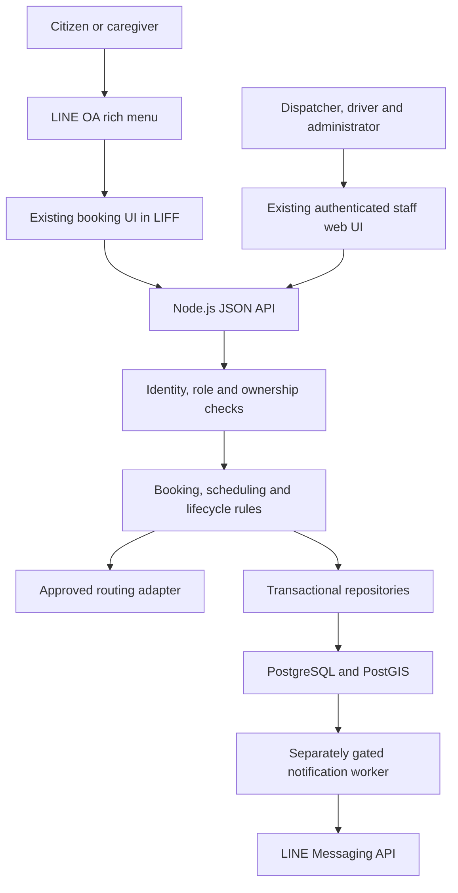
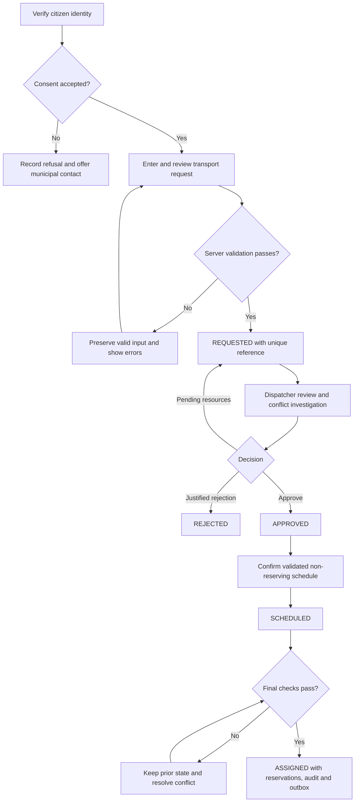
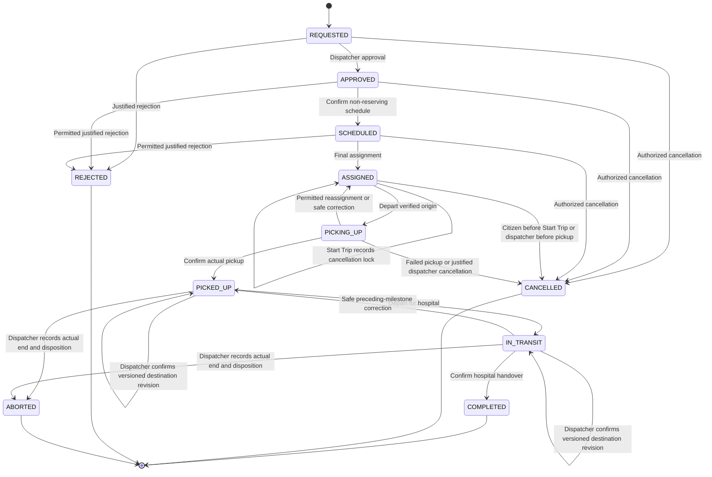
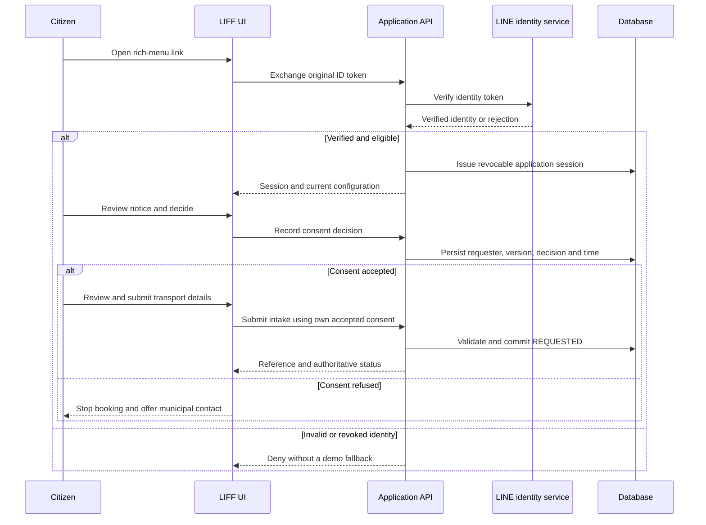
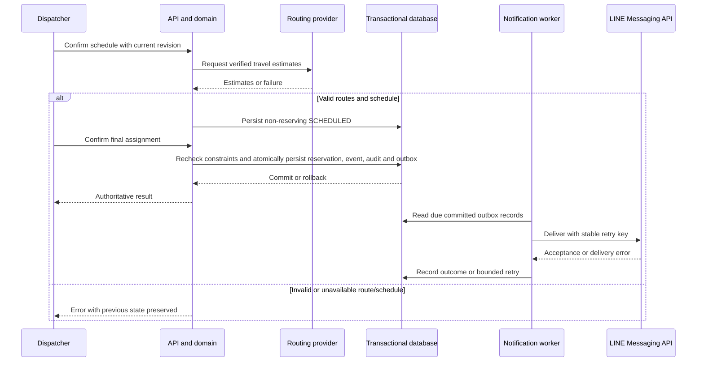
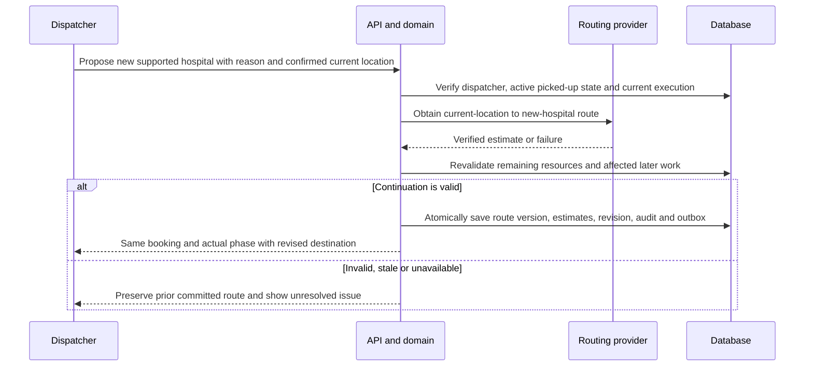

# Software Requirements Specification

**System:** Ban Klang Municipality Non-Emergency Patient Transportation System  
**Document ID:** SRS-BK-2026  
**Version:** 2.1 — refined team requirements baseline  
**Date:** 11 November 2026  
**Status:** Project implementation baseline; municipal acceptance pending  
**Completion target:** Before the end of November 2026, with final delivery scheduled for 30 November 2026  
**Languages:** Thai product interface and user guides; English technical specification

This document defines the required final system. It is not a claim that every feature is already implemented. It replaces the previously generated requirements/design pack as the primary specification. Original requirements and reference documents remain preserved as source records.

| Version | Date | Change | Authority/status |
|---|---|---|---|
| 1.3 | 10 Nov 2026 | Earlier detailed SRS and confirmed operational decisions | Preserved source baseline |
| 2.0 | 11 Nov 2026 | Consolidation into nine requested sections; embedded design diagrams, verification traceability, user-documentation requirements and November delivery plan | Requested by project owner; municipal review/sign-off pending |
| 2.1 | 11 Nov 2026 | Project-owner adoption of post-pickup destination-change rules, permission matrix, field validation, report calculations, notification/verification rules, measurable operational targets and acceptance planning; added FR-051 | Approved for the project baseline by the project owner's instruction; feasibility evidence and municipal acceptance pending |

## 1. Purpose and Scope

### 1.1 Purpose

The system shall support reservation, scheduling, human dispatch, execution and auditing of scheduled non-emergency patient transport operated by Ban Klang Municipality, Mueang Lamphun District, Lamphun Province. It shall replace fragmented form, notebook, telephone and calendar coordination with a shared, controlled operational record.

This SRS shall be used by the project team to implement the real application; by the documentation team to prepare diagrams, specifications and reports; by testers to derive acceptance scenarios; and by municipal stakeholders to review the service and authorize release.

### 1.2 Scope

The system shall support one-way transportation from an eligible pickup point within the municipality's 12 service villages to a supported hospital. Each trip shall carry one patient in one vehicle. Citizens or caregivers shall enter through a LINE Official Account rich-menu link opening the LINE LIFF booking interface. Dispatchers, drivers and administrators shall use authenticated web interfaces.

Included capabilities are consent, requester-owned saved patient information, booking intake, map/GPS pickup selection, backward scheduling, vehicle/driver conflict checks, dispatcher approval and assignment, driver milestones, cancellations and exceptions, LINE notifications, resource/master-data administration, closure and geospatial-change review, access controls, audit records, reports, and operational documentation.

Excluded capabilities are emergency dispatch, medical assessment, clinical-record integration, shared multi-patient rides, scheduled hospital-to-home return journeys, inter-hospital transfer booking, continuous live vehicle tracking, hardware telemetry, fares, payment/refund processing and commercial billing. An incident response may record an actual alternative patient arrangement without turning this platform into a return-trip or emergency dispatch service.

The current UI is the final visual baseline. The team shall preserve its layouts, typography, spacing, navigation, responsive behavior, cards and dialogs. Small additions or changes may provide controls required by this specification. The team shall not replace it with an unrelated workspace design.

### 1.3 Stakeholders and responsibilities

| Actor/stakeholder | Responsibility | Access boundary |
|---|---|---|
| Citizen/caregiver | Provide consent and accurate transport details; review, submit, track and permissibly cancel own requests | Own bookings and authorized saved profiles only |
| Municipal dispatcher | Review requests, resolve conflicts, confirm schedules and assignments, handle changes/incidents/readiness and operational reports | Authorized transport operations; reasons/history required for controlled decisions |
| Driver | Review assigned work, navigate to pickup, record actual milestones and report problems | Assigned shift work or active overruns; minimized finished-trip history |
| Administrator | Maintain accounts, roles, fleet/master data, geography/settings, closures, audit and authorized reports | No dispatcher decision authority or unrestricted patient access merely because of administrator status |
| Municipal service owner | Confirm service data, operational policy, training and release acceptance | Accountable stakeholder; not an additional automatic application role |
| Project team | Implement, test, document and demonstrate the system | Development/test access shall use synthetic records unless separately authorized |

### 1.4 Definitions and requirement conventions

| Term | Meaning |
|---|---|
| Requester | Authenticated citizen/caregiver who owns a request; may differ from the patient |
| Appointment | Hospital appointment date/time used for backward scheduling |
| Hospital target | Appointment minus the fixed 20-minute arrival buffer |
| Pickup waiting | Explicit additional waiting at pickup, separate from verified route duration; zero by default |
| Origin | Depot, previous destination hospital for a chained trip, or dispatcher-verified pre-pickup handoff location |
| Turnaround | Fixed 30-minute preparation at the destination hospital, excluding depot return |
| Reservation | Planned interval allocated to vehicle and driver by final assignment |
| Operational hold | Actual unavailability that may outlast or remain after reservation release |
| Start Trip | Separately recorded event that keeps ASSIGNED but locks citizen cancellation |
| Execution version | Assignment identity/version used to reject actions by a superseded driver execution |
| ABORTED | Ended after actual pickup without hospital handover, with dispatcher-recorded disposition |
| Outbox | Persisted notification work committed with an operational transaction and delivered separately |
| RPO / RTO | Recovery point objective (maximum acceptable data loss: one hour) / recovery time objective (restore verified service within four hours) |
| SUS | System Usability Scale; report results if collected, without an invented acceptance threshold |

“Shall” denotes a requirement. Must requirements are mandatory for acceptance. Should requirements require implementation or an explicit, recorded stakeholder decision to defer them. Detailed FR-001–FR-050 retain their existing identifiers; FR-051 extends the baseline for post-pickup destination changes. Original reference FR-01–FR-12 are a separate namespace. No original FR-13–FR-26 catalog is assumed.

### 1.5 Assumptions, dependencies and items requiring confirmation

Fixed business decisions in this SRS shall not be reopened merely because earlier prototype code behaves differently. The following actual values/approvals remain to be supplied or verified; they shall not be invented:

| ID | Item | Decision owner | Required before |
|---|---|---|---|
| O-01 | Approved 12-village service geometry, supported hospitals, depot and resource capabilities | Municipality | Service-data acceptance and live operation |
| O-02 | Actual closure calendar/source and dates | Municipality | Calendar acceptance and live operation |
| O-03 | Official municipal contact number, current privacy wording, caregiver authority and privacy responsibilities | Municipality/privacy reviewer | Final citizen acceptance and live operation |
| O-04 | Retention durations, deletion/anonymization rules and legal-hold procedure | Municipality/privacy reviewer | Retention acceptance and live operation |
| O-05 | LINE provider/channels/LIFF settings, approved routing/maps, hosting/domain/TLS and secret ownership | Service owner and technical team | Live integration and deployment acceptance |
| O-06 | Municipal confirmation of daily/monthly report fields within section 2.7 | Municipality | Report sign-off |
| O-07 | Hosting feasibility and measured evidence for the adopted targets in section 3.3; approved load-test workload and backup/recovery procedure | Service owner and technical team | Operational performance/recovery acceptance |
| O-08 | Named reviewers/owners, recruitment for the adopted ten-user/seven-senior cohort, team capacity and exact tested device/browser versions | Project owner and municipality | Test scheduling and milestone commitment |

These open service inputs do not authorize omission of required product features. Where an input is missing, development shall use explicit synthetic configuration and mark corresponding live acceptance as pending. November delivery shall not be represented as authorization for real-patient operation without the acceptance gates.

Earlier operational targets were unspecified. The project owner has now adopted the recommendations as the project baseline in section 3.3. Their successful measurement, hosting feasibility and municipal acceptance remain to be established under O-07; target adoption is not evidence that the deployed service meets them.

### 1.6 Source records and precedence

This SRS consolidates the [preserved earlier SRS](SRS-Complete-Official-EN.md), [completed production inputs](PRODUCTION-INPUTS.md), [actors](../../reference_files/user-roles-and-actors.md), [use cases](../../reference_files/use-case-list.md), [functional/non-functional references](../../reference_files/NR_and_NFR.md) and [system logic](../../reference_files/designs/system-logic.md).

Confirmed project-owner decisions, including the revised November completion target, take precedence over superseded seminar scope and earlier proposed designs. This document governs the required target behavior; the implementation plan records actual progress separately. Municipal approval fields shall remain pending until the named stakeholders actually approve them.

## 2. Functional Requirements

### 2.1 Citizen consent and booking

| ID | Priority | Requirement | Acceptance tests |
|---|---|---|---|
| FR-001 | Must | The system shall display the current privacy/consent notice before the citizen can access the booking form. | TC-C01, TC-P01 |
| FR-002 | Must | The system shall record accepted/refused consent, authenticated requester, notice version and server timestamp. | TC-C01, TC-P01 |
| FR-003 | Must | Refusal shall stop digital booking and display the approved municipal telephone alternative. | TC-C01 |
| FR-004 | Must | The system shall support booking for the requester or another patient, preserving patient/requester distinctions. | TC-C02 |
| FR-005 | Must | The system shall offer eligible previously saved patient information for requester-authorized auto-fill and review. | TC-C02, TC-C06, TC-P01 |
| FR-006 | Must | Submission shall be at least 48 hours before the appointment. There shall be no maximum advance booking horizon. | TC-C03 |
| FR-007 | Must | Citizen booking screens shall show a persistent non-emergency notice and emergency contact link for 1669. | TC-C01, TC-U01 |
| FR-008 | Must | The system shall capture standard seating, wheelchair or stretcher needs and permitted additional functional assistance. | TC-C02, TC-C06, TC-D02 |
| FR-009 | Must | The system shall accept pickup coordinates from GPS or a draggable/manual map pin and provide a manual alternative when GPS fails. | TC-C04 |
| FR-010 | Must | The server shall validate pickup eligibility against the approved 12 service villages. | TC-C04, TC-P01 |
| FR-011 | Must | The citizen shall review patient/contact, destination, appointment, assistance and pickup details before submitting. | TC-C02 |
| FR-012 | Must | The system shall issue a unique booking reference and display the request's authoritative status. | TC-C05 |
| FR-013 | Should | Valid draft input shall survive validation/service errors and remain editable before submission. After submission, changes shall be handled by a dispatcher, not direct citizen editing. | TC-C02, TC-C06, TC-F01 |
| FR-014 | Must | A citizen shall cancel only their own booking before the designated driver's Start Trip has occurred. Reassignment shall not reset this cutoff. | TC-C05, TC-R01 |

Citizen flow: verify LINE identity → display notice → record decision → enter/reuse patient and appointment details → assistance and pickup → review/correct → submit REQUESTED → display reference/status. A refused notice or unverified identity shall not be bypassed by a direct route or browser storage.

The interface shall preserve a manually chosen pickup if a delayed GPS callback arrives later. Saved profile selection shall populate only the authenticated requester's authorized records; the user shall review them before submission. Existing browser demo data shall not be silently uploaded as authenticated production data.

#### 2.1.1 Shared field-validation dictionary

Client validation shall provide immediate guidance; server validation shall enforce the same rules and return field-specific errors without erasing valid input. String limits below are Unicode code points after trimming, applied consistently to Thai and other text; phone normalization follows the explicit rule below. The API and database shall reject or safely handle over-limit input consistently. Phone format validation is not proof of ownership or reachability; optional verification records remain separate.

| Field | Required/allowed values | Validation and history rule |
|---|---|---|
| Patient name | Required; 1–120 characters | Trim outer whitespace; accept Thai and other human names without an alphabet-only restriction; preserve display spelling |
| Requester name | Required; 1–120 characters | Preserve requester separately from patient; self-booking may initialize it from the patient name after review |
| Contact phone | Required Thai mobile number | Remove spaces/hyphens; accept domestic `0` followed by nine digits, or `+66` followed by the corresponding nine national digits; store the normalized ten-digit domestic form. Reject other formats with a clear message |
| Pickup address | Required; 1–1,000 characters | Must accompany a verified coordinate/service-village selection; an address alone does not establish geographic eligibility |
| Landmark | Optional; maximum 1,000 characters | Transport directions only; no clinical information |
| Coordinates | Required finite numeric latitude/longitude | Latitude −90 to 90; longitude −180 to 180; server checks the approved village geometry and active scope |
| Village and hospital | Required active catalog references | IDs must exist and remain eligible when the server commits; a UI label is not authoritative |
| Appointment | Required timezone-aware date/time | Interpret/display in Bangkok time; enforce the 48-hour rule at submission and scheduling rules thereafter |
| Mobility | Exactly one: `standard`, `wheelchair`, `stretcher` | Match required resource capabilities |
| Additional assistance | Set of controlled codes; empty means none | `boarding_support` = assistance getting on/off the vehicle; `caregiver_accompanies` = caregiver travels with patient. These preserve the current UI choices; no free-text clinical category. Dispatcher confirms operational feasibility before assignment |
| Booking relationship | Self or caregiver/other patient | Self does not require a separate relationship description; caregiver identification/authority follows the approved notice and O-03 |
| Operational reason/note | Required for the action where specified; 1–1,000 characters | Nonblank after trimming; transport actions/arrangements only. An optional note may be empty but must respect the same length/content boundary |
| Actual end location and patient disposition | Required for ABORTED; each 1–1,000 characters | Describe actual location and confirmed handoff/next arrangement; never replace with a fabricated hospital completion |
| Profile, consent, revision and execution references | Valid server-issued values | Enforce authenticated ownership/current notice/current revision or execution; reject unknown intake fields |

Changing a saved profile shall affect future form auto-fill only. Submitted bookings shall retain their submitted data and consent snapshot; they shall not silently change when a profile or account display name changes. A newer notice version shall require the applicable current consent decision before a new booking; it shall not overwrite prior consent history or automatically invalidate previously accepted transport. Any retrospective policy action requires an explicit approved municipal procedure.

### 2.2 Scheduling and resource management

| ID | Priority | Requirement | Acceptance tests |
|---|---|---|---|
| FR-015 | Must | The server shall obtain verified road travel estimates from the actual origin to pickup and from pickup to hospital. | TC-D02, TC-F01 |
| FR-016 | Must | Hospital target arrival shall equal appointment time minus 20 minutes. | TC-D02 |
| FR-017 | Must | Pickup shall equal target arrival minus pickup-to-hospital travel and explicit pickup waiting. Waiting shall not falsify the route estimate or target. | TC-D02, TC-D03 |
| FR-018 | Must | Departure shall equal pickup minus origin-to-pickup travel. Chained departures shall respect preceding readiness and both resources' location continuity. | TC-D02, TC-D03 |
| FR-019 | Must | Planned readiness shall equal target hospital arrival plus 30 minutes at that hospital. Actual delays, active work and unresolved holds shall prevent premature reuse. | TC-R01, TC-R04 |
| FR-020 | Must | The complete interval shall fit the availability, capability, service and readiness constraints of both vehicle and driver. | TC-D02, TC-D04 |
| FR-021 | Must | The system shall prevent overlapping committed reservations for either vehicle or driver, including concurrent assignment requests. | TC-D04 |
| FR-022 | Must | Resource unavailability shall retain REQUESTED for dispatcher review and notify the dispatcher rather than automatically reject or reserve resources. | TC-D01, TC-F01 |

Using appointment `A`, verified origin travel `R1`, verified hospital travel `R2` and waiting `W >= 0`:

```text
Hospital target = A - 20 minutes
Pickup          = Hospital target - R2 - W
Origin departure= Pickup - R1
Planned ready   = Hospital target + 30 minutes
Reservation     = [Origin departure, Planned ready)
```

Time calculations shall use timezone-aware instants and the Bangkok service day. Fixed operating hours are 06:00–16:00; the full planned interval shall respect those hours, explicit closures and resource windows. Adjacent intervals may share a boundary. Routes shall retain their provenance and shall not be replaced with fabricated duration values when routing fails.

Example: appointment 09:00, pickup-to-hospital travel 35 minutes, origin-to-pickup travel 30 minutes and no extra waiting produce target 08:40, pickup 08:05, departure 07:35 and planned readiness 09:10. A subsequent hospital-origin leg must additionally validate actual readiness and travel to its next pickup.

### 2.3 Dispatcher operations

| ID | Priority | Requirement | Acceptance tests |
|---|---|---|---|
| FR-023 | Must | Dispatchers shall view incoming requests, complete transport details and scheduling guidance. | TC-D01 |
| FR-024 | Must | Dispatchers shall approve valid requests without a mandatory approval reason. | TC-D01 |
| FR-025 | Must | Dispatchers shall change permitted vehicle/driver/schedule details only after fresh routing, availability and downstream checks. | TC-D03 |
| FR-026 | Must | Every dispatcher modification shall store a nonblank reason, actor, timestamp and preserved previous history. | TC-D03, TC-P01 |
| FR-027 | Must | Rejection shall require a persisted nonblank reason visible as appropriate to the requester. | TC-D01 |
| FR-028 | Must | Dispatchers shall investigate and recheck resource conflicts before rejecting for insufficient capacity. | TC-D01, TC-D04, TC-D05 |
| FR-029 | Must | Dispatchers shall view and follow daily assignments, actual progress and exceptional outcomes. | TC-D01, TC-R04 |
| FR-030 | Should | Dispatchers shall record optional inspection/verification call outcomes and permitted operational notes. | TC-D01, TC-D05 |
| FR-031 | Must | Pre-pickup reassignment shall revalidate resources/routes, record required handoff arrangements, notify old/new crews and reject stale execution actions. | TC-D03, TC-R01 |

Approval, confirmed schedule and final assignment shall be separate operations producing APPROVED, SCHEDULED and ASSIGNED respectively. A confirmed schedule proposal shall not reserve resources. Final assignment shall atomically recheck current state, commit both reservations and persist the event, audit and applicable notification work.

Submitted appointment/hospital/pickup changes shall be reviewed by the dispatcher and committed only with successful recalculation and validation. On failure, original details and confirmed reservations shall remain. Changes affecting subsequent work shall generate review/conflict handling rather than silent schedule replacement.

After Start Trip but before pickup, reassignment shall require a dispatcher-confirmed location, operational arrangement and confirmation no older than five minutes and not earlier than the start. A replacement assignment shall establish a new execution version. Released old crew may remain held; their holds shall not falsely block a verified replacement crew merely because both relate to the same booking.

#### 2.3.1 Possible duplicates and verification

A duplicate warning shall compare an existing patient-profile identity where available, plus normalized patient name, contact phone, hospital and appointment instant. A matching name alone shall not establish identity. The baseline flag is an exact match of normalized name/contact/hospital/appointment; other similarity rules require a separately documented change. The same-profile/appointment match shall also be considered where contact details differ.

Warnings shall support review; they shall not automatically reject, merge or cancel a request. Citizens shall not receive other requesters' identities/details through a duplicate check. Cross-requester comparisons and review details belong to the authorized dispatcher view. UI retry/double-click deduplication shall use request/event identity separately from this possible-duplicate rule.

Optional call verification outcomes shall be `confirmed`, `correction_needed`, `unreachable`, or `requester_declined`, with authorized actor, server timestamp and permitted notes. Recording an outcome shall not itself change booking status or bypass the separate approval/rejection/cancellation rules. Corrections to verification records shall preserve earlier history.

Before a capacity-based rejection, the dispatcher shall record a fresh server availability/conflict result, the vehicle/driver alternatives considered and why none provides a valid service arrangement. At least one current conflict/availability check shall be linked to the decision. If the state/resource revision changes before rejection, recheck. Rejection still requires an explicit reason; neither an unreachable call nor a duplicate warning shall automatically cause it.

### 2.4 Driver execution

| ID | Priority | Requirement | Acceptance tests |
|---|---|---|---|
| FR-032 | Must | Drivers shall see assigned daily work, approved pickup/navigation information, hospital/appointment and required assistance within their authorized operational scope. | TC-R01, TC-P01 |
| FR-033 | Must | The normal lifecycle shall be REQUESTED → APPROVED → SCHEDULED → ASSIGNED → PICKING_UP → PICKED_UP → IN_TRANSIT → COMPLETED. | TC-R01 |
| FR-034 | Must | Start Trip shall persist separately while leaving ASSIGNED unchanged and locking citizen cancellation. | TC-R01, TC-C05 |
| FR-035 | Must | Depart Origin shall move ASSIGNED to PICKING_UP and identify the verified depot, previous hospital or handoff origin. | TC-R01 |
| FR-036 | Must | Confirm Patient Pickup shall move PICKING_UP to PICKED_UP for the current assigned driver execution only. | TC-R01 |
| FR-037 | Must | Depart for Hospital shall move PICKED_UP to IN_TRANSIT after required waiting/preconditions. | TC-R01 |
| FR-038 | Must | Confirm Hospital Handover shall move IN_TRANSIT to COMPLETED and retain required turnaround/readiness restrictions. | TC-R01, TC-R04 |
| FR-039 | Must | A driver shall report failed pickup only before actual pickup, with a reason; the reservation shall be cancelled/released while operational holds remain. | TC-R04 |

The driver identity shall come from the verified staff account's linked roster, never a browser-selected or first available driver. Commands shall carry current revision/execution information. The server shall prevent a driver or vehicle from starting another job while still executing an incompatible active job or hold. The interface shall show an update as unconfirmed until server commitment, preserve input on failures and require safe reconciliation after uncertain outcomes.

Operational details shall be available only for assigned current-day work during verified shifts or an already active overrun. Finished history shall expose reference, outcome/status and date only; it shall not retain patient/contact/pickup details as history. Continuous live tracking is outside scope.

### 2.5 Notifications, administration, audit and reports

| ID | Priority | Requirement | Acceptance tests |
|---|---|---|---|
| FR-040 | Must | Applicable booking confirmation, schedule/assignment changes, lifecycle, cancellation and rejection notifications shall be delivered through LINE using auditable, retry-safe outbox processing. | TC-N01, TC-N02, TC-F01 |
| FR-041 | Must | Administrators shall manage vehicle, driver, hospital, service-village and system-configuration data with purpose-limited permissions. | TC-A01 |
| FR-042 | Must | Relevant geospatial-setting changes shall create recalculation proposals for affected trips that have not started. | TC-A02 |
| FR-043 | Must | Existing confirmed schedules shall remain authoritative until a dispatcher reviews and accepts a valid replacement. | TC-A02 |
| FR-044 | Must | Vehicle/driver deactivation shall be blocked while the resource has unfinished operational work. | TC-A01 |
| FR-045 | Must | Suspension or role reduction shall revoke affected existing sessions promptly; stale access shall not continue. | TC-P01 |
| FR-046 | Must | Administrator and dispatcher actions shall be attributed and audited with necessary timestamps, entities and reasons/history. | TC-P01 |
| FR-047 | Must | The system shall produce daily dispatch manifests as `.xlsx` and printable PDF, and monthly `.xlsx` reports with the three specified sheets, subject to municipal field acceptance. | TC-X01, TC-X02 |

Notification provider acceptance shall not be displayed as message-read confirmation. Transient delivery failure shall retry with stable deduplication keys and bounded scheduling; permanent failure shall be visible to authorized staff. Missing credentials shall not produce fake delivery success. No confidential clinical content shall be included in messages.

Administrative geospatial and closure changes shall not silently approve operational replacements or cancel assigned jobs. Administrators initiate configuration changes; dispatchers own confirmation of replacement schedules, including UC-28. Suspected duplicates and optional verification shall support human review, not automatic abuse rejection based on unapproved heuristics.

#### 2.5.1 Notification event and recipient matrix

| Event | Required audience | Minimum permitted content |
|---|---|---|
| Request received | Authenticated requester; authorized dispatcher work queue | Booking reference, REQUESTED status and authenticated review/status link |
| Final assignment | Requester and assigned driver | Reference, confirmed pickup timing, assignment/status and authenticated operational link |
| Schedule/destination change | Requester and affected currently assigned driver; dispatcher change record | Reference, revised necessary timing/status and authenticated details link |
| Reassignment | Requester, old driver and new driver | Reference and explicit assignment-changed/removed/assigned meaning; superseded driver loses operational access |
| Failed pickup | Requester and authorized dispatchers; reporting driver receives confirmation | Reference, failed-pickup/cancellation outcome and instruction that readiness remains controlled |
| Incident or resolution | Authorized dispatchers and relevant requester/current driver | Reference, operational status and next-action/contact guidance without clinical detail |
| Rejection or cancellation | Requester and any affected assigned driver; dispatcher record | Reference, outcome and permitted reason or authenticated reason link |
| Hospital handover/COMPLETED | Requester and relevant assigned driver; dispatcher record | Reference and actual completion outcome; do not imply that turnaround is already waived |
| ABORTED | Requester and relevant driver; authorized dispatcher record | Reference and distinct ABORTED outcome with appropriate contact/details link, not a false completion |

A dispatcher audience may be fulfilled by the authenticated work/alert queue; LINE delivery to staff requires a verified staff LINE binding and must not replace staff web authorization. Reporting staff receive an immediate API/UI confirmation; redundant LINE messages need not duplicate that acknowledgement unless they are an intended recipient. Multiple roles held by one person shall not create duplicate messages for the same event/recipient.

Messages shall exclude patient names, phone numbers, pickup coordinates/addresses and detailed patient dispositions by default. Provide necessary timing and an authenticated link for authorized details. Loss of recipient authorization shall block sensitive link access even if an earlier message exists.

Delivery shall permit five attempts total: the initial attempt and up to four retries, scheduled after delays of 1, 5, 30 and 120 minutes from the preceding failed attempt. If a provider explicitly requires a later retry time, respect that later time while retaining the five-attempt bound. Transient failures alone are retryable; permanent failures such as an invalid/unverified recipient shall go directly to the visible failure queue. Exhausted retries shall also enter that queue with attempt count, sanitized failure, event/recipient reference and next staff action. A named dispatcher shall review booking-related delivery failures during service hours; configuration failures shall also alert the technical service owner. Retries shall retain the event/recipient deduplication identity and shall not create a second operational transaction or false read receipt.

### 2.6 Corrections, cancellation, incidents and readiness

| ID | Priority | Requirement | Acceptance tests |
|---|---|---|---|
| FR-048 | Must | Only dispatchers shall correct an accidentally recorded milestone to its immediately preceding permitted milestone, with reason, preserved history, physical-state confirmation and affected-work validation. Actual pickup and terminal work shall not be reversed. | TC-R02 |
| FR-049 | Must | Only dispatchers shall record ABORTED from PICKED_UP or IN_TRANSIT when transport ends without hospital handover, with reason, actual end time/location and patient handoff/next arrangement; readiness holds shall remain. | TC-R03, TC-R04 |
| FR-050 | Must | Administrators shall maintain closure dates; new closures shall flag existing assignments for dispatcher review without silently cancelling them, and new/changed schedules shall enforce closures. | TC-A02 |
| FR-051 | Must | After actual pickup, a dispatcher shall change to an active supported hospital only through a justified, versioned route-leg revision on the same booking, preserving actual pickup/history, confirming current location and revalidating resources/downstream work; ABORTED shall be used only if transport actually ends without handover. | TC-R05 |

| Situation | Required procedure |
|---|---|
| Citizen cancellation before Start Trip | Verify ownership/cutoff, record cancellation and release applicable reservation without deleting history |
| Dispatcher cancellation after Start Trip but before actual pickup | Require reason; cancel under dispatcher authority and retain operational readiness holds |
| Accidentally recorded Start Trip | Only dispatcher may undo before Depart Origin, with reason and history; do not unlock a citizen cutoff already established by a real start/reassignment |
| Failed pickup | Driver records reason before pickup; CANCELLED, reservation released, physical readiness still controlled |
| Incident/breakdown | Driver reports and contacts dispatcher; preserve actual stage and block unsafe progression while intervention is arranged |
| Safe continuation | Dispatcher records reason and confirmed resolution; resume only when domain/resource constraints permit |
| Patient already onboard, transport cannot reach hospital | Record ABORTED with actual end/disposition; never relabel as failed pickup, routine citizen cancellation or completed handover |
| Readiness after ended work | Confirm each resource's actual location/readiness; enforce active-work/turnaround checks. Partial release does not imply all resources ready; finalize an ended open incident only after its last hold is released |

COMPLETED, CANCELLED, REJECTED and ABORTED are terminal booking outcomes. Terminal outcome alone shall not waive remaining operational holds or privacy restrictions. Original incident/events shall remain in history when resolution or correction records are appended.

#### 2.6.1 Destination change after actual pickup

This is distinct from pre-pickup modification/reassignment. The dispatcher shall retain the same booking/reference and actual pickup event. The driver shall not independently change the recorded destination, restart the trip, re-record pickup or reopen citizen cancellation.

This continuation applies to a supported-hospital destination during the same active pickup journey. It does not introduce standalone hospital-to-hospital transfer or hospital-to-home booking, which remain outside scope.

The dispatcher shall record the reason, an active supported destination hospital, a physically confirmed current location and the proposed continuation. Physical confirmation shall be no older than five minutes, no later than server time and not earlier than actual Start Trip. Obtain a verified route from that location to the new hospital, recompute remaining travel/readiness and evaluate the current vehicle/driver and affected later work. Preserve the prior hospital, appointment commitments, route estimates and milestones in history; never alter them merely to fabricate an on-time arrival. Revised arrival estimates and lateness shall be recorded separately from the original target.

Keep PICKED_UP or IN_TRANSIT according to the confirmed physical state. A destination revision is not permission to reassign an onboard patient through the pre-pickup reassignment command. If a different transport arrangement is actually needed, record dispatcher intervention and the real handoff/disposition; ABORTED is appropriate only when this booking's transport actually ends without hospital handover.

Commit the new route-leg version, destination/estimate changes, revision or execution invalidation, affected resource/downstream validation, audit and applicable outbox in one transaction. Failure shall preserve the earlier committed route/assignment and keep incident/hold restrictions visible. Stale driver commands shall fail and require reloading the new operational view. An active late trip may overrun its planned service interval; do not falsify timestamps to fit the normal booking formula or allow incompatible later work. Downstream conflicts require dispatcher resolution before confirming a continuation that purports to make those resources available.

### 2.7 Required report contents

The daily manifest shall contain booking reference/date, patient/requester names, authorized contact, pickup address/village/coordinates/landmark, destination and appointment, calculated departure/pickup and actual origin, vehicle/driver, mobility, lifecycle status and permitted verification/exception notes. Exclude prohibited clinical data.

The monthly workbook shall contain: (1) service summary with requests, approved/completed/cancelled/rejected/aborted/failed-pickup totals and completion rate; (2) totals by the 12 villages; and (3) hospital/fleet summary by hospital, vehicle, driver, mobility and outcome. ABORTED shall not count as completed or failed pickup. Reports shall enforce authorized scope/field minimization, state the reporting period/export time and record export activity. Final municipal field acceptance is O-06.

#### 2.7.1 Period, counting and rate definitions

Daily and monthly reports shall select the booking cohort by appointment date in Bangkok time: the start of the selected day/month inclusive to the start of the next day/month exclusive. Use a transactionally consistent dataset and label the export's `as of` timestamp, filters and Bangkok reporting period. Counts describe the selected cohort as known at generation time; they are not counts of events merely received during the calendar month.

The monthly cohort includes all valid submitted booking references in that appointment period. The daily dispatch manifest additionally selects bookings with committed assignment history; retain relevant cancelled/aborted/completed assigned trips and their historical crew references rather than inventing assignments for pending requests. The exported filters shall make this difference explicit. A daily operational summary, if included, shall state whether it describes assigned-manifest rows or the full request cohort and shall not mix their totals.

Every booking shall belong to exactly one current outcome/state bucket:

- `completed`: current state COMPLETED.
- `aborted`: current state ABORTED.
- `failed_pickup`: current state CANCELLED with a recorded FAILED_PICKUP event.
- `other_cancelled`: current state CANCELLED without a FAILED_PICKUP event.
- `rejected`: current state REJECTED.
- Open work: counts for each of REQUESTED, APPROVED, SCHEDULED, ASSIGNED, PICKING_UP, PICKED_UP and IN_TRANSIT.

The sum of these mutually exclusive buckets shall equal total distinct booking references in the cohort. A displayed combined cancelled total, if present, shall be explicitly labeled `failed_pickup + other_cancelled` and shall not be added again to those subcategories. Approved totals shall be a separate activity measure: distinct cohort bookings that have an APPROVE event by the report's `as of` time; this may overlap later outcomes and shall not be summed into the outcome total.

```text
Service completion rate (%) =
  completed / (completed + aborted + failed_pickup) * 100
```

This rate measures completed versus the specified ended service attempts; rejected, other-cancelled and open work are excluded from its denominator. If the denominator is zero, display `N/A`, not zero percent. Calculate from unrounded counts and display to one decimal place. Village, hospital and fleet groupings shall use the same cohort and category rules, with a clearly labeled unassigned/not-applicable bucket where no resource was assigned. The API and exported sheets shall use these same definitions.

## 3. Non-functional Requirements

| ID | Requirement | Verification/acceptance basis |
|---|---|---|
| NFR-01 | At least 90% of participants and 85% of seniors shall complete a normal booking within 120 seconds. | Baseline cohort of ten including seven seniors: at least nine overall and six seniors; apply the documented task/timing rules in section 7.3 |
| NFR-02 | Defined scheduling simulations shall produce zero vehicle or driver reservation collisions. | Deterministic scenarios, boundaries and concurrent transaction tests |
| NFR-03 | Citizen UI shall target WCAG 2.1 AA practices, at least 16px primary text, high contrast and at least 48px touch targets. | Automated checks plus manual keyboard/focus, screen-reader, contrast, text-size and touch inspection |
| NFR-04 | The system shall enforce transport-data minimization, explicit consent and verified purpose/role/ownership controls. | Privacy review, negative authorization tests, field inspection and consent/audit evidence |

### 3.1 Security and privacy qualities

Production access shall use HTTPS. Passwords and session tokens shall not be stored in plaintext; secrets shall remain server-side and outside version control/frontend bundles. Authentication, ownership, account status and role authority shall be validated on every protected operation. User input shall be validated at the API boundary; SQL access shall use parameterization and database constraints. Untrusted client role, state, routing estimates or lifecycle recording time shall not become authority.

Session expiry/revocation/logout shall deny subsequent protected access without a prototype fallback. Authentication abuse controls and safe errors shall avoid exposing credentials or unnecessary internal details. Personal data shall not be sent to unapproved third-party services or third-party AI systems. The municipality shall confirm applicable privacy roles, notices, legal basis, caregiver authority and retention procedures; this specification is not a legal approval.

The following permission matrix is normative. `Own` means authenticated requester ownership; `Assigned` means the current driver execution within authorized shift/active-overrun scope; `Operational` means necessary dispatcher service access; `Aggregate` excludes patient/contact/pickup details. A dash means denied. Role selection in a prototype is not a grant of any permission.

| Action/data | Citizen | Dispatcher | Driver | Administrator |
|---|---|---|---|---|
| Consent and saved profiles | Own | — | — | — |
| Create/review own draft and submit | Own | — | — | — |
| Read booking operational details | Own | Operational | Assigned active work | — |
| Read ended-trip history | Own booking status | Operational | Reference/status/date only | Aggregate reports only |
| Citizen cancellation | Own, before Start Trip | Separate justified dispatcher cancellation before pickup | — | — |
| Approve/reject, schedule/assign, pre-pickup modify | — | Yes, with applicable guards/reasons | — | — |
| Driver Start Trip/departure/pickup/transit/handover | — | — | Assigned, ordered and version-checked | — |
| Report failed pickup | — | Separate cancellation/intervention procedure | Assigned, before pickup only | — |
| Report transport incident | — | Operational | Assigned active work | — |
| Resolve incident, change post-pickup destination, correct, ABORT or confirm readiness | — | Yes, with physical/state/reason constraints | — | — |
| Manage accounts/roles/resources/windows/master data/configuration/closures | — | Read needed operational catalog only | Read needed assigned context only | Yes, with deactivation/revocation safeguards |
| Confirm geospatial replacement schedule | — | Yes, UC-28 | — | Initiate configuration/proposal only |
| Read audit/history | Own status/history only | Necessary operational history | Minimized own history | Protected administrative/minimized audit |
| Export patient-bearing daily manifest | — | Yes, for authorized service work | — | — |
| Export monthly aggregate report | — | Yes | — | Yes |
| Review booking delivery failures | — | Operational queue | Own command acknowledgement only | Sanitized configuration/service diagnostics only |

Administrators shall not receive patient-bearing exports or operational detail merely because of administrator status. Where one person performs multiple duties, use explicitly authorized role context; do not assume an administrator inherits dispatcher powers. Access reduction shall deny the next protected request after the revocation/account-change transaction commits. Approved privacy/support procedures outside this matrix require explicit documented authorization rather than an implicit broad access exception. Test both allowed actions and negative cells under TC-P02.

### 3.2 Reliability, consistency and recovery

Booking state, reservations, lifecycle events, holds, audit and applicable outbox entries shall commit atomically. Invalid/stale/concurrent operations shall not partially update records. Requests shall use stable event identity for safe retries; uncertain outcomes shall be reconciled with server state. Client pending/error states shall preserve valid input and prevent duplicate uncontrolled submission.

Routing failure shall preserve the existing booking/schedule and block unverified assignment. Notification failure shall not undo a valid committed transaction. Reconnection shall not skip milestones or create a false successful update. Backup and recovery procedures shall preserve both operational state and required history; restore shall be tested before live operation.

### 3.3 Performance, availability and maintainability

The following values are adopted project targets. The technical/service owners shall verify hosting feasibility and demonstrate them; municipal operational acceptance remains O-07. A feasibility failure requires a recorded owner decision and controlled baseline revision, not silent relaxation or a false passing result.

| ID | Adopted measurable target | Measurement/acceptance |
|---|---|---|
| NFR-P01 | Support 50 concurrent users | Record a reviewed workload mix, dataset, operation rate and test duration; exercise realistic citizen and staff operations rather than idle sessions alone |
| NFR-P02 | At least 95% of normal interactive API requests complete within 2 seconds under the agreed 50-user workload | Measure request-to-complete-response latency in the documented test environment; classify export generation and third-party-routing operations separately; errors do not count as successful business outcomes |
| NFR-P03 | At least 95% of routing-dependent interactive operations complete within 10 seconds under the agreed workload | Include provider interaction; a timeout shall show a clear failure with unchanged committed state, not fake scheduling success. Report availability/functional failures separately from latency |
| NFR-P04 | At least 99.5% availability during published service hours | Measure monthly across published open days, 06:00–16:00 Bangkok time. All unavailability of required booking/dispatch/driver service during those hours counts; do not silently exclude maintenance or provider-caused service failure |
| NFR-P05 | RPO at most 1 hour; protected automated database backup/recovery-point creation at least hourly | Monitor failed/stale backups; protect backups outside the primary database failure domain with restricted access and approved encryption. Prove restoration to a recovery point no more than one hour before the injected failure |
| NFR-P06 | RTO at most 4 hours | Measure from declared service failure until restored application/database service, access controls, history and pending-outbox behavior are verified; complete restore rehearsal before release and after material recovery-affecting changes |

For availability, usable critical service means the authenticated booking/status, dispatcher review/assignment and driver-recording paths function; showing a landing page while these fail is not availability. Record actual downtime and calculate `100 * (published service minutes - unavailable minutes) / published service minutes`. If no service minutes exist in a period, display `N/A`. Backup retention duration remains governed by O-04; the hourly recovery target does not invent a retention schedule.

Before release, verify the probes, downtime accounting and alerts with controlled outages and report availability over the actual pilot observation window. Label a partial-month observation as partial; do not claim that a short rehearsal proves a complete production month. The 99.5% monthly service-hour objective remains an operational obligation after activation, with the first complete monthly result reviewed by the service owner.

The code shall separate presentation, authenticated interfaces, domain rules and persistence. Schema changes shall use versioned migrations; applied migration history shall not be edited. Tests and requirement IDs shall remain traceable. Errors, audit and notification outcomes shall be observable to authorized operators without leaking secrets or clinical content. Logs shall support incident investigation under the approved retention/access policy.

The citizen interface shall be tested inside LINE on at least one Android device and one iPhone. Staff web acceptance shall include desktop Chrome and Edge, Android Chrome and iPhone Safari, with exact OS/browser/LINE versions recorded for the tested release. Automated desktop emulation shall supplement, not replace, the real-device LIFF checks. Critical operations shall remain understandable on small screens and when external services are unavailable.

## 4. System Architecture

### 4.1 Logical architecture and external boundaries

The system shall use the existing React/TypeScript frontend, a Node.js JSON API and PostgreSQL/PostGIS. LINE supplies citizen identity and applicable messaging; an approved routing service supplies travel estimates; approved map/navigation services support location interactions. Browser clients shall not access the database directly.



### 4.2 Component responsibilities and interfaces

| Component | Responsibility | Related requirements |
|---|---|---|
| Citizen presentation | Consent, profiles, intake, maps, review, own status/cancellation | FR-001–FR-014 |
| Dispatcher presentation | Review, scheduling, assignment, modifications, operations, verification and exports | FR-023–FR-031, FR-043, FR-047–FR-049 |
| Driver presentation | Scoped work, origin/navigation, ordered milestones, problem reports and minimized history | FR-032–FR-039 |
| Administration presentation | Master data, accounts, geography, closures, audit and reporting permissions | FR-041–FR-047, FR-050 |
| API/auth layer | Verified identities, purpose-limited reads/writes, validation, revisions and safe errors | All protected requirements, NFR-04 |
| Domain services | Schedule arithmetic/constraints, lifecycle, reassignment, corrections, revised route legs and readiness | FR-015–FR-022, FR-025–FR-028, FR-031, FR-033–FR-039, FR-048–FR-051 |
| Database/repositories | Atomic writes, constraints, schema/version history and audit/outbox persistence | FR-002, FR-012, FR-020–FR-021, FR-044–FR-046 |
| Notification delivery | Minimized templates, deduplication, retry and delivery-status evidence | FR-040 |

The API shall expose JSON boundaries for public configuration; staff/LINE login, current identity and logout; catalog; consent; owner-scoped profiles; booking create/read; lifecycle commands; schedule/assignment/modification; readiness; minimized driver history; authorized master/account/availability management; verification and recalculation review; closures/audit; and reports. Implementation of a boundary is not implied merely by its inclusion here.

The [detailed API document](../guides/API.md) and current physical schema provide existing concrete endpoint/field contracts. Remaining endpoint contracts shall be completed consistently with this SRS before their clients are wired. Command inputs shall include appropriate event identity and current revision/execution preconditions. The server shall own actor identity, state transitions, validated routes and recording timestamps. Actual end/handoff confirmation inputs shall be validated against server time and history.

### 4.3 UI ownership and implementation trace

| Route/surface | Existing implementation owner | Requirement scope |
|---|---|---|
| `/booking/*` | [BookingPage](../../src/pages/BookingPage.tsx) | FR-001–FR-014, citizen aspects of FR-040; NFR-01, NFR-03, NFR-04 |
| `/staff/login` | [StaffLoginPage](../../src/pages/StaffLoginPage.tsx), [RequireStaff](../../src/components/RequireStaff.tsx) | Verified staff authority, FR-045, NFR-04 |
| `/dispatcher/*` | [DispatcherPage](../../src/pages/DispatcherPage.tsx), [operational controls](../../src/components/DispatcherOperations.tsx) | FR-015–FR-031, FR-040, FR-043, FR-046–FR-049 |
| Post-pickup destination change in dispatcher trip operations | Dispatcher trip operations with separate destination preview/commit controls | FR-051; same booking and actual phase with versioned route-leg history |
| `/driver/*` | [DriverPage](../../src/pages/DriverPage.tsx), [driver API adapter](../../src/services/driverApi.ts) | FR-019–FR-021, FR-032–FR-040; dispatcher-owned exceptions remain dispatcher decisions |
| `/admin/*` | [AdminPage](../../src/pages/AdminPage.tsx) | FR-041–FR-047, FR-050 |
| Domain/API/storage | [Lifecycle](../../src/domain/lifecycle.ts), [scheduling](../../src/domain/scheduling.ts), [assignment](../../src/domain/assignment.ts), [API](../../server/app.mjs), [repositories](../../server/repository.mjs) | Server invariants, authorization and data consistency |

These are ownership pointers, not completion claims. The existing [actor/use-case catalog](../../reference_files/use-case-list.md) and [maintained diagram source](../../reference_files/use-case-diagram.md) preserve UC-01–UC-29. Original and detailed FR identifiers shall use the crosswalk in the preserved SRS; no IDs shall be silently repurposed.

### 4.4 Booking and dispatch activity



### 4.5 Lifecycle state model

The following state diagram shows principal paths. Incident and hold records supplement the state; Start Trip is not an extra booking state. Every transition remains subject to actor, ownership, revision, timing and physical-state rules.



### 4.6 Identity and booking sequence



### 4.7 Assignment and notification sequence



### 4.8 Post-pickup route revision sequence

The post-pickup destination operation shall have its own authenticated dispatcher boundary and shall not reuse the pre-pickup modification command with weakened guards. Its request shall contain event identity, expected booking/execution revision, destination hospital, reason, confirmed current location and physical-confirmation timestamp. The server shall obtain routes and recording timestamps and commit a new route-leg version without resetting actual pickup or the active phase. Exact transport/response schemas shall be maintained in the API specification; the implemented preview/commit contract is documented in [the API guide](../guides/API.md), with acceptance evidence and limitations in the integration plan.



No diagram shall be interpreted as allowing a bypass of the validation/authorization conditions in section 2. The current UI and source flows provide presentation detail; this SRS governs the required operational semantics.

## 5. Data Management

### 5.1 Data dictionary and ownership

| Entity group | Principal information | Ownership/invariants |
|---|---|---|
| Users and sessions | User ID, role, account/access status, staff credential hash or verified LINE identity link, session hash/expiry/revocation | Privileged fields are server-managed; access reduction revokes sessions |
| Consent | Requester, notice version, decision and recorded time | Booking requires that requester's applicable accepted decision |
| Saved patient profiles | Patient/contact, mobility, service village and saved pickup reference | Requester-owned; no cross-requester selection |
| Locations/villages/hospitals | Origin/destination points, eligible service geometry and active status | Approved operational master data; geographic validation on server |
| Service settings/closures | Depot, Bangkok timezone, fixed hours, configuration revision and explicit closure dates/reasons | Configuration changes retain appropriate proposal/audit history |
| Vehicles/drivers/windows | Capabilities, active status, linked driver user, actual positions and availability windows | No unsafe deactivation; both resources must satisfy constraints |
| Booking | Unique reference, requester/patient/contact, consent/profile reference, pickup/hospital, appointment, mobility/assistance, status, start/cancellation lock, revision and execution version | 48-hour lead time; purpose-limited fields; exact lifecycle and owner scope |
| Schedule/reservation | Booking/version, vehicle/driver, origin, route estimates/provenance, waiting, departure/pickup/arrival/readiness and commitment/release state | Non-reserving proposals distinct from committed reservations; no resource overlaps |
| Hold/position updates | Resource, related trip where applicable, actual location, start/end, reason and confirming actor/time | Physical availability is not inferred from reservation cancellation |
| Events/incidents/disposition | Ordered commands/history, actor/time, reasons, incident resolution, actual end/location and patient arrangement | Preserve originals; corrections/resolutions are attributable |
| Revised route legs | Booking, ordered leg/version, prior leg, confirmed actual origin, new supported hospital, route provenance/estimate, revised arrival/readiness, reason and authorizing actor/time | Preserve original pickup/commitments and active phase; atomically invalidate stale route/execution actions; add versioned persistence for FR-051 |
| Verification | Booking, authorized actor/time, outcome and operational notes | Optional verification is recorded without clinical data |
| Notifications | Recipient, booking/event, template, deduplication key, attempt/outcome/retry state | Minimized payloads and safe retries; no false read receipts |
| Audit | Actor, action, entity, time and reason/history reference | Protected, attributable and purpose-limited |

Physical tables, columns, types, foreign keys, checks and indexes are defined by ordered migrations [001](../../database/migrations/001_foundation.up.sql), [002](../../database/migrations/002_dispatch_changes.up.sql), [003](../../database/migrations/003_api_support.up.sql), [004](../../database/migrations/004_citizen_fields.up.sql), [005](../../database/migrations/005_consent_decisions.up.sql), [006](../../database/migrations/006_admin_accounts.up.sql) and [007](../../database/migrations/007_admin_resources.up.sql), [008](../../database/migrations/008_service_administration.up.sql), [009](../../database/migrations/009_destination_continuation.up.sql), [010](../../database/migrations/010_notification_review.up.sql), [011](../../database/migrations/011_notification_messages.up.sql), [012](../../database/migrations/012_assignment_labels.up.sql), [013](../../database/migrations/013_dispatch_review.up.sql), [014](../../database/migrations/014_capacity_evidence.up.sql). They are the current physical-schema reference, not a declaration of complete requirements acceptance. Required changes shall use new versioned migrations. The `trip_route_legs` entity below is persisted by migration 009; implementation verification and remaining acceptance limits are recorded in the integration plan.

### 5.2 Core entity relationships

```mermaid
erDiagram
  users ||--o{ auth_sessions : authenticates
  users ||--o{ consent_records : decides
  users ||--o{ patient_profiles : owns
  users ||--o{ bookings : requests
  consent_records ||--o{ bookings : authorizes
  patient_profiles o|--o{ bookings : populates
  service_villages ||--o{ bookings : contains_pickup
  hospitals ||--o{ bookings : receives
  locations ||--o{ hospitals : locates
  locations ||--o{ schedules : defines_origin
  users ||--o| drivers : links_roster
  vehicles o|--o{ availability_windows : has_windows
  drivers o|--o{ availability_windows : has_windows
  bookings ||--o{ schedules : preserves_versions
  vehicles ||--o{ schedules : assigned
  drivers ||--o{ schedules : assigned
  bookings ||--o{ trip_events : records
  bookings ||--o{ trip_route_legs : preserves_route_versions
  locations ||--o{ trip_route_legs : defines_confirmed_origin
  hospitals ||--o{ trip_route_legs : receives_revised_leg
  users ||--o{ trip_route_legs : authorizes
  bookings ||--o{ trip_incidents : encounters
  bookings ||--o| trip_dispositions : ends_with
  bookings o|--o{ resource_holds : relates_to
  vehicles o|--o{ resource_holds : held
  drivers o|--o{ resource_holds : held
  vehicles o|--o{ resource_position_updates : positioned
  drivers o|--o{ resource_position_updates : positioned
  locations ||--o{ resource_position_updates : confirms_position
  bookings ||--o{ verification_logs : verified
  bookings ||--o{ notifications : queues
  users ||--o{ notifications : receives
  users ||--o{ audit_logs : acts
  locations ||--o| service_settings : depot
  users ||--o{ service_closures : maintains
```



This is a logical relationship view. SQL constraints define exact optionality, resource-target combinations, uniqueness and temporal/geographic restrictions. Audit entity references are polymorphic and shall not be falsely represented as a booking-only foreign key.

### 5.3 Data lifecycle, retention and protection

The system shall collect only transport identities/contact, pickup, assistance, appointment/destination and necessary operational/security records. It shall not collect diagnoses, symptoms, medical history, medical records, laboratory results, physician notes, national ID scans, payment data or unrelated marketing data.

Records shall be validated on entry, scoped on every read/write and minimized in reports, notifications and finished driver history. Personal data shall not be copied into unrestricted logs, demonstrations or public screenshots. Development/test databases shall use fictional records; synthetic service geometry shall not be represented as the approved municipality boundary.

Consent, booking/assignment changes, incident resolution and audit evidence shall remain reconstructable. Account/profile/master changes shall not break historical records. Deletion/anonymization shall follow approved retention and legal-hold policy O-04; the team shall not choose an arbitrary duration or silently remove coordinates immediately after completion.

Backups shall be protected with restricted access and handled under the approved policy. Restore tests shall verify bookings, schedules, history, permissions and pending notification work, including safe post-restore retries. Backup frequency, recovery point and recovery time are O-07 and must be closed before operational sign-off.

## 6. User Documentation

### 6.1 Required user-facing documents

| Deliverable | Audience | Mandatory content |
|---|---|---|
| Citizen quick-start guide | Citizens/caregivers, including seniors | Open rich menu, consent/refusal, self/caregiver form, assistance, GPS/manual pickup, 48-hour rule, review, reference/status, cancellation cutoff, phone alternative and 1669 |
| Dispatcher operating guide | Fleet coordinators | Triage/verification, pending resources, separate approval/schedule/assignment, conflict resolution, justified rejection/change, chained origins, reassignment/handoff, incidents, ABORTED, corrections, readiness, closures/recalculation review and exports |
| Driver quick guide | Drivers | Verified login/shift scope, actual origin, navigation/contact use, separate Start Trip/departure, pickup/transit/handover, failed pickup, incidents, disconnection/retry and minimized history |
| Administrator guide | Authorized administrators | Accounts/roles/revocation, resources/capabilities/windows, master geography, closures, safe deactivation, proposal/audit boundaries and authorized reports |
| Service/privacy instructions | Public and authorized staff | Approved notice/contact, consent implications, request/complaint route, emergency exclusion and approved data-subject procedures |

User-facing guides shall be in clear Thai with screenshots from the actual accepted UI and fictional examples. They shall match button labels, workflow order and mobile behavior; no fabricated screen or unimplemented feature shall be presented as operational. Quick guides shall be suitable for printing or sharing through the municipality's approved channel.

### 6.2 Required technical and operational documents

The team shall maintain deployment/configuration instructions; secret ownership/rotation procedures without publishing values; migration/rollback limitations; API/data documentation; backup/restore instructions; monitoring and support contacts; routing/LINE outage procedures; failed-pickup, reassignment and post-pickup incident runbooks; retention/deletion and breach-response procedures; and release/rollback instructions.

Documents shall have a version/date, owner and applicable release. Updates to requirements, UI labels, APIs, diagrams and training materials shall be reviewed together. Training and a rehearsal using synthetic data shall be completed for dispatchers, drivers and administrators before operational acceptance. Staff acknowledgement and unresolved questions shall be recorded.

## 7. Testing Requirements

### 7.1 Test strategy and evidence

The team shall maintain requirement-to-test traceability and test both success and failure/unauthorized paths. Tests shall distinguish pure domain rules, physical database constraints, HTTP API behavior, browser integration, simulated external services and live configured integrations. Passing one layer shall not be described as proof of another.

Test evidence shall identify the requirement/test ID, build/version, date, environment, dataset, preconditions, steps/inputs, expected result, actual result, pass/fail, tester and defect/evidence reference. Screenshots/logs shall use synthetic or appropriately minimized data and shall not expose secrets. A failed or unavailable test shall remain failed/pending; it shall not be silently omitted.

### 7.2 Required acceptance scenarios

| Test ID | Requirement coverage | Required scenario/result |
|---|---|---|
| TC-C01 | FR-001–FR-003, FR-007 | Current notice gates intake; accept/refuse decisions persist; refusal offers official contact; emergency link remains visible |
| TC-C02 | FR-004–FR-005, FR-008, FR-011, FR-013 | Self/caregiver and authorized profile flows; correct assistance/review; draft editing and preserved valid input |
| TC-C03 | FR-006 | Exactly 48 hours accepted, earlier rejected, no maximum advance cap; explicit timezone interpretation |
| TC-C04 | FR-009–FR-010 | GPS refusal/timeout, manual pin, stale GPS race, service-boundary and inactive-village checks |
| TC-C05 | FR-012, FR-014 | Unique reference/true status; own-only access and cancellation; Start Trip and reassignment cutoff remain enforced |
| TC-C06 | FR-001–FR-005, FR-008, FR-011, FR-013 | Required/length/Unicode/phone/enum validation at client and server; rejected unknown assistance codes; saved-profile updates do not mutate bookings; current notice required for new intake while historical consent remains intact |
| TC-D01 | FR-022–FR-024, FR-027–FR-030 | Queue, pending resource handling, approval without reason, justified rejection, conflict investigation, daily view and optional call evidence |
| TC-D02 | FR-008, FR-015–FR-018, FR-020 | Both verified routes, fixed buffer, separate waiting, correct origin, service hours, capabilities and complete windows |
| TC-D03 | FR-017–FR-018, FR-025–FR-026, FR-031 | Earlier pickup, chained continuity, atomic detail/resource changes, failed-change preservation, fresh post-start handoff and old/new execution handling |
| TC-D04 | FR-020–FR-021, FR-028 | Vehicle and driver independent conflicts, adjacent intervals, proposals not reserving and concurrent commits with zero collisions |
| TC-D05 | FR-028, FR-030 | Exact/profile-based possible duplicates flag for human review without cross-requester disclosure or automatic rejection; all four verification outcomes retain actor/time/history; capacity rejection requires fresh conflict evidence and investigated alternatives |
| TC-R01 | FR-014, FR-019, FR-031–FR-038 | Verified driver scope, separate Start Trip/departure, ordered actions, stale driver/version rejection, second-job blocking and true hospital handover |
| TC-R02 | FR-048 | Only authorized preceding correction, physical confirmation/reason/history; no actual-pickup reversal, incident bypass or terminal reopening |
| TC-R03 | FR-049 | Post-pickup incident remains active; only dispatcher ABORT with actual end/location/disposition; distinct outcome and held resources |
| TC-R04 | FR-019, FR-029, FR-038–FR-039, FR-049 | Failed pickup, late work, actual turnaround, current versus old crew holds, partial readiness and final ended-incident resolution |
| TC-R05 | FR-051 | Dispatcher-only post-pickup supported-hospital change retains same reference, actual pickup/phase/history and original commitments; verified current location/route, stale-action rejection, atomic rollback, downstream/readiness checks and correct continuation versus ABORTED |
| TC-A01 | FR-041, FR-044 | Authorized master/account/window edits, valid references/capabilities and blocked unsafe deactivation |
| TC-A02 | FR-042–FR-043, FR-050 | Recalculation proposals and dispatcher confirmation preserve old schedule; closures flag existing work without silent cancellation |
| TC-P01 | FR-002, FR-005, FR-010, FR-026, FR-032, FR-045–FR-046; NFR-04 | Token/role/ownership negatives, consent/profile isolation, finished-detail denial, minimized history, audit attribution and access revocation |
| TC-P02 | Section 3.1 matrix; FR-045–FR-047, FR-051; NFR-04 | Exercise allowed and denied cells for every role, including administrator denial of patient-bearing daily exports and operational decisions; revocation denies the next protected request after commit |
| TC-N01 | FR-040 | Correct recipients/templates, transactional outbox, stable retry identity, bounded/permanent failures and no false read receipt |
| TC-X01 | FR-047 | Daily `.xlsx`/PDF and monthly three-sheet `.xlsx`, correct scope/fields/totals, separate ABORTED and audited export |
| TC-X02 | FR-047; section 2.7.1 | Bangkok day/month boundaries, consistent as-of cohort, exactly one outcome bucket per reference, cancelled subcategory exclusion, separate approval activity, rate denominator/one-decimal rounding and zero-denominator N/A |
| TC-F01 | FR-013, FR-015, FR-022, FR-040; reliability | Routing/LINE/network/database interruption, stale revisions and uncertain writes preserve valid state/input without false success |
| TC-U01 | FR-007; NFR-01, NFR-03 | Ten-person cohort including seven seniors: at least nine overall and six seniors complete within 120 seconds; inspect readable text, contrast, touch, keyboard/focus and the specified real-device/browser matrix |
| TC-O01 | NFR-04; section 5.3 | Approved retention/legal-hold behavior, backup restore, permissions and pending-outbox recovery |
| TC-O02 | NFR-P01–NFR-P06 | Documented realistic 50-user workload, 95th-percentile 2-second normal/10-second routing results, 99.5% service-hour availability method/evidence, hourly protected recovery points, RPO ≤1 hour and verified RTO ≤4 hours; record actual feasibility/result rather than assuming success |
| TC-N02 | FR-040; section 2.5.1 | Event/recipient/content matrix, staff queue versus verified LINE binding, initial attempt plus 1/5/30/120-minute retries, later provider retry instruction, permanent failure/exhaustion queue and stable deduplication |

### 7.3 Required test levels and execution conditions

- Domain tests shall cover lifecycle guards, cancellation lock, exact arithmetic, time boundaries, origin continuity, capabilities, readiness, corrections and reassignment.
- Database tests shall cover migrations, foreign keys/ownership, geography, temporal constraints, immutable history, collision exclusion and concurrent rollback behavior using temporary databases.
- API tests shall verify real authentication/authorization, persisted commands, version conflicts, idempotency, admin safeguards, limited history and outbox behavior.
- Browser tests shall exercise the existing UI across separate identities/sessions and mobile/desktop layouts. Full journeys shall include a real test API and PostgreSQL, not only intercepted responses.
- External integration tests shall use synthetic providers for reproducible failures and separately record live LINE/routing/map checks after approved configuration exists. Real outbound messages require the authorized test procedure.
- Usability tests shall use an agreed cohort including seniors. Record participant counts, task definitions, success rules and elapsed time; report SUS results if collected, without inventing an unapproved SUS pass threshold.
- Security/privacy tests shall include horizontal and vertical privilege attempts, expired/revoked sessions, driver reassignment, profile isolation and absence of prohibited fields/secrets in responses, exports, logs and messages.

The baseline usability cohort shall contain ten distinct participants, seven classified as seniors under the municipality-agreed recruitment criteria and three other representative users. At least nine of ten overall and six of seven seniors shall complete the normal task in no more than 120 seconds. For any separately approved expanded cohort, compute required successes by rounding `0.90 * total participants` and `0.85 * senior participants` upward; do not redefine the cohort after seeing results.

The timed task starts when the participant selects booking entry within a verified LINE session and ends when a valid submitted reference is displayed. It includes the notice/consent, form, pickup choice, review and submission, but not dispatcher approval. Use equivalent fictional eligible appointments/patient data; record assistance, errors, abandonment, provider/environment failures and timing. Unassisted success is required for the timed completion measure. A blocked/failed attempt shall remain recorded even if an environment-corrected repeat is performed; do not silently discard unfavorable results. Document recruitment criteria and test conditions before testing. This is the project's acceptance cohort, not a claim about population-wide usability.

Record Android/iPhone LINE tests and staff desktop/mobile browser/OS versions. Automated accessibility passes shall be accompanied by manual inspection; neither synthetic-provider tests nor developer screenshots constitute municipal acceptance.

### 7.4 Defects and regression control

Defects shall record severity, impacted requirement, reproduction, expected/actual behavior, owner and retest result. Fixes shall be verified at their responsible layer and through affected user flows. No unresolved defect that permits unauthorized disclosure, unsafe resource allocation, lost committed data, false completion or prohibited state transition shall remain at acceptance. Any accepted lower-impact deviation shall have an explicit named-owner decision and delivery plan.

## 8. Acceptance Criteria

### 8.1 Product acceptance

| Gate | Required evidence | Responsible acceptance parties |
|---|---|---|
| AC-01 Requirements | Every Must requirement implemented and traced to a passing test; every Should requirement implemented or explicitly dispositioned; original FR IDs retained | Project owner and municipal reviewer |
| AC-02 Integrated journeys | Citizen request → dispatcher review/schedule/assignment → driver handover → citizen status, plus permitted cancellation and failure/incident variants, verified through browser/API/database | Test lead and operational reviewers |
| AC-03 Scheduling safety | Correct route/buffer/waiting/turnaround calculations; zero defined simulation collisions and rejected concurrent conflicts | Test lead and dispatcher reviewer |
| AC-04 Authorization/privacy | Passing permission-matrix tests, field/profile/notice rules, verified identities, ownership/revocation, minimized history and approved data-handling/retention procedures | Technical lead and municipal/privacy reviewer |
| AC-05 Operations/exceptions | Correct failed pickup, post-pickup incidents and same-booking destination revision, ABORTED, corrections, late work and independently confirmed resource readiness with preserved history | Dispatcher/driver reviewers |
| AC-06 Reporting/delivery | Accepted daily/monthly formats and deterministic cohort/bucket/rate definitions; permitted exports; notification event/recipient matrix and exact retry/permanent-failure rules verified | Municipality and test lead |
| AC-07 Usability/accessibility | NFR-01 measured thresholds met and NFR-03 inspection accepted on the agreed device/cohort matrix | User-test lead and municipal representative |
| AC-08 Operability | Demonstrated load/latency/recovery targets; availability probes, outage accounting and actual pilot-window evidence as specified in 3.3, followed by monthly service monitoring; approved hosting/secrets/TLS, actual service data, support/incident/rollback procedures and staff training. Any changed target requires an explicitly approved baseline revision | Service owner and technical lead |
| AC-09 Delivery | Required source/build, SRS/design diagrams, interface/data specifications, user/runbook documentation, traceability and test/approval records delivered before November closes | Project owner |

### 8.2 Traceability and completion rules

The FR tables in section 2 provide individual requirement-to-test mappings for FR-001–FR-051. Sections 2.1.1, 2.3.1, 2.5.1, 2.6.1 and 2.7.1 refine those requirements and are verified by TC-C06, TC-D05, TC-N02, TC-R05 and TC-X02 respectively. The permission matrix maps to TC-P02; NFR-P01–NFR-P06 map to TC-O02. Section 4.2 maps requirements to architectural owners; section 4.3 maps them to actual web routes/source. Section 5 maps the persisted concepts and invariants; section 7 defines acceptance scenarios. A reviewer can therefore trace an SRS requirement to design, app owner, data rule and required test, and trace a real app surface back to its requirements.

The evidence record for each requirement shall contain: requirement ID, owning use case(s), route/component, API/domain owner, affected entities/constraints, test IDs, executed evidence, result and outstanding defect/decision. A file pointer alone is not proof of completion. The implementation plan may record progress, but shall not redefine this SRS to hide incomplete work.

Booking, scheduling, driver, administration, reports and privacy acceptance shall use the actual accepted application design. Screenshots, test counts and stakeholder signatures shall reflect real evidence; no completed-looking prototype or simulated provider result shall be described as a fully verified live municipal system.

### 8.3 Operational release and approvals

Real-patient activation additionally requires closed O-01–O-07 items, municipality-approved service/privacy/retention/report inputs, verified external accounts/providers, completed training/rehearsal, accepted backup/restore and a recorded release/rollback decision. An external approval delay may block live operation even if the software demonstration is delivered on time.

| Approval role | Named approver | Decision/date/evidence |
|---|---|---|
| Project owner | To be recorded | Pending |
| Municipal service representative | To be recorded | Pending |
| Technical/test representative | To be recorded | Pending |
| Privacy/operational reviewer as appointed | To be recorded | Pending |

No signature or approval shall be assumed from document generation. Any remaining gap shall be stated in the release record together with its impact and owner; safety/privacy-critical gates shall not be waived through an undocumented deadline exception.

## 9. Project Timeline

### 9.1 Target and planning basis

The project-owner target is completion **before the end of November 2026**, replacing the former December 2026 target. The proposed final-delivery date is **30 November 2026, before the month closes in Bangkok time**. This is an accelerated schedule based on the existing foundation; it is a plan, not a guarantee that staffing, external approvals and outstanding scope already fit the available time.

The team shall confirm O-08 capacity/owners and O-01–O-07 dependencies immediately. Any dependency delay or failed critical test shall trigger a documented scope/resource/schedule discussion rather than an unreported reduction in mandatory requirements or test coverage.

### 9.2 Proposed milestones

| Window | Milestone/work | Exit evidence | Dependencies |
|---|---|---|---|
| 11–12 Nov | Review this nine-section SRS, reconcile remaining service inputs, assign owners and freeze the agreed requirement baseline | Reviewed SRS, open-item register, delivery ownership and acceptance plan | Project owner and municipal contacts available |
| 13–16 Nov | Complete citizen identity/consent/profile/intake/status/cancellation integration using the final UI | Synthetic-provider and real test-API/database citizen journeys; separate live LINE checks when configured | LINE/notice/contact inputs, approved service fixtures |
| 17–21 Nov | Complete administration, windows/accounts, verification/recalculation, required reports and approved retention operations | Authorized admin/report/data tests; accepted field definitions and no unsafe resource changes | Municipal service/retention/report decisions and implementation capacity |
| 22–25 Nov | Full multi-actor integration, negative security/privacy, concurrency, routing/notification failures and recovery rehearsal | Reproducible cross-layer test results, collision simulation, restore evidence and defect register | All required modules integrated in a test environment |
| 26–28 Nov | User testing, accessibility inspection, municipal UAT, documentation and staff rehearsal | Measured usability results, manual/automated accessibility evidence, UAT decisions and training materials | Agreed senior/user cohort, reviewers and realistic synthetic scenarios |
| 29 Nov | Resolve/retest acceptance-blocking defects, freeze release candidate and review go/no-go | Accepted candidate, requirement/evidence coverage, rollback plan and explicit remaining issues | Test and stakeholder gates satisfied |
| 30 Nov | Final project demonstration and handover before November closes | Deliverable package and recorded product acceptance; operational activation only if separately approved | All applicable acceptance gates and accountable sign-off |

Milestone dates are proposed planning windows under the confirmed November target. They shall be updated with actual owner assignments and capacity estimates. The team shall prioritize unconfirmed external inputs immediately; live configuration shall not be assumed merely because code can run with injected synthetic providers.

#### 9.2.1 Named ownership and acceptance appointments

The project owner shall assign a named person to each responsibility below by 12 November and record the names in the team's delivery/evidence register. One person may hold multiple responsibilities, but a shared team label shall not conceal an unowned deliverable. The SRS does not invent team-member names or confirm their capacity.

| Responsibility | Accountable delivery/acceptance work |
|---|---|
| Requirements owner | Baseline, FR/test/design traceability, open-item decisions and controlled requirement changes |
| Backend/data owner | API/domain/database, authorization, atomic changes, route revisions, reports/outbox and recovery feasibility |
| Frontend/integration owner | Final UI preservation, LIFF/staff interfaces, validation, role scope, errors and real-device integration |
| Test/documentation owner | Reproducible evidence, permission/report/retry tests, ten-user/seven-senior recruitment, accessibility, guides and defect retesting |
| Municipal acceptance owner | Service/privacy/report input coordination, operational reviewers, UAT/training and recorded release decision |

Book the 26–28 November user/UAT sessions and named reviewers during baseline planning. Reserve 29 November for acceptance-blocking fixes and retests, and 30 November for final demonstration/handover. Escalate missing municipal inputs, unavailable devices/participants or unstaffed critical work immediately; do not silently defer a Must requirement or fabricate acceptance evidence to meet the date.

### 9.3 Change control and delivery contents

Every scope or requirement change shall record the requester, reason, impacted FR/NFR/use case, design/data/API implications, test changes, effort/dependency impact and approving owner. The SRS version, affected diagrams and traceability evidence shall be updated together. Existing IDs shall remain stable; future requirements shall receive new identifiers rather than silently repurposing FR-001–FR-051 or the adopted NFR identifiers.

Final delivery shall include this SRS with its embedded architecture/state/sequence/ER diagrams, maintained use-case/actor references, the accepted UI and source/build, migration and API specifications, deployment and recovery instructions, Thai user guides/runbooks, test/traceability evidence, usability/accessibility results, report samples using synthetic/minimized data and actual approval/release records. Original source requirements and references shall remain available as provenance.
