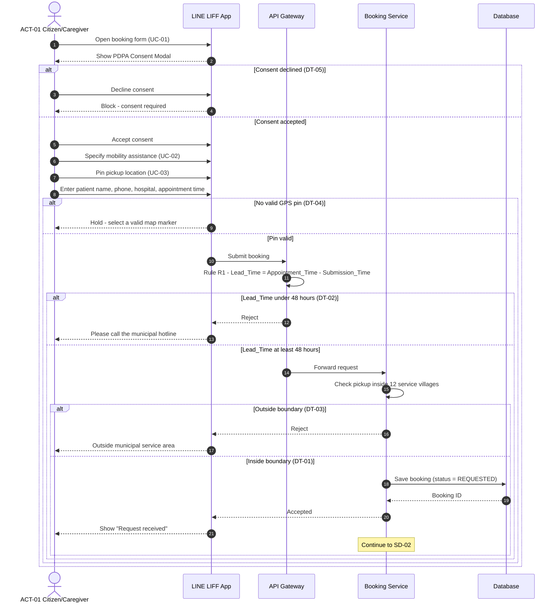
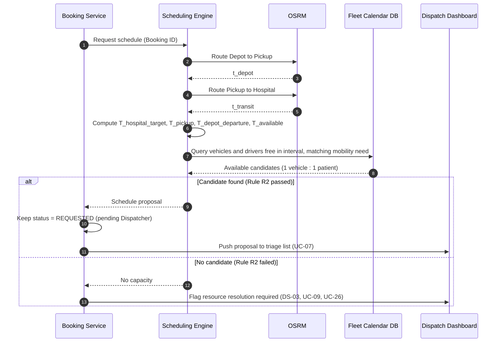

# System Logic & Scheduling Specification

**Project:** Municipal Patient Transit Booking Platform (Takuk Takak)  
**Associated Issue:** #3 ([week-1] Define System Logic)  
**Primary Actors:** ACT-01 (Citizen/Caregiver), ACT-02 (Dispatcher), ACT-03 (Driver), ACT-04 (Administrator)

---

## 1. End-to-End System Logic Flow

The booking and dispatch lifecycle follows a deterministic, human-in-the-loop pipeline:

1. **Intake & Consent:** ACT-01 accesses the LINE LIFF application, reviews and accepts the mandatory PDPA Consent Modal, and inputs booking parameters (patient name, contact phone, pickup map pin, destination hospital, appointment time, and mobility assistance requirement).
2. **Lead-Time Verification (Rule R1):** The system automatically checks whether the submission occurs at least 48 hours prior to the hospital appointment time.
3. **Travel Duration Estimation:** The routing engine queries OSRM to obtain deterministic drive times for two legs:
   * Leg 1: Municipal Depot -> Patient Pickup Location (`t_depot`)
   * Leg 2: Patient Pickup Location -> Destination Hospital (`t_transit`)
4. **Backward Scheduling Calculation:** The system computes the required patient pickup time and depot departure time backwards from the hospital appointment time, enforcing a mandatory 20-minute arrival buffer.
5. **Fleet Conflict Verification (Rule R2):** The scheduling engine checks resource calendars for available EMS vehicles and drivers during the calculated operating interval `[T_depot_departure, T_available)`, ensuring zero interval overlaps (single occupancy: 1 vehicle : 1 patient).
6. **Dispatcher Review (Human-in-the-Loop):** System-generated schedule recommendations are routed to ACT-02 via the web dispatch dashboard for approval, manual adjustment, or resource resolution; manual rejection with a reason is a last resort.
7. **Driver Execution & Milestone Tracking:** Upon approval, the trip is assigned to ACT-03, who updates only the execution milestones of the system-wide 8-stage state machine until patient handover at the hospital is complete.

---

## 2. Lead-Time Validation (Rule R1)

To ensure operational feasibility and prevent ad-hoc resource starvation, all booking requests must satisfy a minimum advance notice window:

    Lead_Time = Appointment_Time - Submission_Time

* **Condition 1 (`Lead_Time >= 48 hours`):** Request is accepted into the routing and scheduling pipeline.
* **Condition 2 (`Lead_Time < 48 hours`):** Request is rejected automatically by the client/API gateway. A notification instructs the citizen to contact the municipal hotline directly for urgent coordination.

---

## 3. Backward Scheduling Model & Worked Example

### 3.1 Mathematical Formulation
The algorithm guarantees patient arrival at the medical facility 20 minutes before the scheduled clinical appointment time:

1. **Target Hospital Arrival Time:**  
   `T_hospital_target = Appointment_Time - 20 minutes`

2. **Scheduled Patient Pickup Time:**  
   `T_pickup = T_hospital_target - Travel_Time_to_Hospital`  
   *(where `Travel_Time_to_Hospital = OSRM_duration(Pickup_Location, Hospital)`)*

3. **Depot Departure Time:**  
   `T_depot_departure = T_pickup - Travel_Time_to_Pickup`  
   *(where `Travel_Time_to_Pickup = OSRM_duration(Depot_Location, Pickup_Location)`)*

4. **Vehicle Next-Available Time:**  
   `T_available = T_hospital_target + Turnaround_Duration`  
   *(where `Turnaround_Duration = 30 minutes` for patient handover, vehicle sanitation, and return transit)*

---

### 3.2 Worked Calculation Example
* **Hospital Appointment Time (`T_appointment`):** `09:00 AM`
* **Route Duration: Depot -> Patient Home (`t_depot`):** `15 minutes`
* **Route Duration: Patient Home -> Lamphun Hospital (`t_transit`):** `35 minutes`
* **Preparation Buffer:** `20 minutes`
* **Turnaround Duration:** `30 minutes`

**Deterministic Step-by-Step Output:**
* `T_hospital_target` = 09:00 AM - 20 min = **08:40 AM**
* `T_pickup` = 08:40 AM - 35 min = **08:05 AM**
* `T_depot_departure` = 08:05 AM - 15 min = **07:50 AM**
* `T_available` = 08:40 AM + 30 min = **09:10 AM**

**Calculated Vehicle Interval:** `[07:50 AM - 09:10 AM)` (Total blocked duration: 80 minutes).

---

## 4. Decision Tables

### 4.1 Intake Validation Decision Table (System-Level)

| Rule ID | Advance Notice >= 48h | Inside 12 Service Villages | Valid GPS Pin | Accepted PDPA Consent | System Action |
| :---: | :---: | :---: | :---: | :---: | :--- |
| **DT-01** | Yes | Yes | Yes | Yes | **Accept:** Compute OSRM route & propose schedule |
| **DT-02** | No | - | - | - | **Reject:** Prompt municipal phone hotline |
| **DT-03** | Yes | No | - | - | **Reject:** Outside municipal boundary |
| **DT-04** | Yes | Yes | No | - | **Hold:** Prompt citizen to select valid map marker |
| **DT-05** | Yes | Yes | Yes | No | **Block:** Consent required to proceed |

### 4.2 Dispatcher Review Decision Table (Human-in-the-Loop)

| Scenario | Vehicle/Driver Availability | Schedule Feasibility | Action | Resulting Event |
| :--- | :--- | :--- | :--- | :--- |
| **DS-01** | Vehicle & Driver free during interval | Valid (`T_departure > T_current`) | **Approve** | Send LINE confirmation card; assign driver |
| **DS-02** | Time-slot conflict detected | Alternate vehicle available | **Modify** | Reassign vehicle/driver or adjust pickup time |
| **DS-03** | Fleet capacity exhausted | No vehicle available | **Resolve resources and recheck** | Keep REQUESTED; if still impossible, Dispatcher may manually reject with recorded reason and send rejection notice |

---

## 5. System-Wide 8-Stage Trip Lifecycle State Machine

To eliminate the need for complex, error-prone continuous GPS streaming while maintaining transparent milestone tracking, the system manages the full lifecycle; drivers manually trigger only execution milestones through their mobile web interface:

    [1. REQUESTED] 
           | (Dispatcher approves after schedule review)
           v
    [2. APPROVED] 
           | (Dispatcher confirms assignment)
           v
    [3. SCHEDULED] 
           | (Shift begins)
           v
    [4. ASSIGNED] 
           | (Driver departs municipal depot)
           v
    [5. PICKING_UP] 
           | (Driver confirms patient pickup)
           v
    [6. PICKED_UP] 
           | (Patient safely boarded; vehicle en route to hospital)
           v
    [7. IN_TRANSIT] 
           | (Patient arrived & handed over to medical staff)
           v
    [8. COMPLETED]

* **State 1 (`REQUESTED`):** Citizen successfully submits the intake form.
* **State 2 (`APPROVED`):** Dispatcher explicitly approves a valid request; scheduling engine alone cannot approve.
* **State 3 (`SCHEDULED`):** Following Dispatcher approval, the confirmed schedule locks the vehicle/driver interval.
* **State 4 (`ASSIGNED`):** Trip manifest is dispatched to the driver's task queue.
* **State 5 (`PICKING_UP`):** Driver taps "Depart Depot" to navigate toward the patient pickup pin.
* **State 6 (`PICKED_UP`):** Driver uses Confirm Patient Pickup to confirm the patient has been picked up.
* **State 7 (`IN_TRANSIT`):** Vehicle departs patient residence toward destination hospital.
* **State 8 (`COMPLETED`):** Driver confirms hospital handover; subsequent vehicle readiness must still respect resource-availability constraints.

**Exceptional terminal outcomes:** `CANCELLED` (Citizen cancellation before Driver Start Trip or automatic cancellation after Driver reports failed pickup) and `REJECTED` (Dispatcher manual rejection with reason) are separate from the eight normal milestones. Driver Start Trip confirms work without changing `ASSIGNED`; Depart Depot sets `PICKING_UP`. A cancellation caused by failed pickup notifies Citizen and Dispatcher and releases the resource reservation immediately.

---

## 6. Sequence Diagrams

Three core flows, traced to the Use Case List, the System Logic steps (Section 1), rules R1/R2, the decision tables (Section 4) and the state machine (Section 5). Step numbers in the tables match the `autonumber` labels in each diagram.

| Diagram | Use Cases | Section 1 | Rules / Tables | State |
| :--- | :--- | :---: | :--- | :--- |
| **SD-01** Citizen Booking Submission | UC-01 Submit Booking Request («include» UC-02 Specify Mobility Assistance Needs, UC-03 Pin Pickup Location) | 1-2 | R1, DT-01 to DT-05 | -> `REQUESTED` |
| **SD-02** Backward Scheduling & Conflict Check | Triggered by UC-01; output feeds UC-07 Triage Booking Request; capacity warning for UC-09 | 3-5 | R2, Section 3, DS-03 | remains `REQUESTED` pending Dispatcher |
| **SD-03** Dispatcher Approval | UC-07, UC-08, UC-09 («extend»), UC-10 Approve, UC-11 Modify, UC-12 Reject, UC-13 Log Justification («include»); downstream UC-04, UC-05, UC-17 to UC-19 | 6-7 | DS-01 to DS-03 | `REQUESTED` -> `APPROVED` -> `SCHEDULED` -> `ASSIGNED` |

---

### 6.1 SD-01: Citizen Booking Submission

Shows how ACT-01's request passes consent, pin, lead-time (R1) and boundary validation before being saved as `REQUESTED`.



| Step | Description | Links to |
| :---: | :--- | :--- |
| 1-4 | Form opens with the PDPA Consent Modal. Declining blocks the flow. | UC-01; DT-05 |
| 5-9 | Citizen specifies mobility need, pins pickup location and enters details. A missing or invalid pin holds the form. | UC-02, UC-03; DT-04 |
| 10-13 | The gateway checks Rule R1. Under 48 hours is rejected and the citizen is directed to the hotline. | Section 2; R1; DT-02 |
| 14-17 | The pickup must be inside the 12 service villages, otherwise the request is rejected. | DT-03 |
| 18-21 | A valid request is saved as `REQUESTED`, the citizen is acknowledged, and scheduling starts (SD-02). | DT-01; State 1 |

---

### 6.2 SD-02: 48-Hour Backward Scheduling & Conflict Check

Shows how an accepted request becomes a schedule using OSRM, and how Rule R2 finds a vehicle and driver free for `[T_depot_departure, T_available)`.



| Step | Description | Links to |
| :---: | :--- | :--- |
| 1 | Booking Service passes the booking to the Scheduling Engine. | Section 1 step 3 |
| 2-5 | OSRM returns `t_depot` (Depot -> Pickup) and `t_transit` (Pickup -> Hospital). | Section 1 step 3 |
| 6 | Backward scheduling. Example: appointment 09:00, `t_depot` 15 min, `t_transit` 35 min gives 08:40, 08:05, 07:50 and 09:10, so the blocked interval is `[07:50, 09:10)`. | Section 3.1 / 3.2 |
| 7-8 | **Rule R2:** find vehicles and drivers with zero overlap on the interval that fit the requested mobility assistance. | Section 1 step 5; R2; UC-02 |
| 9-11 | A candidate exists: status remains `REQUESTED` and the proposal goes to the dispatcher. | State 2; UC-07 |
| 12-13 | No candidate: the booking stays `REQUESTED`; dispatcher resolves resources, rechecks conflicts and may reject manually only as a last resort. | DS-03; UC-09 |

---

### 6.3 SD-03: Dispatcher Approval (Human-in-the-Loop)

Shows how ACT-02 approves without mandatory justification, modifies with justification, or rejects with a reason after resource resolution, and how each outcome reaches ACT-01 and ACT-03.

```mermaid
sequenceDiagram
    autonumber
    actor P as ACT-02 Dispatcher
    participant D as Dispatch Dashboard
    participant B as Booking Service
    participant S as Scheduling Engine
    participant M as LINE Messaging API
    actor C as ACT-01 Citizen/Caregiver
    participant V as Driver Web App (ACT-03)

    P->>D: Open pending requests (UC-07)
    D->>B: Load proposed and capacity-flagged requests
    B-->>D: Proposals with vehicle, driver, warnings
    P->>D: Review vehicle-driver assignment (UC-08)
    opt Scheduling warnings present
        P->>D: Evaluate warnings (UC-09)
    end
    alt Approve (DS-01) or Modify (DS-02)
        P->>D: Approve (no reason), or modify vehicle/driver/earlier pickup time with justification
        D->>B: Submit decision
        B->>S: Re-validate interval and departure time
        alt Valid
            S-->>B: Valid
            B->>B: Status = APPROVED then SCHEDULED; lock resources; log modification reason if any
            B->>M: Send confirmation card
            M-->>C: Confirmation card with pickup time (UC-04, UC-05)
            B->>V: Dispatch manifest, status = ASSIGNED (UC-17, UC-18, UC-19)
        else Conflict
            S-->>B: Conflict
            B-->>D: Show conflict, adjust again
        end
    else No resources available (DS-03)
        P->>D: Manage fleet and driver resources (UC-26)
        D->>S: Recheck candidates and conflicts
        S-->>D: Updated resource availability
        opt Still infeasible after resolution attempts
            P->>D: Reject as last resort with reason (UC-12, UC-13)
        D->>B: Submit rejection, justification logged
        Note over P,B: Manual rejection requires a recorded reason; otherwise review continues
    end
```

| Step | Description | Links to |
| :---: | :--- | :--- |
| 1-3 | Dispatcher opens the proposals (including capacity-flagged ones) from SD-02. | UC-07; Section 1 step 6 |
| 4-5 | Reviews the assignment; warnings are evaluated only when present. | UC-08; UC-09 |
| 6-13 | **Approve / Modify:** approval needs no justification; modification requires one and re-checked against `T_departure > T_current` and the R2 conflict rule. If valid: `SCHEDULED`, confirmation card to the citizen, manifest to the driver (`ASSIGNED`). | DS-01, DS-02; UC-10, UC-11, UC-13, UC-04, UC-05, UC-17 to UC-19; States 3-4 |
| 14-15 | If the interval conflicts, the dispatcher is shown the conflict and adjusts again. | DS-02; R2 |
| 16-19 | **Reject:** only as a last resort after resource resolution, reason is logged and the citizen receives a rejection notice with the reason. | DS-03; UC-12, UC-13 |

After `ASSIGNED`, the driver advances the trip with manual milestone buttons (UC-20, Section 5).
---

## 7. Dispatcher Verification Workflow

Before a request can be approved in SD-03, the Dispatcher verifies that the passenger is real and eligible (rules VR-01 to VR-07 in `docs/02-requirements/user-roles-and-actors.md`). Citizens use the LIFF web app inside LINE and do not register separately, so the request carries only their LINE ID and the details they typed. A phone confirmation call is optional at Dispatcher discretion, not mandatory for every request.

### 7.1 Decision Table

| Scenario | Contact reached | Details match | Duplicate / abuse flag | Action |
| :---: | :---: | :---: | :---: | :--- |
| **DV-01** | Yes | Yes | No | **Verified:** continue to approve or modify (SD-03) |
| **DV-02** | No | - | - | **Dispatcher reviews**; no automatic rejection or fixed call-attempt threshold |
| **DV-03** | Yes | No | - | **Dispatcher reviews** mismatch and decides next action; any flagging policy requires confirmation |
| **DV-04** | Yes | Yes | Yes | **Escalate:** Dispatcher decides and logs justification |

### 7.2 SD-04: Dispatcher Verification

**Use cases:** UC-07, UC-12, UC-13; optional verification is part of Dispatcher review (not the Citizen cancellation UC-25). The result feeds UC-10 / UC-11 in SD-03.

```mermaid
sequenceDiagram
    autonumber
    actor P as ACT-02 Dispatcher
    participant D as Dispatch Dashboard
    participant B as Booking Service
    participant M as LINE Messaging API
    actor C as ACT-01 Citizen/Caregiver

    P->>D: Open request (UC-07)
    D-->>P: Show details and automated checks (VR-01 to VR-04)
    opt Dispatcher decides call is needed (VR-05)
        P->>C: Call contact phone and verify details
    alt Reached and details match (DV-01)
        C-->>P: Confirms name, hospital, appointment, pickup, mobility need
        P->>D: Record result = VERIFIED
        D->>B: Save verification (who, when, outcome)
        Note over P,B: Continue to SD-03 (approve or modify)
    else Not reached (DV-02)
        P->>D: Record UNREACHABLE; decide next action (no automatic rejection)
        D->>B: Save verification outcome
        Note over P,B: Manual rejection requires a recorded reason; otherwise review continues
    else Details mismatch or suspected fake (DV-03)
        P->>D: Record mismatch; decide next action; flagging policy TBD
        D->>B: Save verification outcome
        Note over P,B: Manual rejection requires a recorded reason; otherwise review continues
    end
    end
```

| Step | Description | Links to |
| :---: | :--- | :--- |
| 1-2 | Dispatcher opens the request and sees the automated check results. | UC-07; VR-01 to VR-04 |
| 3 | Dispatcher may call the contact phone when necessary. | VR-05 |
| 4-6 | Details match: result saved as `VERIFIED`, then SD-03 continues. | DV-01 |
| 7-10 | Unreachable: record result; Dispatcher determines next action; no automatic rejection. | DV-02; UC-12 |
| 11-14 | Mismatch: record result; Dispatcher determines next action; flagging rules remain unconfirmed. | DV-03; UC-12 |

**Placement:** SD-04 runs only when Dispatcher elects to verify, between steps 4-5 of SD-03 (review assignment) and the approve/modify decision. Record the result as a `verification_status` field rather than a new state in Section 5.

### 7.3 Effect on the Dispatcher Review Decision Table (Section 4.2)

Phone verification is optional. The table below is updated to match the confirmed Dispatcher decision and resource-resolution rules.

| Scenario | Passenger Verified (VR-05) | Vehicle/Driver Availability | Schedule Feasibility | Action | Resulting Event |
| :--- | :---: | :--- | :--- | :--- | :--- |
| **DS-01** | Optional / reviewed if performed | Vehicle & Driver free during interval | Valid (`T_departure > T_current`) | **Approve** | Send LINE confirmation card; assign driver |
| **DS-02** | Optional / reviewed if performed | Time-slot conflict detected | Alternate vehicle available | **Modify** | Reassign vehicle/driver or adjust pickup time |
| **DS-03** | Optional | Fleet capacity exhausted | No vehicle available | **Resource resolution; manual reject only as last resort** | Keep REQUESTED while resolving; rejection notice with reason if rejected |
| **DS-04** | Unreachable or mismatch when verification performed | - | - | **Dispatcher review** | Record outcome; any rejection is manual with reason |

---

## 8. Confirmed Cross-Actor Exception & Administrative Rules

1. **Citizen cancellation:** Available only before Driver Start Trip. On successful cancellation, set exceptional terminal outcome `CANCELLED`, notify affected actors, and release the assignment. Start Trip confirmation is the cutoff; Depart Depot later sets `PICKING_UP`.
2. **Failed pickup:** Driver reports inability to pick up the patient. The system automatically sets `CANCELLED`, notifies Citizen and Dispatcher, and immediately releases the resource reservation. Physical vehicle readiness and overlap prevention remain a technical validation concern.
3. **Emergency reassignment:** Allowed before Confirm Patient Pickup, even after Depart Depot. Recheck vehicle and driver conflicts, update the old and new drivers' schedules automatically, and notify both drivers; no acknowledgement is required.
4. **Geospatial configuration:** Admin changes trigger recalculation for bookings not yet started. Keep the previous active schedule until Dispatcher reviews and confirms the recalculated proposal. The fixed 20-minute arrival buffer cannot be changed.
5. **Administrative controls:** Prevent deactivation of vehicles/drivers with unfinished assignments; revoke active sessions immediately on permission reduction/suspension; log Admin and Dispatcher activities. Invalid forms retain entered values and show field errors.
6. **Pickup-time modification:** Dispatcher may move pickup earlier only when the required arrival at hospital at least 20 minutes before appointment is maintained; all modifications require conflict recheck and a reason.

### Technical details pending validation (not new confirmed business rules)

- Resource-release scheduling must not assign a vehicle/driver to overlapping physical work after failed pickup.
- Define atomic handling of simultaneous Citizen Cancel and Driver Start Trip.
- Define fallback if recalculated schedules fail conflict checks while prior schedules remain active.
- Define safe transfer logistics for reassignment after Depart Depot but before pickup.
- The existing 30-minute turnaround assumption remains in the original model; its coverage of return transit should be validated before deployment.
