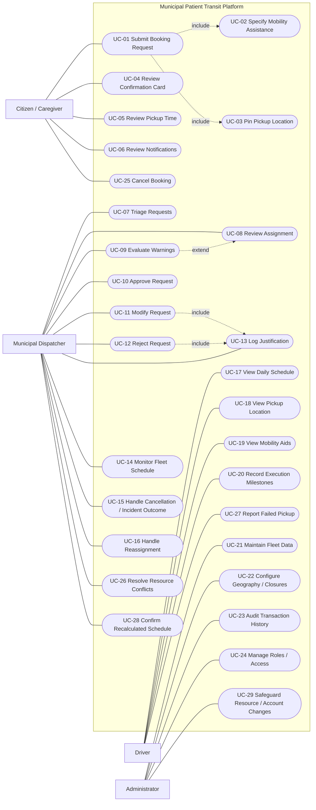

# Maintained Use-Case Diagram

The PNG is a historical export. This source reflects the original 29 stable use-case IDs and current ownership. Approval does not include justification. Dispatcher owns UC-28; administrator initiates settings changes. Incident handling, corrections, readiness and ABORTED are extensions of UC-15/UC-20/UC-23; holiday administration extends UC-22. These extensions follow SRS Sections 16.11–16.12.

